## Prisutnost i sudjelovanje {.stock-slide}

:::: {.columns}
::: {.column width="52%"}
**Dolazak nije obvezan.**

Ako dolazite, aktivno sudjelujte:

- Postavljajte pitanja.
- Predvidite rezultat.
- Objasnite svoje odluke.

Evidentirajte prisutnost QR kodom na sljedećem slajdu.
:::
::: {.column width="43%"}
{fig-alt="Nastavnik objašnjava ideje na ploči."}
:::
::::

::: {.notes}
Vrijeme: 0.5–1.5 min (1 min).
Dolazak na predavanja i vježbe nije obvezan. Potaknite aktivno sudjelovanje. Slijedi kratka evidencija; ne predstavlja bodovni prag.
:::

## Evidencija prisutnosti {#attendance .attendance-slide}

::: {.attendance-content}
[{width=455 height=455 fig-alt="QR kod za evidenciju prisutnosti na kolegiju Blockchain aplikacije."}](https://bit.ly/bc-tu-sam)

[bit.ly/bc-tu-sam](https://bit.ly/bc-tu-sam)
:::

::: {.notes}
Vrijeme: 1.5–2 min (0.5 min).
Ostavite pola minute za evidenciju putem QR koda ili poveznice. QR kod i poveznicu dostavio je nastavnik 2026-10-14; dekodirani sadržaj QR koda je https://bit.ly/bc-tu-sam.
:::

## Što predavanje daje, a AI i materijali ne daju? {.value-slide}

AI dobro objašnjava pojmove, a materijali su vam dostupni i bez dolaska. **Ako samo slušate, to vam je često dovoljno.** Uživo dobivate ovo:

::: {.value-grid}
::: {.card}
**Odgovor na vaše pitanje**

Zabunu ispravljamo dok nastaje, na vašem primjeru.
:::
::: {.card}
**Prioriteti**

Što je bitno za projekt i obranu, a što je samo zanimljivo.
:::
::: {.card}
**Razmišljanje naglas**

Kako se rješava problem bez gotovog odgovora, s kompromisima i greškama.
:::
::: {.card}
**Rasprava s kolegama**

Isti problem, više obranjivih rješenja. Obrana traži upravo to.
:::
::: {.card .card-wide}
**Stakeholder vašeg projekta**

Glumim naručitelja: imam svoje interese, mijenjam zahtjeve i odlučujem je li rješenje prihvatljivo. To AI ne može vjerodostojno odglumiti.
:::
:::

::: {.notes}
Vrijeme: 2–3 min (1 min).

- Budite iskreni: AI i materijali dobro pokrivaju objašnjenje pojmova. Predavanje vrijedi kad je interaktivno.
- Pitati: što ste zadnji put naučili od AI-ja, a što ste ipak morali nekoga pitati?
- Stakeholder: nastavnik glumi naručitelja studentskih projekata (nastavnikova uputa, 2026-10-14). Pregovaranje o zahtjevima, promjena prioriteta i prihvaćanje rješenja traže stvarnu osobu s interesima; AI može simulirati razgovor, ali ne snosi posljedice odluke.
- Prijelaz: različiti studenti dolaze iz različitih razloga.
- Prilagođeno iz RS uvoda (slajd 4). Nisu sva BA predavanja snimljena (nastavnik, 2026-10-13), pa se uvod ne poziva na snimke. Formulaciju „Ako samo slušate, to vam je često dovoljno” treba potvrditi nastavnik.
:::

## Različiti studenti, različiti razlozi {.value-slide}

| Ako ste… | Predavanje vam daje… |
|:---|:---|
| **samouki, s AI-jem i materijalima** | provjeru razumijete li zaista; dođite barem kad zapnete |
| **netko kome treba ritam** | strukturu tjedna i manje gradiva za kraj semestra |
| **tihi, ne volite pitati naglas** | slušanje bez pritiska; pitanja možete postaviti u Google Chatu „FIPU BA” |
| **zaposleni ili s obvezama** | materijale i pitanja u Chatu; dođite kad možete |
| **usmjereni na ocjenu** | način razmišljanja koji se traži na obrani |

**Dođite kad vam to nešto daje. Ako dođete, sudjelujte.**

::: {.notes}
Vrijeme: 3–3.5 min (0.5 min).

- Nitko nije kažnjen zbog nedolaska; dolazak nije obvezan.
- Tihim studentima ponudite Google Chat „FIPU BA” kao jednako vrijedan kanal za pitanja.
- Redak „zaposleni” ne obećava snimke kao punu zamjenu jer nisu sva predavanja snimljena. Redak „usmjereni na ocjenu” treba potvrditi nastavnik: oslobođeni studenti ne prolaze usmeni, ali projekt i dalje moraju moći objasniti.
:::

## Nastavnici {.teachers-slide}

| **Dio nastave** | **Nastavnik** |
|:---|:---|
| Predavanja | izv. prof. dr. sc. Nikola Tanković |
| Vježbe | Luka Sever, mag. comp. |

::: {.chat-card}
{.chat-icon fig-alt="Ikona Google Chata"}

::: {.chat-text}
**Google Chat · FIPU BA**

Primarni kanal za pitanja o kolegiju i dogovor projekta. Pišite **asinkrono**.
:::
:::

**Moodle (e-učenje):** [e-ucenje.unipu.hr](https://e-ucenje.unipu.hr)

**Javni web kolegija:** [ntankovic.unipu.hr/ba](https://ntankovic.unipu.hr/ba)

::: {.notes}
Vrijeme: 3.5–4 min (0.5 min).

Raspored kao u WA uvodu (nastavnik, 2026-10-14). Google Chat je primarni kanal za pitanja i dogovor projekta; pišite asinkrono. Za projekt: kratak opis problema i predloženog opsega. Za tehničko pitanje: očekivani i stvarni rezultat te mali primjer koji ponavlja problem. ntankovic.unipu.hr/ba preusmjerava na Notion stranicu kolegija „Blockchain aplikacije” (provjereno 2026-10-14). Nastavnik je 2026-10-08 izričito potvrdio da preferira asinkronu komunikaciju putem Google Chata u odnosu na konzultacije i e-poštu. Pitanja i dogovor projekta usmjeriti na Chat; ne nuditi e-poštu ili konzultacije kao uobičajeni prvi korak. Ne pretpostavljati trenutačan odgovor. Naziv grupe FIPU BA nastavnik je potvrdio 2026-10-12. Rezervacija obrane ispita zasebna je administrativna radnja. Nastavnik vježbi: Luka Sever, mag. comp. (nastavnik, 2026-10-14).
:::

## Čime se kolegij bavi {.visual-slide}

**Tko provjerava i prihvaća promjene zajedničkog stanja?**

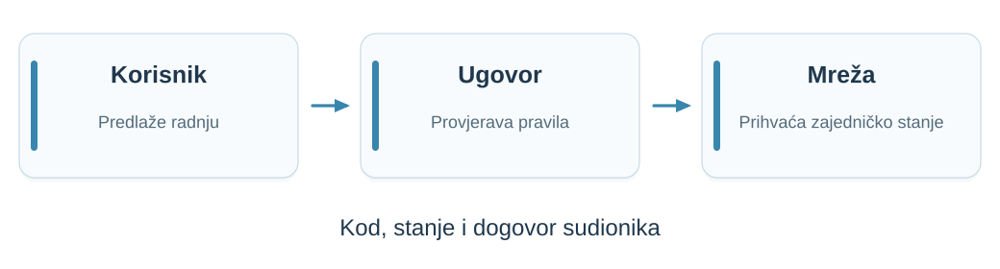{width=1040 fig-alt="Korisnik predlaže radnju, pametni ugovor provjerava pravila, mreža se usuglašava o prihvaćenom stanju."}

Od povjerenja i konsenzusa do pametnog ugovora i korisničkog sučelja.

::: {.notes}
Vrijeme: 4–5 min (1 min).

Cilj preuzet i jezično dorađen iz BA-01, str. 4. Povežite programiranje s obrazlaganjem arhitekturnih odluka. Ne obećavati da *blockchain* uklanja sve posrednike.
:::

## Što ćete moći nakon kolegija

- Objasniti zašto je povjerenje važno pri usuglašavanju stanja.
- Izraditi i testirati pametni ugovor te povezati korisničko sučelje.
- Odlučiti što pripada *blockchainu*, a što drugim dijelovima aplikacije.
- Obrazložiti treba li odabranoj aplikaciji *blockchain*.

::: {.notes}
Vrijeme: 5–6 min (1 min).

Ishodi cijelog kolegija, ne očekivani rezultat današnje orijentacije. Danas studenti trebaju prepoznati put učenja, opisati projektni rad i protumačiti poznata pravila ocjenjivanja.
:::

## Tko odlučuje koji zapis vrijedi? {.visual-slide}

Tri organizacije upravljaju zajedničkim digitalnim budžetom.

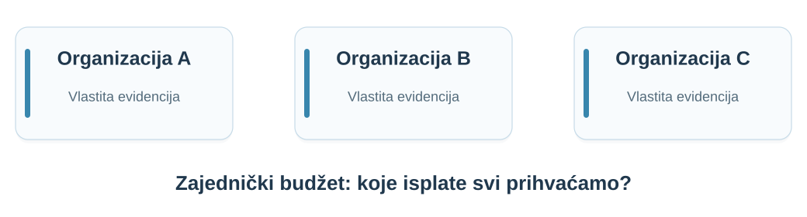{width=1040 fig-alt="Organizacije A, B i C imaju vlastite zapise i trebaju zajednički prihvaćenu povijest isplata."}

**Možemo li provjeravati odluke bez isključive kontrole jednog operatora?**

::: {.notes}
Vrijeme: 6–8 min (2 min).

Usklađeno s nastavnikovim pregledom predavanja 01: digitalni budžet zamjenjuje fizički izložak. Organizacije mogu koristiti ugovor, posrednika i pravnu zaštitu. Pitanje je može li zajedničko provođenje pravila smanjiti neslaganja o prihvaćenom digitalnom stanju bez isključive ovlasti jednog operatora. Konkurentnost sama ne opravdava decentralizaciju. Ovo je nastavni primjer, ne obvezna projektna tema.
:::

## Plan nastave · 1.–3. tjedan {.course-plan-slide}

::: {.plan-entry data-week="01"}
**Od raspodijeljenih do decentraliziranih sustava**

Polazimo od zajedničkih podataka i granica povjerenja.
:::

::: {.plan-entry data-week="02"}
**Konsenzus i problem bizantskih generala**

Kako postići dogovor ako sudionici mogu slati proturječne poruke?
:::

::: {.plan-entry data-week="03"}
**Temelji *blockchaina***

Povezujemo transakcije i provjerljive zapise u *blockchain*.
:::

::: {.notes}
Vrijeme: 8–9 min (1 min).

Plan prema COURSE.md. Ovo je najava tema, bez tehničkog uvođenja protokola. Puna tehnička predavanja planirana su za 90–120 minuta s raspravom i ponavljanjem.
:::

## Plan nastave · 4.–6. tjedan {.course-plan-slide}

::: {.plan-entry data-week="04"}
**Bitcoin i dokaz rada**

Kako otvorena mreža bira zajedničku povijest?
:::

::: {.plan-entry data-week="05"}
**Ethereum i programabilni *blockchain***

Kako transakcija može izvršiti program i promijeniti stanje?
:::

::: {.plan-entry data-week="06"}
**Dokaz uloga i moderni Ethereum**

Odvajamo izvršavanje programa od dogovora o blokovima.
:::

::: {.notes}
Vrijeme: 9–10 min (1 min).

Plan prema COURSE.md. Ovo je najava tema, bez tehničkog uvođenja protokola. Puna tehnička predavanja planirana su za 90–120 minuta s raspravom i ponavljanjem.
:::

## Plan nastave · 7.–9. tjedan {.course-plan-slide}

::: {.plan-entry data-week="07"}
**Pametni ugovori u Solidityju**

Pišemo prvi ugovor i pratimo promjene njegova stanja.
:::

::: {.plan-entry data-week="08"}
**Dizajn i sigurnost pametnih ugovora**

Provjeravamo ovlasti, testiramo i analiziramo pogreške.
:::

::: {.plan-entry data-week="09"}
**Razvoj Web3 aplikacija**

Povezujemo sučelje, novčanik i pametni ugovor.
:::

::: {.notes}
Vrijeme: 10–11 min (1 min).

Plan prema COURSE.md. Ovo je najava tema, bez tehničkog uvođenja protokola. Puna tehnička predavanja planirana su za 90–120 minuta s raspravom i ponavljanjem.
:::

## Plan nastave · 10.–12. tjedan {.course-plan-slide}

::: {.plan-entry data-week="10"}
**Decentralizirana pohrana i IPFS**

Rješavamo pohranu datoteka izvan *blockchaina*.
:::

::: {.plan-entry data-week="11"}
**Arhitekture *blockchain* aplikacija**

Povezujemo ugovor, pohranu i ostale usluge u aplikaciju.
:::

::: {.plan-entry data-week="12"}
**Skaliranje, ograničenja i kada koristiti *blockchain***

Uspoređujemo rješenja i obrazlažemo izbor arhitekture.
:::

::: {.notes}
Vrijeme: 11–12 min (1 min).

Plan prema COURSE.md. Ovo je najava tema, bez tehničkog uvođenja protokola. Puna tehnička predavanja planirana su za 90–120 minuta s raspravom i ponavljanjem.
:::

## Od ideje do aplikacije

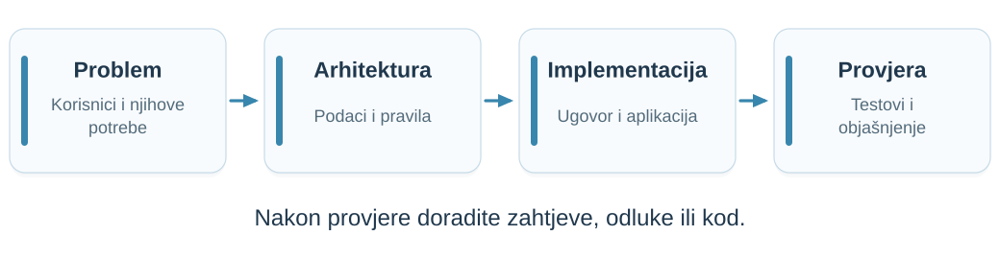{width=1040 fig-alt="Problem i korisnici vode odluci o podacima i pravilima, zatim implementaciji i naposljetku provjeri ponašanja. Rezultati provjere služe doradi."}

**Svaki izbor treba razlog.**

- Što postiže *blockchain* u vašem primjeru? Kako biste isti problem riješili običnom bazom?
- Koje su **prednosti i nedostaci** u odnosu na običnu bazu?
- Može li, i treba li, rješenje biti **hibridno**: dio na *blockchainu*, dio u bazi?

::: {.notes}
Vrijeme: 12–13.5 min (1.5 min).

BA-01, str. 7: zahtjevi korisnika, model sustava, arhitektura i implementacija. Struktura prikaza inspirirana uvodima RS i WA. Student ne treba izabrati temu danas; najprije mora moći opisati problem. Usporedba s bazom (nastavnikova dopuna, 2026-10-14): prednosti su zajednička provjera pravila i povijesti bez jednog administratora; nedostaci su trošak i sporost zapisa, javnost podataka i teška izmjena već postavljenog ugovora. Hibridno rješenje je uobičajeno: na *blockchainu* ostaju pravila i stanje kojima sudionici moraju zajednički vjerovati, a datoteke, pretraživanje i osobni podaci ostaju izvan njega. Detaljnije u predavanjima 01 i 11–12.
:::

## Trebate li *blockchain*? (1/2) {.tree-slide}



[Ako si **dionici međusobno vjeruju**, dovoljna je obična baza.]{.fragment}

::: {.notes}
Vrijeme: 13.5–14.5 min (1 min).

Kućice se pojavljuju na klik, jedna po jedna. Statična inačica za PDF: assets/need-blockchain-1.hr.svg.
- Stablo je nastavnikovo (2026-10-20): dijeljenje → međusobno povjerenje → jedan dionik kojem svi vjeruju → poznati dionici. Inspirirano s K. Wüst i A. Gervais, „Do you need a Blockchain?”, IEEE CVCBT 2018, Fig. 1 (https://eprint.iacr.org/2017/375), čiji je redoslijed: stanje → više pisaca → uvijek dostupna treća strana → svi pisci poznati → svi pisci vjeruju jedni drugima → javna provjerljivost. Pitanje o javnoj provjerljivosti ovdje je izostavljeno.
- Dijeljenje: ako stanje služi samo jednom dioniku, dovoljni su SQLite ili datoteka. Ako služi većem broju dionika, treba dedicirana baza, a sljedeća pitanja određuju tko je vodi.
- Zamjenjuje nastavnikov stari dijagram iz BA-01, str. 9–11 (izvor dijagrama nije naveden); kritika tog dijagrama je na slajdu „Još neki razlozi…”.
- Pitanje za studente: provucite svoju ideju kroz stablo. Gdje izlazi?
:::

## Trebate li *blockchain*? (2/2) {.tree-slide}



[*Blockchain* ima smisla tek kad dionici dijele stanje, a **nema nikoga kome svi vjeruju**.]{.fragment}

::: {.notes}
Vrijeme: 14.5–15.5 min (1 min).

Nastavak stabla: dionici si ne vjeruju međusobno. Ako svi vjeruju barem jednom dioniku, baza je kod njega (posrednik, npr. središnja banka u T2). Inače: privatni *blockchain* (s dozvolama) ako se svi dionici poznaju, javni *blockchain* ako se ne poznaju. Izvor je u bilješci prethodnog slajda. Statična inačica za PDF: assets/need-blockchain-2.hr.svg.
:::

## Još neki razlozi… {.value-slide}

::: {.value-grid}
::: {.card}
**Stanje se mijenja, povijest ne**

Ako zapise morate brisati ili prepravljati, *blockchain* nije dobar izbor.

[Primjer: web-trgovina u kojoj kupac traži brisanje računa i svojih podataka.]{.example}
:::
::: {.card}
**Osobni podaci ne idu na *blockchain***

GDPR jamči pravo na brisanje, a zapis se ne može obrisati. Šifra s vremenom može pasti, a goli sažetak (*hash*) često se može pogoditi.

[Primjer: zdravstveni karton ostaje u bolnici; na *blockchainu* najviše dokaz da zapis postoji.]{.example}
:::
::: {.card}
**Nepromjenjiv zapis ≠ *blockchain***

Potpisani javni dnevnik s revizorima često je dovoljan.

[Primjer: Certificate Transparency, javni dnevnici TLS certifikata, bez *blockchaina*.]{.example}
:::
::: {.card}
**Povjerenje ima cijenu**

Svaki zapis plaća naknadu i čeka potvrdu. Baza je brža.

[Primjer: Bitcoin cilja jedan blok svakih 10 min (oko 7 transakcija/s); kartične mreže obrađuju tisuće u sekundi.]{.example}
:::
:::

**Za svoj projekt napišite zašto vam treba *blockchain*, a zašto ne bi bila dovoljna baza.**

::: {.notes}
Vrijeme: 15.5–16.5 min (1 min).

Kritički osvrt na stari dijagram iz BA-01 (str. 10–11) i na stablo s prethodnog slajda:
- Stari dijagram pita „zapisi se nikad ne mijenjaju ni brišu?”. To je preusko: stanje pametnog ugovora se mijenja; nepromjenjiva je povijest transakcija. Pravo pitanje je morate li brisati ili prepravljati povijest (npr. pravo na brisanje, GDPR čl. 17).
- GDPR (Uredba (EU) 2016/679), čl. 17: pravo na brisanje; čl. 16: pravo na ispravak. Nepromjenjiva povijest na *blockchainu* s tim je u sukobu, pa osobni podaci ostaju izvan njega.
- Osobni podaci: stari dijagram nudi šifriranu bazu, što je dobro. Na *blockchain* ne stavljati ni šifrirane osobne podatke (šifra s vremenom može pasti), a ni sažetak nije anonimizacija ako postoji poveznica s osobom: podaci s malo mogućih vrijednosti (OIB, datum rođenja, dijagnoza) pogađaju se izračunom sažetaka svih kandidata, a isti sažetak povezuje zapise iste osobe. Uobičajen kompromis: podatak i slučajna sol ostaju izvan *blockchaina*, na *blockchainu* je samo obveza (sažetak sa soli); brisanjem podatka i soli zapis na *blockchainu* postaje praktički nepovezan s osobom (pravno nije neupitno). EDPB, Smjernice 02/2025 o obradi osobnih podataka putem blockchain tehnologija (travanj 2025., javno savjetovanje), preporučuju osobne podatke držati izvan *blockchaina*. Status konačnog usvajanja provjeriti.
- „Zapis otporan na krivotvorenje” sam po sebi ne traži *blockchain*: ako postoji operater, dnevnik koji samo dodaje zapise uz javnu provjeru (npr. Certificate Transparency, RFC 9162) daje provjerljivost bez konsenzusa.
- Cijena: Wüst i Gervais (2018), Tablica I: centralizirana baza ima bolju propusnost i kašnjenje; *blockchain* plaća za uklanjanje posrednika.
- Stari dijagram ne pita postoji li posrednik od povjerenja, a to je najčešći razlog da *blockchain* ne treba.
- Primjeri na karticama (nastavnikov zahtjev, 2026-10-14): Bitcoin cilja prosječno 10 min po bloku (podešavanje težine); propusnost oko 7 transakcija/s prema K. Croman et al., „On Scaling Decentralized Blockchains”, FC 2016 Workshops (BITCOIN). Kartične mreže: Visa navodi kapacitet od desetaka tisuća poruka u sekundi; na slajdu namjerno samo „tisuće”. Certificate Transparency: RFC 9162; dnevnici su Merkleova stabla koja samo dodaju zapise, uz neovisne revizore, bez konsenzusa.
:::

## Projektni zadatak {.project-task-slide}

**Predložite temu i dogovorite opseg s nastavnikom.**

::: {.project-type-grid}
::: {.tech-card}
{fig-alt="Ikona aplikacije"}

**Aplikacija nad *blockchainom***

Samostalno ili u timu od 2–3 studenta.
:::
::: {.tech-card}
{fig-alt="Ikona ugovora"}

**Pametni ugovor**

Moguć za samostalan rad.
:::
::: {.tech-card}
{fig-alt="Ikona blockchaina: povezani blokovi"}

**Jednostavni *blockchain***

Alternativa, uz odobrenje teme.
:::
:::

**Obrana projekta je individualna.**

::: {.notes}
Vrijeme: 16.5–18 min (1.5 min).

Preneseno iz nastavnikova BA-01, str. 5 i 7. Nastavnik je odobrio primjenu zajedničkih pravila iz RS/WA (2026-10-08); projektni opseg iz BA izvora ostaje za završni pregled. Individualna provjera projekta može dovesti do poziva na usmeni.
:::

## Što je na *blockchainu*, a što izvan njega?

| Dio aplikacije | Pitanje za vaš projekt |
|:---|:---|
| Pametni ugovor | Koja pravila i stanje trebaju zajedničku provjeru? |
| Korisničko sučelje | Kako korisnik traži promjenu i prati ishod? |
| Pohrana i ostale usluge | Gdje su datoteke i podaci za pretraživanje? |

Projekt treba objasniti **vezu između tih dijelova**.

::: {.notes}
Vrijeme: 18–19 min (1 min).

Pregled projektnih odgovornosti iz BA-01, str. 7. Ne uvoditi IPFS protokol niti tehničke detalje novčanika. Pametni ugovor na Ethereumu sadrži kod i stanje; izvor https://ethereum.org/en/developers/docs/smart-contracts/, provjereno 2026-10-08.
:::

## Nadogradnja ranije aplikacije {.reuse-project-slide}

Možete zatražiti da projekt bude **nadogradnja aplikacije s prethodnog kolegija**.

:::: {.reuse-criteria}
::: {.reuse-criterion}
**Najmanje vrlo dobar (4)**

Prethodna aplikacija mora biti ocijenjena ocjenom **4 ili 5**.
:::
::: {.reuse-criterion}
**Zahtjev nastavniku**

Predstavite postojeću aplikaciju i predložite što biste nadogradili.
:::
::::

::: {.notes}
Vrijeme: 19–20 min (1 min).

Nastavnik je 2026-10-08 dopustio mogućnost nadogradnje ranije aplikacije uz zahtjev, ako je ocijenjena najmanje vrlo dobar (4). To nije automatski prijenos stare ocjene. U zahtjevu student pokazuje postojeće stanje i predloženu nadogradnju; ovdje ne dodajemo propisani obrazac ni rok zahtjeva. Ostala pravila projekta i odobravanja tehnologija ostaju primjenjiva.
:::

## Nadogradnja aplikacije za diplomski rad {.thesis-slide}

Uz odobrenje nastavnika aplikaciju možete po želji nadograđivati za **RITR** (5. godina) i **diplomski rad** (kraj studija). Dodani rad mora biti **jasno razgraničen**.

:::: {.reuse-criteria}
::: {.reuse-criterion}
**RITR · 6 ECTS**

≈ **180 sati** rada na dodanom dijelu.
:::
::: {.reuse-criterion}
**Diplomski rad · 30 ECTS**

≈ **900 sati** rada. Nadogradnja mora odgovarati tom opsegu.
:::
::::

- Svaki rad ima **vlastiti repozitorij**.
- U README-u navedite **što je napravljeno prije, što kasnije i za koji kolegij ili rad**.

::: {.notes}
Vrijeme: 20–21 min (1 min).

Nastavnikova uputa, 2026-10-14: nadogradnja je po želji i uz odobrenje nastavnika; RITR je na 5. godini, diplomski rad na kraju studija. Nadogradnja za diplomski rad (30 ECTS) moguća je i za RITR (6 ECTS), uz zaseban repozitorij za svaki rad i jasne napomene o tome što je napravljeno prije, što kasnije i za što. Isti rad ne može se dvaput vrednovati; procjenjuje se samo dodani dio.
Sati prema Zakonu o visokom obrazovanju i znanstvenoj djelatnosti (NN 119/22), čl. 67. st. 2.: „Jedan ECTS bod predstavlja 30 sati procijenjenog prosječno utrošenog studentskog rada pri ostvarivanju ishoda učenja.” Dakle 30 ECTS ≈ 900 h, 6 ECTS ≈ 180 h. Važeći UNIPU Pravilnik o studiranju (pročišćeni tekst 2019. i izmjene do 2021.) ne propisuje broj sati po bodu; raniji Pravilnik o studiju (2011., čl. 28.) navodio je 28 sati, ali je zamijenjen.
:::

## Ideje za projekte {.project-ideas-slide}

**Svaka tema treba razlog za zajedničku provjeru.**

:::: {.project-ideas-grid}
::: {.project-idea}
**01 · Zajednički budžet**

Trošenje odobrava više neovisnih potpisnika.

[Ovlasti, prijedlog isplate i potvrde.]{.idea-backend}
:::
::: {.project-idea}
**02 · Prikupljanje sredstava**

Ugovor čuva uplate i provodi uvjete isplate ili povrata.

[Cilj, rok i ishod prikupljanja.]{.idea-backend}
:::
::: {.project-idea}
**03 · Glasovanje o fondu**

Poznati članovi odlučuju o zajedničkim sredstvima.

[Članstvo, glasovi i provedba odluke.]{.idea-backend}
:::
::: {.project-idea}
**04 · Registar potvrda**

Fakulteti izdaju i opozivaju diplome; poslodavac ih provjerava.

[Ovlasti izdavatelja, izdavanje i opoziv, dokaz bez osobnih podataka.]{.idea-backend}
:::
::::

::: {.notes}
Vrijeme: 21–22.5 min (1.5 min).

Prilagođeno iz BA-01, str. 20 i 26–32 te COURSE.md. Nakon nastavnikove korekcije uklonjene su generičke AI/web ideje bez opravdane uloge *blockchaina*. Svaka preostala tema polazi od više sudionika koji ne žele kontrolu jednog administratora. Ako svi vjeruju istom administratoru, usporediti rješenje s običnom bazom. Budžet: više potpisa za isplatu; prikupljanje sredstava: unaprijed određeni rok i cilj te povrat ako cilj nije dosegnut. Glasovanje: unaprijed poznati članovi, bez tvrdnje da jedna adresa znači jednu osobu; ne obećavati tajnost glasovanja. Registar potvrda (nastavnik, 2026-10-19): ugovor vodi popis ovlaštenih izdavatelja (dodavanje glasovanjem članova ili odlukom administratora je dizajnersko pitanje) i čuva samo sažetke sa soli, uz izdavanje i opoziv; PDF diplome i sol ostaju izvan *blockchaina*. Poslodavac učita PDF i sol te dobije: valjano, opozvano ili nepoznato. Zašto *blockchain*: nijedan fakultet ne želi da registar vodi drugi fakultet, a provjera radi i ako izdavatelj prestane postojati. Registar dokazuje tko je što izdao i kada, ne istinitost sadržaja. Financijske primjere izvoditi samo sa simuliranim sredstvima. AI nije obvezan dio projektnog proizvoda; slajdovi o AI alatima i odgovornosti ostaju.
:::

## Misao vodilja: zajednička pravila bez upravitelja {.value-slide}

Financijska i druga imovina, potvrde, glasovanje: **pravila zapisana u ugovoru**, a nitko ih ne može sam zaobići.

::: {.value-grid}
::: {.card}
**Pravila unaprijed**

Uvjeti, rokovi, isplata ili povrat: ugovor ih provodi sam.
:::
::: {.card}
**Više vlasnika**

Višepotpisni novčanik: isplata tek uz potvrdu dogovorenog broja vlasnika.
:::
::: {.card}
**Transparentnost**

Javni proračun, zalog, izdane potvrde: svatko može provjeriti povijest.
:::
::: {.card}
**Ključevi i sigurnost**

Kako zaštititi sredstva i oporaviti pristup bez jednog administratora?
:::
:::

[Glasovanje uz oprez: za manje odluke poznatih članova, ne za izbore.]{.example}

::: {.notes}
Vrijeme: 22.5–23.5 min (1 min).

Prema BA-01, str. 26–29 („Misao vodilja”): tok novca koji se može programirati, dogovor više vlasnika računa i/ili ovisnost o vremenu, razmjena bez središnjeg autoriteta; transparentnost (državni i općinski proračun, javni bilježnik, javna obećanja i zalog); alati za širu primjenu (višepotpisni novčanici, upravljanje privatnim ključevima). Primjere izvoditi samo sa simuliranim sredstvima na testnoj mreži.

Naslov promijenjen 2026-10-19 (nastavnik): „programabilni novac” je preuzak, jer se projektne teme 03 i 04 ne bave novcem. Izostavljena je i tvrdnja „bez posrednika koji uzima proviziju”: transakcije se plaćaju (*gas*); razlika je u tome što nitko ne može sam odlučiti hoće li se pravilo provesti.

Glasovanje uz oprez: važni izbori vode se papirom i olovkom jer zahtijevaju tajnost glasa, otpornost na prisilu i kupnju glasova (birač ne smije moći dokazati kako je glasao), pouzdanu provjeru identiteta (jedna adresa nije jedna osoba) i provjerljiv fizički trag za ponovno brojanje, a glasovanje s osobnog uređaja izloženo je zlonamjernom softveru. Na javnom *blockchainu* bez dodatne kriptografije vidi se kako je glasala svaka adresa. Primjereno je za manje, javne odluke poznatih članova (npr. udruga, fond kluba).
:::

## Još područja za projekte {.areas-slide}

::: {.areas-grid}
::: {.card}
**Financije**

Štednja, zajednički novčanik, kvadratno financiranje javnih dobara.
:::
::: {.card}
**Igre**

Na sreću ili spretnost; problem nasumičnosti na *blockchainu*.
:::
::: {.card}
**Upravljanje**

Udruga, zajednička imovina, glasovanje i odluke članova.
:::
::: {.card}
**Stvaratelji sadržaja**

Financiranje i prikupljanje sredstava bez platforme posrednika.
:::
::: {.card}
**Potvrde i identitet**

Provjerljive potvrde, bez osobnih podataka na *blockchainu*.
:::
::: {.card}
**Istraživanje**

BFT algoritmi, simulacije, ZK dokazi, skaliranje. Dobro za RITR i diplomski.
:::
:::

**Svaka tema prolazi stablo „Trebate li *blockchain*?”.**

::: {.notes}
Vrijeme: 23.5–24.5 min (1 min).

Prema BA-01, str. 20–21 i 30–32 (kategorije projekata, znanstveno istraživanje, decentralizacija postojećih sustava).
- Kvadratno financiranje: V. Buterin, Z. Hitzig, E. G. Weyl, „A Flexible Design for Funding Public Goods”, Management Science 65(11), 2019.
- Nasumičnost: vrijednosti iz bloka može donekle birati onaj tko ga predlaže; koristiti shemu commit–reveal ili provjerljivu slučajnu funkciju (VRF).
- Istraživanje (BA-01, str. 21): BFT algoritmi (Tendermint, IBFT), simulacija radnih karakteristika, ZK dokazi, skaliranje Ethereuma, BPMN nad Ethereumom. Takve teme prikladne su za nadogradnju u RITR-u ili diplomskom radu.
- Potvrde i identitet: na *blockchain* ide najviše potpis ili obveza (commitment); osobni podaci ostaju izvan njega (vidi slajd „Još neki razlozi…”).
:::

## Prijedlog teme: četiri pitanja

1. **Tko su korisnici** i što žele postići?
2. **Zašto im treba zajedničko stanje** i kome vjeruju?
3. **Što ćete implementirati**, a što ostaje izvan opsega?
4. **Kako ćete pokazati da radi**, uključujući neuspješan pokušaj?

Prijedlog teme odobrava nastavnik.

::: {.notes}
Vrijeme: 24.5–25.5 min (1 min).

Operacionalizacija zahtjeva starog projektnog zadatka, BA-01 str. 6–7; nije novi formalni obrazac predaje. Pozovite studente da na jednoj ideji usmeno odgovore na prva dva pitanja.
:::

## Predznanje i priprema {.prerequisites-slide}

Za praktični dio obnovite znanja koja već koristite u programiranju.

:::: {.tech-grid}
::: {.tech-card}
**Funkcije i podaci**

Strukture podataka, uvjeti i pogreške.
:::
::: {.tech-card}
**JavaScript**

Osnove jezika i korisničkog sučelja.
:::
::: {.tech-card}
**Asinkroni rad**

Pozivi i razmjena podataka.
:::
::: {.tech-card}
**Git i testovi**

Pokretanje projekta i provjera rezultata.
:::
::::

::: {.learning-start}
**Solidity i pojmove *blockchaina* uvodimo postupno.**
:::

::: {.notes}
Vrijeme: 25.5–26.5 min (1 min).

Ovo su preporuke za pripremu, ne formalni uvjeti upisa. Ne preuzimati Python, FastAPI, Vue ili Firebase kao obvezne tehnologije iz drugih kolegija.
:::

## Tehnologije u primjerima {.stack-slide}

::: {.stack-grid}
::: {.stack-card}
**Pametni ugovori**

[{.ticon fig-alt=""}[**Solidity** [jezik pametnih ugovora]{.si-desc}]{.si-text}]{.stack-item}

[{.ticon fig-alt=""}[**Foundry** [testovi i lokalni *blockchain*]{.si-desc}]{.si-text}]{.stack-item}

[{.ticon fig-alt=""}[**OpenZeppelin** [provjereni gotovi ugovori]{.si-desc}]{.si-text}]{.stack-item}
:::
::: {.stack-card}
**Korisničko sučelje**

[{.ticon fig-alt=""}[**Vue 3** [korisničko sučelje]{.si-desc}]{.si-text}]{.stack-item}

[{.ticon fig-alt=""}[**Vite** [razvojni poslužitelj i izgradnja]{.si-desc}]{.si-text}]{.stack-item}

[{.ticon fig-alt=""}[**Pinia** [stanje aplikacije]{.si-desc}]{.si-text}]{.stack-item}

[{.ticon fig-alt=""}[**viem** [veza s *blockchainom* i novčanikom]{.si-desc}]{.si-text}]{.stack-item}
:::
::: {.stack-card}
**Pohrana i pozadina**

[{.ticon fig-alt=""}[**IPFS** [datoteke i metapodaci]{.si-desc}]{.si-text}]{.stack-item}

[{.ticon fig-alt=""}[**web3.py** [ako je pozadina u Pythonu]{.si-desc}]{.si-text}]{.stack-item}
:::
:::

**Za druge projektne tehnologije zatražite prethodno izričito odobrenje nastavnika.**

::: {.notes}
Vrijeme: 26.5–27.5 min (1 min).

Popis tehnologija dao je nastavnik 2026-10-14 (Foundry, OpenZeppelin, Vue 3, Vite, viem, Pinia, web3.py za Python pozadinu); Solidity i IPFS prema COURSE.md. IPFS se obrađuje nakon ugovora i Web3 dijela.
Zašto ne web3.js: ChainSafe je arhivirao web3.js 4. 3. 2025. i preporučio viem ili ethers.js (https://blog.chainsafe.io/web3-js-sunset/). viem se u Vue aplikaciji može koristiti izravno; wagmi (paket @wagmi/vue) je neobavezan dodatak za povezivanje novčanika. ethers.js v6 ostaje prihvatljiva alternativa uz odobrenje. web3.py održava Ethereum Foundation; aktualna stabilna grana je 7.x (7.16.0, svibanj 2026.).
Ne proglašavati Firebase, PostgreSQL ni MongoDB obveznima. Ikone: Simple Icons (CC0) u bojama marki, Pinia iz WA uvoda, viem i Foundry pojednostavljene oznake; žigovi pripadaju vlasnicima.
:::

## AI i provjera razumijevanja {.visual-slide}

**AI je dopušten.** Koristite tehnologije obrađene na predavanjima ili odobrene od profesora.

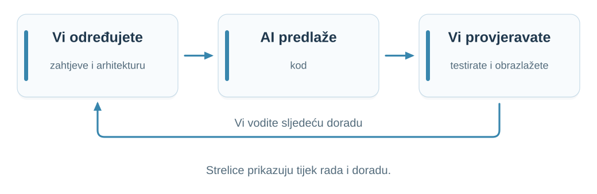{width=1040 fig-alt="Vi određujete zahtjeve i arhitekturu; AI predlaže kod; vi provjeravate, testirate i obrazlažete odluke."}

Razumijte **svaku liniju koda**. Obrazložite svaki izbor, alternative i kompromise.

**Arhitektura je skup informiranih odluka. Dokažite svoje.**

::: {.notes}
Vrijeme: 27.5–29 min (1.5 min).

Zajednička AI pravila iz RS/WA, potvrđena za BA 2026-10-08; puni tekst u ai-policy.hr.md. Student mora pokazati da je sam vodio arhitekturne odluke i obrazlaže alternative i kompromise. Primjer: skriven gumb ne sprječava izravan poziv ugovora; provjeriti ovlasti drugim računom. Ne traži se poseban zapis promptova.
:::

## Preporučeni AI alati {.ai-tools-slide}

:::: {.ai-tools-grid}
::: {.ai-tool}
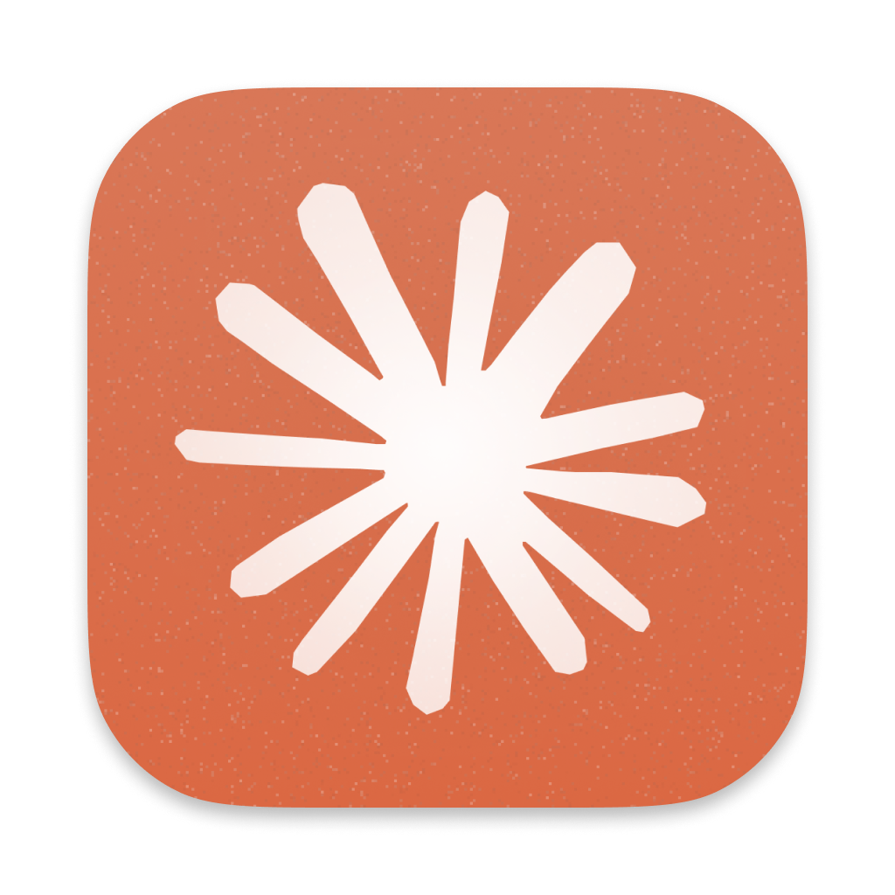{fig-alt="Claude"}

**[Claude Code](https://code.claude.com/docs/en/overview)**

Rad na kodu projekta, objašnjenja i provjere.
:::
::: {.ai-tool}
{fig-alt="Claude"}

**[Claude Design](https://claude.com/product/design)**

Ideje za sučelje i interaktivni prototipovi.
:::
::: {.ai-tool}
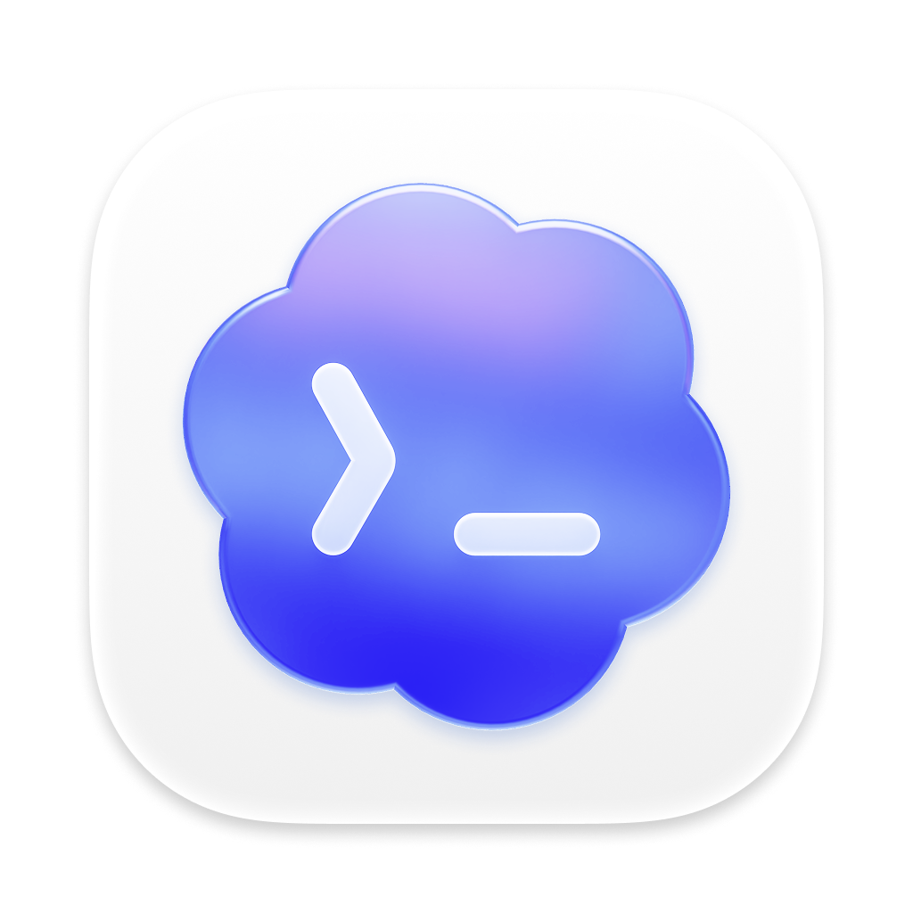{fig-alt="Codex"}

**[Codex](https://learn.chatgpt.com/docs/code-review)**

Razumijevanje promjena i pregled koda.
:::
::::

::: {.open-models}
**Otvoreni modeli za istraživanje**

[Qwen3-Coder](https://github.com/QwenLM/Qwen3-Coder) · [DeepSeek-Coder-V2](https://github.com/deepseek-ai/DeepSeek-Coder-V2)

Modeli s dostupnim težinama za preuzimanje; za pokretanje trebaju odgovarajući alat i računalo. Licence ovise o modelu.
:::

Zapise razgovora s AI-jem ne predajete. Neobavezno: odjeljak **„Uporaba AI-ja”** u README-u projekta.

::: {.notes}
Vrijeme: 29–30 min (1 min).

Razlikujte alat i model: alat povezuje rad na projektu s modelom; model sam po sebi nije razvojno okruženje. Otvorene modele navodimo kao primjere za istraživanje, ne kao obveznu instalaciju ili rang-listu. Dostupne težine (open weights) nisu isto što i potpuna otvorenost svih podataka i postupka treniranja. DeepSeek ima zasebnu licencu modela. Izbor AI alata ne mijenja pravilo o odobrenju projektnih tehnologija. Zapisi razgovora s AI-jem ne traže se; dovoljni su commitovi i obrana. Neobavezni odjeljak „Uporaba AI-ja” u README-u navodi alate, za što su korišteni i kako je rezultat provjeren (RS, potvrđeno za BA 2026-10-13).

Izvori za zadržane alate, provjereni 2026-10-08: [Claude Code](https://code.claude.com/docs/en/overview), [Claude Design](https://claude.com/product/design), [Codex](https://learn.chatgpt.com/docs/code-review), [Qwen3-Coder](https://github.com/QwenLM/Qwen3-Coder), [DeepSeek-Coder-V2](https://github.com/deepseek-ai/DeepSeek-Coder-V2).
:::

## Commitovi i individualni doprinos {.contribution-slide}

Na projektu radite **kontinuirano**: **nekoliko commitova tjedno** kroz najmanje **2–3 tjedna**, uz provjeru autentičnosti. Prati se **rad svakog člana**.

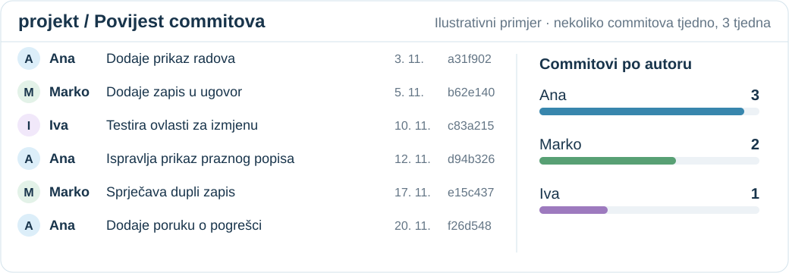{width=1040 fig-alt="Izmišljeni primjer šest commitova od 3. do 20. studenoga, nekoliko tjedno: Ana tri, Marko dva, Iva jedan. Uz svaki commit vidljivi su autor, opis promjene i datum."}

**Budite spremni objasniti vlastite promjene.** Broj commitova sam po sebi ne pokazuje kvalitetu doprinosa.

::: {.notes}
Vrijeme: 30–31 min (1 min).

- Timski rezultat ne zamjenjuje individualno razumijevanje. Pitajte kako bi svaki član pokazao što je napravio i zašto.
- Projekt izrađen u nekoliko dana ili s jednim commitom ne zadovoljava traženi način rada.
- Izvorni hodogram još navodi commit svakih 1–2 dana; vrijedi blaže pravilo preuzeto iz RS-a i potvrđeno za BA 2026-10-13: nekoliko commitova tjedno, najmanje 2–3 tjedna rada.
- Ilustracija je izmišljena: imena, datumi i hashevi nisu iz stvarnog repozitorija. Broj commitova nije kriterij ocjene; pregledava se sadržaj promjena.
:::

## Kako položiti kolegij {.flow-slide}

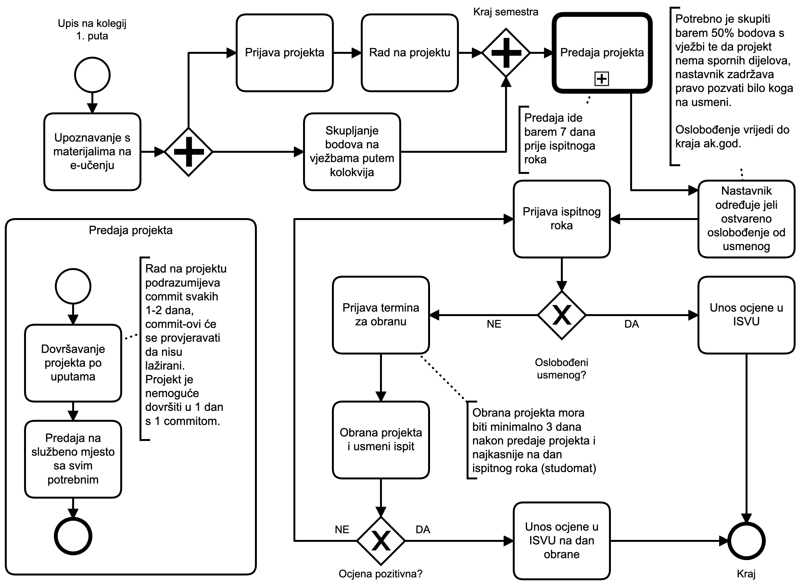{height=430 .lightbox fig-alt="Izvorni nastavnikov BPMN hodogram prolaska kolegija. Povijesni rokovi i uvjeti na slici pojašnjeni su tekstom ispod i na sljedećim slajdovima."}

::: {.flow-clarification}
**Aktualno:** predaja ≥3 radna dana prije obrane; commitovi nekoliko puta tjedno kroz najmanje 2–3 tjedna. Oslobođenje: pozitivna ocjena iz vježbi, uz odluku nastavnika. Kliknite dijagram za povećanje.
:::

::: {.notes}
Vrijeme: 31–32.5 min (1.5 min).

Izvorni nastavnikov hodogram vraćen na njegov izričiti zahtjev. Na slici su povijesne napomene: sedam dana za predaju i tri kalendarska dana do obrane; vrijedi aktualno pravilo najmanje tri radna dana između predaje i obrane. Pozitivna ocjena iz vježbi i projekt bez spornih dijelova omogućuju oslobođenje uz nastavnikovu odluku; nije automatsko pravo. Oslobođenje vrijedi do kraja akademske godine. Prag od 50% iz starog RS dijagrama u BA je zamijenjen nastavnikovim uvjetom pozitivne ocjene iz vježbi. Ako nema ocjene ili je 1, usmeni je obvezan. Objasniti paralelni rad, grananje i ponovnu prijavu nakon negativnog ishoda. Prikazana je izvorna slika assets/assessment-flow.original.png bez grafičkih izmjena. Klikom otvorite povećani prikaz. Aktualno ocjenjivanje objašnjeno je na sljedećem slajdu. Slika navodi i commit svakih 1–2 dana; vrijedi blaže pravilo s prethodnog slajda (nekoliko commitova tjedno, najmanje 2–3 tjedna rada).
:::

## Predaja i obrana {.submission-slide}

**Gotov projekt uvjet je za pristup ispitu.**

Predajte najmanje **3 radna dana prije obrane**, koja je najkasnije na dan ispitnog roka.

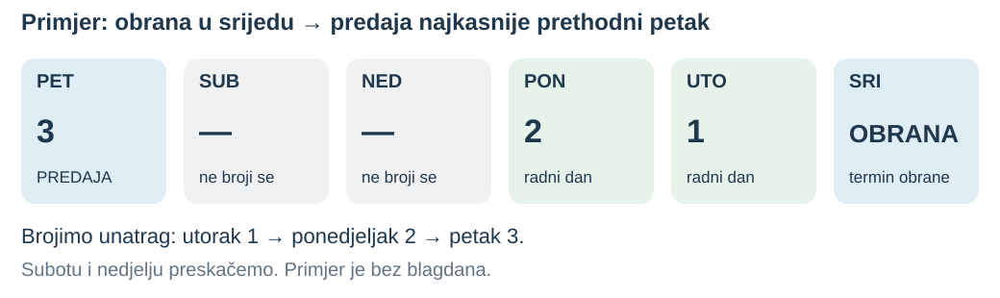{width=1040 fig-alt="Primjer bez blagdana: za obranu u srijedu predaja je najkasnije prethodni petak."}

Prijavite ispitni rok i naznačite ako ste oslobođeni usmenog.

**Rezervacija obrane:** [ntankovic.unipu.hr/termin](https://ntankovic.unipu.hr/termin) · termini se otvaraju 10 dana unaprijed

::: {.notes}
Vrijeme: 32.5–33.5 min (1 min).

Zajednički hodogram s ispravcima u RS izvorima, potvrđen za BA 2026-10-08. Nema starog roka od sedam dana. Tri radna dana broje se između predaje i obrane. Na putu oslobođenja naznačiti oslobođenje. Rezervacija termina na slajdu: https://ntankovic.unipu.hr/termin; termini postaju dostupni 10 dana unaprijed, pa rezervirajte čim znate datum predaje. Nastavnik zadržava pravo pozvati bilo kojeg studenta na usmeni.
:::

## Kako se određuje ocjena

**Konačna ocjena temelji se na prosjeku ocjena iz predavanja i vježbi.**

::: {.grade-example}
Projekt iz predavanja **5** + vježbe **2**

Prosjek **3,5** → konačna ocjena **4**
:::

Prosjek se zaokružuje na cijelu ocjenu; **,5 se zaokružuje naviše**.

Ako ocjena iz vježbi **nedostaje ili je 1**, slijedi **usmeni ispit**.

**Ocjena usmenog tada je konačna ocjena.**

::: {.notes}
Vrijeme: 33.5–35 min (1.5 min).

Izravna nastavnikova uputa, 2026-10-08. Stari postoci 70/30/10 ne vrijede za ovaj nacrt. Primjer 5 i 2 daje 4 izričito je potvrđen. Nastavnik je 2026-10-12 potvrdio pravilo zaokruživanja: 3,5 → 4, tj. polovica se zaokružuje naviše (npr. 4,5 → 5). Nastavnik je potvrdio: ocjena usmenog određuje konačnu ocjenu. Ne računa se prosjek usmenog i projekta.
:::

## Ako projekt ne obranite ove godine {.academic-year-slide}

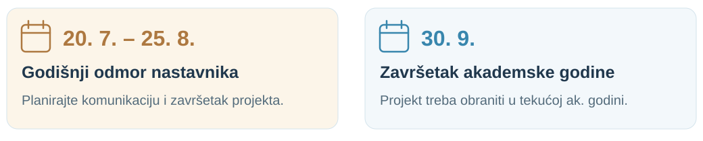{width=1040}

Ako projekt ne obranite do završetka akademske godine, **30. 9.**:

- ponovno prijavljujete projekt
- izrađujete **novi projekt samostalno** i branite ga

**Prijedlog novog projekta odobrava nastavnik.**

::: {.notes}
Vrijeme: 35–36 min (1 min).

Razlikujte neuspješan pojedinačni izlazak na ispit od pravila koje se odnosi na projekt neobranjen tijekom akademske godine. Ovo pravilo ne znači da svaki neuspješan izlazak odmah zahtijeva novu temu. Akademska godina završava 30. rujna. Godišnji odmor nastavnika traje od 20. srpnja do 25. kolovoza; datume je naveo nastavnik. Ne predstavljajte 30. rujna kao zajamčeni ispitni termin niti godišnji odmor kao službenu promjenu rasporeda ispitnih rokova.
:::

## Znanje za usmeni ispit

**Povežite pojmove s odlukama u vlastitom projektu.**

- Povjerenje, raspodijeljenost, decentralizacija i konsenzus
- Transakcije, stanje i osnove *blockchaina*
- Pametni ugovori, ovlasti, testiranje i sigurnost
- Web3, pohrana i arhitektura aplikacije

Budite spremni objasniti korišteni kod, biblioteke i njihove pretpostavke.

::: {.notes}
Vrijeme: 36–37 min (1 min).

Slajd preuzima svrhu WA slajda, a sadržaj izvodi iz BA programa i ranije potvrđene individualne provjere. Ne poziva se na nepostojeći BA popis ispitnih pitanja i ne uvodi dodatni formalni dokument. Objasnite primjenjuje li se usmeni prema BA pravilima ocjenjivanja; ne prenijeti WA obvezni usmeni za sve.
:::

## Pokažite razumijevanje projekta {.visual-slide}

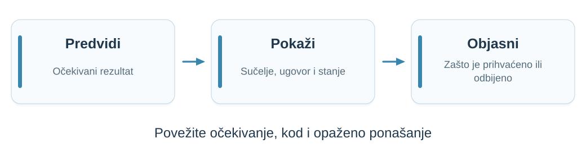{width=1040 fig-alt="Predvidite rezultat, pratite radnju kroz sučelje i ugovor, objasnite promjenu stanja."}

Pratite **korisničku radnju, poziv ugovora i promjenu stanja**.

Pokažite uspješan pokušaj i pokušaj koji mora biti odbijen.

::: {.notes}
Vrijeme: 37–38.5 min (1.5 min).

Prilagodba zajedničkih WA/RS smjernica prema korisnikovoj uputi 2026-10-08. Primjeri promjena: dodatna provjera ovlasti, zabrana duplog zapisa, filtar prikaza. Opseg se prilagođava vremenu i projektu; nije popis zajamčenih zadataka. Koristiti lokalno okruženje i testne podatke.
:::

## Dorada projekta: objasnite izmjenu {.visual-slide .design-change-slide}

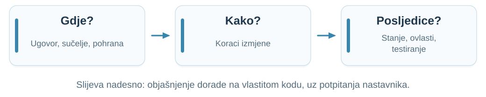{width=1040 fig-alt="Tri koraka: gdje bi išla izmjena u ugovoru, sučelju i pohrani; kako biste je proveli; koje su posljedice za stanje, ovlasti i testiranje."}

::: {.question-grid}
::: {.question-card}
Kako biste dodali **rok** nakon kojeg ugovor odbija nove uplate ili glasove?
:::
::: {.question-card}
Gdje biste dodali **novu ulogu** i tko je smije dodijeliti?
:::
::: {.question-card}
Što se događa ako se **ista transakcija** pošalje dvaput?
:::
:::

**Pokažite mjesta u svom kodu i obrazložite kompromise.** Nastavnik postavlja potpitanja.

::: {.notes}
Vrijeme: 38.5–39.5 min (1 min).

- Umjesto izmjene koda uživo student objašnjava doradu na vlastitom projektu: gdje bi izmjena išla, kako bi je proveo i koje su posljedice.
- Zašto: zadatak za izmjenu uživo lako se prepiše u AI alat. Objašnjenje uz vlastiti kod i potpitanja pokazuje stvarno razumijevanje.
- Potpitanja: što se događa sa stanjem već postavljenog ugovora, tko smije pozvati novu funkciju, kako biste testom pokazali i uspješan i odbijeni slučaj?
- Po potrebi student manju izmjenu može pokazati u kodu, bez AI alata, lokalno i na testnim podacima.
- Primjeri nisu pitanja koja će svaki student dobiti; pitanja se biraju prema projektu. Zamjena za „Izmjena koda uživo” prema RS-u, potvrđena za BA 2026-10-13.
:::

## Prije prvog tehničkog predavanja

Trebate znati:

- Gdje postaviti pitanja: **Google Chat „FIPU BA”**
- Kako predložiti temu projekta i što mora riješiti *blockchain*
- Koje su vaše obveze i kako se određuje ocjena

Slijedi: **Od raspodijeljenih do decentraliziranih sustava**.

**Tri organizacije upravljaju zajedničkim digitalnim budžetom. Što dobivamo zajedničkim poslužiteljem, a kome time dajemo kontrolu?**

::: {.notes}
Vrijeme: 39.5–41 min (1.5 min).

Završni slajd prema RS uvodu, spojen s ranijim BA slajdom „Pitanja i sljedeće predavanje”. Vrijeme uključuje pitanja i ponavljanje. Zatražite da student objasni što se događa ako nema ocjenu iz vježbi te razlikuje nastavni primjer od svoje projektne teme. Završno pitanje vodi u prvo tehničko predavanje bez ranog uvođenja Bitcoina.
:::
