## Evidencija prisutnosti {#attendance .attendance-slide}

::: {.attendance-content}
[{width=455 height=455 fig-alt="QR kod za evidenciju prisutnosti na kolegiju Blockchain aplikacije."}](https://bit.ly/bc-tu-sam)

[bit.ly/bc-tu-sam](https://bit.ly/bc-tu-sam)
:::

::: {.notes}
Vrijeme: 0.5–1 min (0.5 min).
Ostavite pola minute za evidenciju putem QR koda ili poveznice. Isti QR kod kao u predavanju 00 (https://bit.ly/bc-tu-sam).
:::

## Što je ledger?

**Ledger** (*glavna knjiga*): uređen zapis svih knjiženja po računima, iz kojeg se u svakom trenutku može izračunati saldo svakog računa. Izvod je pogled na jedan račun.

```{=html}
<div class="statements"><div class="statement"><div class="st-head"><span>Banka A · izvod računa</span><span>ožujak</span></div><div class="st-meta">Vlasnik: <b>Ana</b> · račun A-0001</div><table><thead><tr><th>Datum</th><th>Opis</th><th class="num">Iznos</th><th class="num">Saldo</th></tr></thead><tbody><tr><td>1. 3.</td><td>početno stanje</td><td class="num "></td><td class="num">0,00</td></tr><tr><td>1. 3.</td><td>gotovinska uplata</td><td class="num credit">+100,00</td><td class="num">100,00</td></tr><tr><td>2. 3.</td><td>K1 · plaćanje Borisu</td><td class="num debit">−30,00</td><td class="num">70,00</td></tr><tr><td>5. 3.</td><td>K2 · uplata od Borisa</td><td class="num credit">+10,00</td><td class="num">80,00</td></tr></tbody></table></div><div class="statement"><div class="st-head"><span>Banka A · izvod računa</span><span>ožujak</span></div><div class="st-meta">Vlasnik: <b>Boris</b> · račun A-0002</div><table><thead><tr><th>Datum</th><th>Opis</th><th class="num">Iznos</th><th class="num">Saldo</th></tr></thead><tbody><tr><td>1. 3.</td><td>početno stanje</td><td class="num "></td><td class="num">0,00</td></tr><tr><td>1. 3.</td><td>gotovinska uplata</td><td class="num credit">+20,00</td><td class="num">20,00</td></tr><tr><td>2. 3.</td><td>K1 · uplata od Ane</td><td class="num credit">+30,00</td><td class="num">50,00</td></tr><tr><td>5. 3.</td><td>K2 · plaćanje Ani</td><td class="num debit">−10,00</td><td class="num">40,00</td></tr></tbody></table></div></div>
```

**Dvojno knjigovodstvo** (*double-entry bookkeeping*): isto knjiženje K1 ide na teret Ane i u korist Borisa, istim iznosom.

::: {.notes}
Vrijeme: 1–3 min (2 min).

Pitajte koliko je ukupno novca na oba računa nakon gotovinskih uplata i nakon svakog knjiženja. Uvijek 120: K1 i K2 samo premještaju novac. Gotovinska uplata je drukčija: novac dolazi izvana, pa banka drugu stranu knjiženja vodi na svom računu blagajne, koji se na izvodu klijenta ne vidi.

Glavna knjiga služi za tri stvari: saldo svakog računa u svakom trenutku, trag tko je kada što promijenio i usklađivanje s drugima. U dvojnom knjigovodstvu svaka transakcija upisuje se u glavnu knjigu dvaput, jednom na teret jednog računa i jednom u korist drugog ([Dictionary.com / Collins: double entry](https://www.dictionary.com/browse/double-entry)). Zato zbroj salda ostaje isti, a pogrešno knjiženje vidi se kao neslaganje. Stroga knjigovodstvena terminologija (dnevnik, duguje, potražuje, strana banke nasuprot strani klijenta) nije cilj kolegija; koristimo bankovne izraze terećenje i odobrenje. Naša kasnija isplata tx~1~ isto je takvo knjiženje: terećenje F, odobrenje X.
:::

## Ledger banke: sva knjiženja na jednom mjestu

Banka vodi **jednu** glavnu knjigu za sve račune, uključujući svoju blagajnu. Istaknuti retci su Anin izvod.

```{=html}
<div class="statement ledger"><div class="st-head"><span>Banka A · glavna knjiga (ledger)</span><span>ožujak</span></div><table><thead><tr><th>Datum</th><th>Knjiženje</th><th>Račun</th><th class="num">Terećenje</th><th class="num">Odobrenje</th></tr></thead><tbody><tr class=""><td>1. 3.</td><td>U1 · gotovinska uplata</td><td>Blagajna banke</td><td class="num debit">100,00</td><td class="num credit"></td></tr><tr class="hl"><td></td><td></td><td>Ana</td><td class="num debit"></td><td class="num credit">100,00</td></tr><tr class=""><td>1. 3.</td><td>U2 · gotovinska uplata</td><td>Blagajna banke</td><td class="num debit">20,00</td><td class="num credit"></td></tr><tr class=""><td></td><td></td><td>Boris</td><td class="num debit"></td><td class="num credit">20,00</td></tr><tr class="hl"><td>2. 3.</td><td>K1 · Ana plaća Borisu</td><td>Ana</td><td class="num debit">30,00</td><td class="num credit"></td></tr><tr class=""><td></td><td></td><td>Boris</td><td class="num debit"></td><td class="num credit">30,00</td></tr><tr class=""><td>5. 3.</td><td>K2 · Boris plaća Ani</td><td>Boris</td><td class="num debit">10,00</td><td class="num credit"></td></tr><tr class="hl"><td></td><td></td><td>Ana</td><td class="num debit"></td><td class="num credit">10,00</td></tr><tr class="sum"><td></td><td>Ukupno</td><td></td><td class="num">160,00</td><td class="num">160,00</td></tr></tbody></table></div>
```

**Svako knjiženje ima dva retka, pa su zbrojevi terećenja i odobrenja uvijek jednaki.**

::: {.notes}
Vrijeme: 3–5 min (2 min).

Pitajte odakle na Aninu izvodu dolazi +100 i gdje je druga strana tog knjiženja. Na računu blagajne banke, koji Ana ne vidi.

Izvod klijenta samo je filtar glavne knjige po jednom računu: Anini redci daju 0 → 100 → 70 → 80. Gotovinska uplata ima drugu stranu na računu blagajne, jer novac dolazi izvana; K1 i K2 samo premještaju novac između računa klijenata. Jednakost zbrojeva (160 = 160) je ugrađena provjera: knjiženje s jednom stranom odmah se vidi. Ne ulazimo u to da su za banku računi klijenata obveze, a blagajna imovina, pa terećenje ne znači uvijek smanjenje; koristimo izraze terećenje i odobrenje kao na izvodu. Ovo je pojednostavljeni nastavni prikaz, ne kontni plan stvarne banke.
:::

## Kako surađuju banke s odvojenim evidencijama? {.illustrated-slide}

**Svaka banka vodi vlastiti ledger. Surađuju kroz poruke, obračun i poravnanje, a sve vjeruju središnjoj banci.**

Račun kod središnje banke imaju samo banke i druge licencirane institucije, uz mjesečne naknade.

Ugovori i institucije određuju odgovornosti; spor se može rješavati pravnim putem.

**Naš primjer ide prema pitanju: možemo li smanjiti ovisnost o naknadnom usklađivanju i sporovima?**

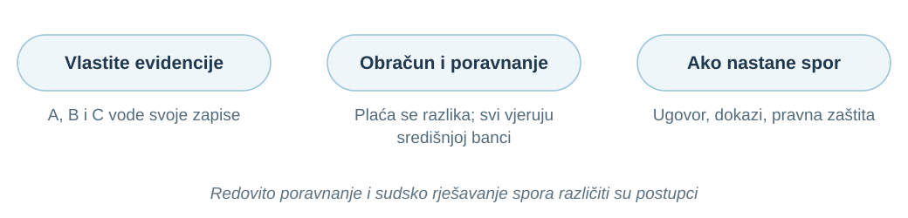{width=1040 fig-alt="Vlastite evidencije: A, B i C vode svoje zapise; Obračun i poravnanje: Plaća se razlika; svi vjeruju središnjoj banci; Ako nastane spor: Ugovor, dokazi, pravna zaštita. Redovito poravnanje i sudsko rješavanje spora različiti su postupci"}

::: {.notes}
Vrijeme: 5–7 min (2 min).

Pitajte što rješava poravnanje, a što sud. Zatim zatražite primjer troška koji nastaje tek kada se sudionici ne mogu usuglasiti.

Banke ne moraju dati jednoj drugoj administratorsku kontrolu nad svim svojim evidencijama. Vode zasebne zapise, razmjenjuju naloge i koriste dogovorene postupke obračuna obveza i njihova poravnanja. U jednom konkretnom sustavu, tx~2~, međubankovne se obveze poravnavaju prijenosom novca između računa kod središnje banke u stvarnom vremenu. [ECB: tx~2~](https://www.ecb.europa.eu/ecb-and-you/explainers/tell-me/html/what-is-t2.en.html). Sud nije korak kroz koji prolazi svako plaćanje: pravna zaštita služi rješavanju sporova, dok poravnanje ima vlastita pravila i infrastrukturu. U redovnom radu evidencije se slažu: nalozi između dviju banaka skupljaju se tijekom ciklusa, a poravnava se samo razlika, pa A plati B ili B plati A (netiranje; velika i hitna plaćanja idu pojedinačno i u stvarnom vremenu). Evidencije se ne slažu zato što banke međusobno uspoređuju knjige, nego zato što sve vjeruju središnjoj banci i oslanjaju se na njezin zapis. Ako se pojavi razlika, npr. pogrešan iznos ili dvostruki nalog, rješava se povratom ili opozivom po pravilima platne sheme. Sud dolazi tek kod spora o samom poslu. To je slučaj posrednika od povjerenja iz predavanja 00. Račun u tx~2~ mogu imati kreditne institucije, a od 2025. i platne institucije i institucije za e-novac pod istim uvjetima (samo sredstva za poravnanje tog dana, bez čuvanja novca korisnika; [ECB, 19. 7. 2024.](https://www.ecb.europa.eu/press/intro/news/html/ecb.mipnews240719.en.html)); građani i obične tvrtke ne mogu. Naknade prema [ECB TARGET Services Pricing Guide S~3~.0, srpanj 2026.](https://www.ecb.europa.eu/paym/target/coco/shared/docs/ecb.pricingcoco_target_2026_v3.0.en.pdf): račun za plaćanja (RTGS) 400 € mjesečno + 0,80 € po nalogu ili 5.000 € mjesečno + 0,60–0,05 € po nalogu; TIPS 800 € mjesečno + 0,002 € po trenutnom plaćanju. Revizija cijena RTGS-a 2026.: provjeriti jesu li navedeni iznosi već nove vrijednosti. Usporedba: pristup posredniku daje licenca uz fiksne troškove i nadzor; javni *blockchain* otvoren je svima, ali se plaća svaki zapis.

Naš zajednički digitalni budžet pojednostavnjuje pitanje zajednički prihvaćenog stanja; nije model cjelokupnog bankovnog poslovanja. Organizacije mogu prihvatiti operatora, ugovor, reviziju i nadležni sud. Ako zapisi postanu nespojivi, treba prikupiti dokaze, uskladiti evidencije ili riješiti spor. Želimo istražiti može li zajedničko provođenje preciznih pravila spriječiti dio takvih neslaganja prije nego što nastanu.

Zato početno pitanje nije kako računati dvije istodobne isplate. Pitanje je tko smije konačno prihvatiti ili promijeniti zajednički zapis i na čiji se autoritet ostali oslanjaju. Najprije ćemo vidjeti što rješava pouzdan koordinator, zatim replike i na kraju neovisni operatori. Isplate 80 i 60 kasnije daju konkretno pravilo za provjeru tih rješenja.
:::

## Pravni put postoji, ali koliko traje i košta? {.illustrated-slide}

**1.147 dana ≈ 3,1 godine**: prvostupanjske trgovačke parnice u Hrvatskoj, 2024. ([EK, izvješće 2025.](https://commission.europa.eu/document/download/920cc4c5-ceef-4072-9d5c-95ef1bba1f78_en?filename=15_1_63948_coun_chap_croatia_en.pdf))

Trošak: pristojbe, zastupanje, prema potrebi vještačenje, a uz to i čekanje.

**Ilustracija:** 100.000 € nedostupno 3 godine × 5% godišnje = 15.000 € jednostavnog troška financiranja.

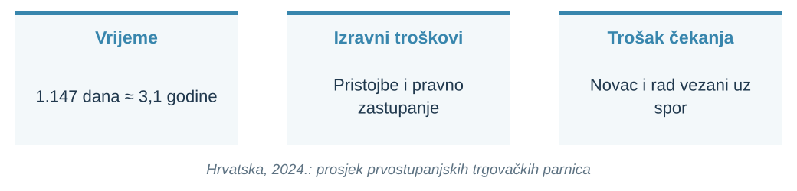{width=1040 fig-alt="Vrijeme: 1.147 dana ≈ 3,1 godine; Izravni troškovi: Pristojbe i pravno zastupanje; Trošak čekanja: Novac i rad vezani uz spor. Hrvatska, 2024.: prosjek prvostupanjskih trgovačkih parnica"}

::: {.notes}
Vrijeme: 7–9 min (2 min).

Odvojite na ploči izmjereni podatak 1.147 dana od pretpostavljenog izračuna 15.000 €. Pitajte gdje nastaje poslovni trošak čekanja.

Europska komisija u izvješću o vladavini prava za Hrvatsku iz 2025., str. 6, navodi prosječno trajanje prvostupanjskih trgovačkih parnica od 1.147 dana u 2024. To je oko 3,1 godine. Brojka opisuje tu kategoriju postupaka i godinu; nije trajanje svake parnice, međubankovnog poravnanja ili posebno sporova o digitalnim zapisima. Ne uključujemo je kao prognozu današnjeg pojedinačnog predmeta. [Izvor](https://commission.europa.eu/document/download/920cc4c5-ceef-4072-9d5c-95ef1bba1f78_en?filename=15_1_63948_coun_chap_croatia_en.pdf).

Pravni postupak uključuje pristojbe i moguću naknadu za zastupanje; dodatni dokazni postupci mogu tražiti dodatne izdatke. Iznos ovisi o predmetu i radnjama, pa nema jedne poštene cijene za sve sporove. [Europski portal e-pravosuđa](https://e-justice.europa.eu/topics/taking-legal-action/where-and-how/how-bring-case-court/hr_en). Uz to, organizacija troši vrijeme na dokumentaciju i upravljanje sporom.

Odvojeno računamo autorsku ilustraciju: ako je 100.000 eura zbog spora nedostupno tri godine i pretpostavimo jednostavni trošak financiranja od 5% godišnje, dobivamo 15.000 eura. To nije sudska tarifa, zakonska kamata, opaženi prosjek ni tvrdnja da je novac blokiran u svakoj parnici. Brojevi pokazuju zašto i vrijeme može biti skupo. Spor se može riješiti i dogovorom ili drugim odgovarajućim putem; ne tvrdimo da svako neslaganje završava višegodišnjom parnicom.
:::

## Možemo li dio sporova spriječiti unaprijed? {.illustrated-slide}

**Umjesto naknadnog spora o zapisima: možemo li se dogovoriti prije prihvaćanja promjene?**

Nitko sam ne smije nametnuti novu prihvaćenu povijest.

Moguća korist: manje usklađivanja. Cijena: protokol, komunikacija i nove pretpostavke.

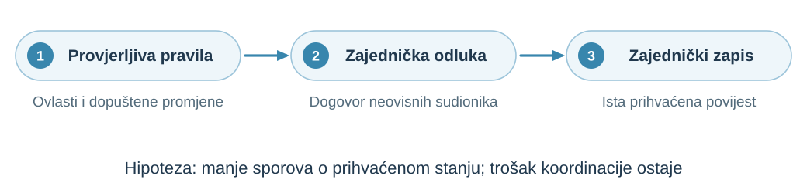{width=1040 fig-alt="Provjerljiva pravila: Ovlasti i dopuštene promjene; Zajednička odluka: Dogovor neovisnih sudionika; Zajednički zapis: Ista prihvaćena povijest. Hipoteza: manje sporova o prihvaćenom stanju; trošak koordinacije ostaje"}

::: {.notes}
Vrijeme: 9–11 min (2 min).

Tražite jedan spor koji provjera salda može spriječiti i jedan koji ostaje moguć čak uz zajednički zapis.

Za naš digitalni budžet predlažemo promjenu dizajna: dopuštene radnje unaprijed preciziramo i sudionici neovisno provjeravaju prijedloge. Trebaju i zajednički postupak prihvaćanja. Sama lokalna provjera ili kopija baze nije dovoljna. Cilj je, pod izričitim pretpostavkama protokola, spriječiti da dva ispravna sudionika nespojive promjene smatraju konačno prihvaćenima.

To je istraživačko pitanje predavanja, a ne unaprijed dokaz da je blockchain jeftiniji. Dio neslaganja o digitalnom stanju mogao bi se spriječiti ili lakše provjeriti, ali sustav plaća komunikaciju, održavanje i složenije upravljanje. Pogrešna pravila, pogreške u programu i pitanja izvan digitalne evidencije ostaju mogući izvori spora. Tehničko prihvaćanje zapisa ne ukida pravne zahtjeve i sudsku zaštitu.

Pouzdana zajednička baza također može automatizirati pravila i smanjiti pogreške. Decentralizirani pristup postaje zanimljiv kada sudionici uz to ne žele jednom operatoru dati isključivu ovlast nad prihvaćenim stanjem. Tijekom predavanja uspoređujemo tu korist s cijenom i preostalim povjerenjem. Konačan izbor mora slijediti potrebe aplikacije.
:::

## Ishodi i predznanje {.outcomes-slide}

Nakon predavanja moći ćete:

1. **razlikovati** raspodijeljenost, decentralizaciju i P2P [Analiza]{.bloom .b4}
2. **pratiti** promjene stanja kroz više replika [Primjena]{.bloom .b3}
3. **razlikovati** kašnjenje, djelomičan ispad i bizantsko ponašanje [Analiza]{.bloom .b4}
4. **navesti** pretpostavke povjerenja za predloženo rješenje [Razumijevanje]{.bloom .b2}
5. **obrazložiti** kada je zajednički koordinator dovoljan [Vrednovanje]{.bloom .b5}

::: {.prereq}
[Predznanje]{.prereq-label} Zapis podataka, uvjet i poziv funkcije. Blockchain ne treba poznavati.
:::

::: {.notes}
Vrijeme: 11–12 min (1 min).

Najavite 120 minuta uključujući kratke zadatke i raspravu. Provjerite poznaju li studenti JSON zapis i jednostavnu funkciju.

Kroz cijelo predavanje pratimo isti zapis i iste sudionike. Ne tražimo da zapamtite popis protokola. Cilj je da na crtežu pokažete tko može što učiniti, koju informaciju svaki sudionik ima i koju pretpostavku vaš zaključak zahtijeva. Riječi poput „sigurno”, „dostupno” ili „decentralizirano” nisu dovoljne bez objašnjenja.

Redoslijed rada je namjeran: prvo odredimo poslovno pravilo, zatim ga pokušamo provesti na jednom mjestu, pa dodajemo kopije i ispade. Tek kad organizacije odbiju zajedničku kontrolu, prelazimo na drukčiji model povjerenja. Na kraju treba moći objasniti zašto dodavanje poslužitelja samo po sebi nije riješilo taj problem.
:::

## Kako prikazujemo stanje i transakcije {.illustrated-slide}

**Stanje** (*state*) [S~x~]{.expr}: cijeli zapis nakon x prihvaćenih transakcija. **Transakcija** (*transaction*): jedna dopuštena promjena iz [S~x~]{.expr} u [S~x+1~]{.expr}.

**Ledger čuva transakcije redom; stanje dobijemo kad ih primijenimo jednu po jednu.**

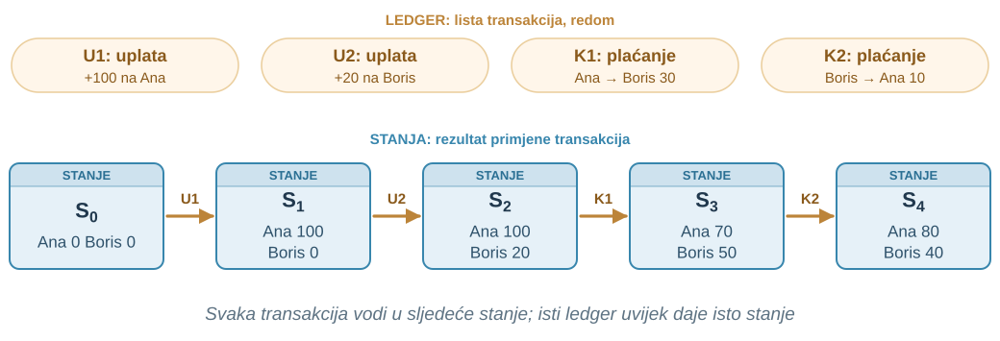{width=1040 fig-alt="Ledger je lista transakcija redom: U1 uplata +100 na Ana, U2 uplata +20 na Boris, K1 Ana plaća Borisu 30, K2 Boris plaća Ani 10. Stanja su rezultat primjene: S0 v0 (Ana 0, Boris 0), U1, S1 v1 (100, 0), U2, S2 v2 (100, 20), K1, S3 v3 (70, 50), K2, S4 v4 (80, 40). Svaka transakcija vodi u sljedeće stanje; isti ledger uvijek daje isto stanje"}

::: {.notes}
Vrijeme: 12–14 min (2 min).

Pitajte: ako dvije banke imaju isti ledger, mogu li imati različito stanje? Ne, ako transakcije primjenjuju istim redom i po istim pravilima. Ako imaju različit ledger ili različit redoslijed, mogu.

Ovo je notacija za ostatak kolegija. Plava kartica je stanje, cijeli zapis u jednom trenutku, a čip S~x~ kaže koje je to stanje po redu; narančasta pilula je transakcija, jedna promjena koja vodi iz S~x~ u S~x+1~. Primjer nastavlja izvode s Anom i Borisom: S~4~ daje upravo salda 80 i 40 sa slajda o ledgeru. Isti ledger, primijenjen istim redom, uvijek daje isto stanje; zato je kasnije ključno pitanje tko određuje redoslijed transakcija. U predavanju 03 vidjet ćemo kako se transakcije grupiraju u blokove; ovdje je svaka transakcija jedan korak.
:::

## Tri organizacije, jedan digitalni budžet {.illustrated-slide}

**A, B i C** upravljaju zajedničkim budžetom F. **Svaki smije predložiti isplatu.**

Svi trebaju isti pregled prihvaćenih isplata i preostalog salda.

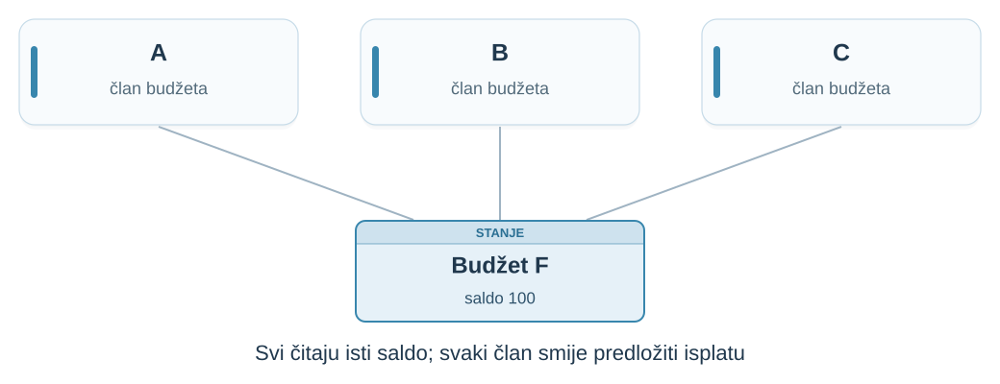{width=900 fig-alt="Tri kućice A, B i C (član budžeta) spojene su sa stanjem Budžet F, saldo 100. Svi čitaju isti saldo; svaki član smije predložiti isplatu"}

::: {.notes}
Vrijeme: 14–17 min (3 min).

Razdvojite na ploči organizacije A/B/C od računa F/X/Y. Ovdje samo uvodimo članove i budžet; tko predlaže koju isplatu, vidimo na sljedećem slajdu, a tko odlučuje, na slajdu s pravilom.

Organizacije A, B i C unaprijed su poznati članovi. Svaki smije predložiti isplatu iz fonda F, ali prijedlog nije odluka. U primjeru je tx~1~ prijenos 80 jedinica iz F u X, a tx~2~ prijenos 60 jedinica iz F u Y. X i Y su odredišni računi u istoj digitalnoj evidenciji; oznake A, B i C označavaju sudionike i njihove čvorove, a ne odredišta isplate.

Zahtjev mora doći od ovlaštenog člana, imati pozitivan iznos i dovoljno pokrića u stanju u kojem se prihvaća. Stanja numeriramo: S~x~ je stanje nakon x prihvaćenih promjena. Indeks x označava korak prihvaćene povijesti, a ne vrijeme na zidnom satu; u kodu ga zovemo verzija. Prvo ćemo svim organizacijama dati zajedničkog koordinatora. Kasnije mijenjamo pretpostavku da mu sve vjeruju.
:::

## Stanje zapisujemo izričito {.illustrated-slide}

**Stanje S~7~:**

```json
{"F": 100, "X": 0, "Y": 0, "verzija": 7}
```

Indeks stanja u kodu zovemo **verzija** (*version*). U istom trenutku stižu dva prijedloga:

**[tx~1~]{.tx}** (predlaže B): `isplati(F, X, 80, očekivana_verzija=7)`<br>**[tx~2~]{.tx}** (predlaže C): `isplati(F, Y, 60, očekivana_verzija=7)`

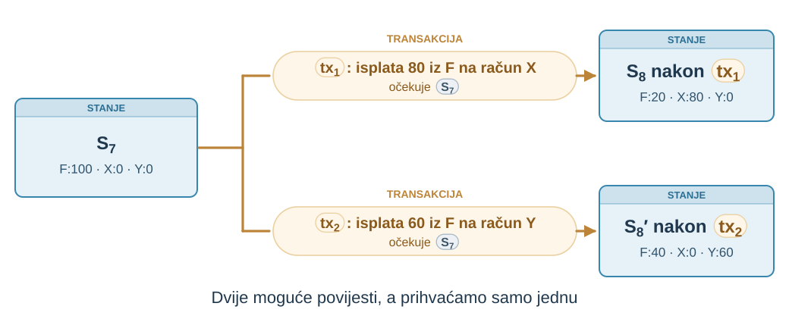{width=860 fig-alt="Iz stanja S7 (F:100 · X:0 · Y:0) vode dvije transakcije: tx1 (80 iz F na račun X) u S8 F:20 · X:80 · Y:0 i tx2 (60 iz F na račun Y) u alternativno stanje S8′ F:40 · X:0 · Y:60. Dvije moguće povijesti, a prihvaćamo samo jednu"}

::: {.notes}
Vrijeme: 17–19 min (2 min).

Neka student izračuna sva tri salda nakon tx~1~, zatim nakon tx~2~. Provjerite zbroj i naglasite razliku između zahtjeva i prihvaćene promjene. Ovo je snimka jednog trenutka pri S~7~: B i C predlažu, A ne predlaže ništa; uloge nisu stalne. S~8~′ je alternativno stanje: isti korak od S~7~, ali druga povijest.

Početno stanje zapisujemo kao S~7~ = (F:100, X:0, Y:0). tx~1~ je prijedlog isplate 80 jedinica iz F u X uz očekivano stanje S~7~. Sustav provjerava ovlast podnositelja, pozitivan iznos, pokriće i očekivano stanje. Prijedlog ne mijenja stanje samim slanjem.

Prihvaćeni tx~1~ daje S~8~ = (F:20, X:80, Y:0). Odbijeni zahtjev ne mijenja stanje. Obje strane prijenosa trebaju biti jedna atomarna promjena: nije dovoljno samo smanjiti F ili samo povećati X. Zbroj salda u zatvorenom primjeru ostaje 100. U nastavku dijagrami često pokazuju samo saldo F i oznaku stanja, ali krediti primatelja ostaju dio istog stanja.
:::

## Pravilo koje mora ostati istinito {.illustrated-slide}

**Isti novac ne smije se potrošiti dvaput, a saldo fonda ne smije postati negativan.**

[tx~1~]{.tx} i [tx~2~]{.tx} polaze od istog stanja [S~7~]{.ver .v7} i svaka je za sebe valjana. Zajedno bi iz fonda od 100 potrošile 140: to je dvostruko trošenje (*double spending*).

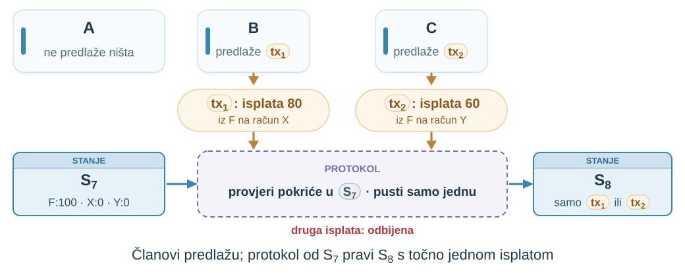{width=900 fig-alt="B predlaže tx1 (isplata 80 iz F na račun X), C predlaže tx2 (isplata 60 iz F na račun Y), A ne predlaže ništa. Iz stanja S7 (F:100 · X:0 · Y:0) obje ulaze u protokol koji provjerava pokriće u S7 i pušta samo jednu; nastaje S8 sa samo tx1 ili tx2; druga isplata je odbijena"}

[Tko provodi to pravilo i bira koja isplata prolazi?]{.bridge}

::: {.notes}
Vrijeme: 19–22 min (3 min).

Protokol ovdje znači unaprijed dogovorena pravila koja dijele svi članovi i kojih se svi moraju držati: tko smije predložiti, što se provjerava i kada je isplata prihvaćena. Nijedan član ne može sam promijeniti ta pravila. Prihvatiti možemo samo jedno od S~8~ i S~8~′. Završite pitanjem s dna slajda: tko provodi pravilo?

Usporedite parove 80+60 i 30+40. Razlikujte nedostatak pokrića od zastarjelog očekivanog stanja.

Poslovno pravilo ima dvije strane. Prvo, isti novac ne smije se potrošiti dvaput: tx~1~ i tx~2~ obje polaze od stanja S~7~ i svaka zasebno prolazi provjeru pokrića, ali obje zajedno trošile bi istih 100 jedinica. To je dvostruko trošenje (*double spending*). Ovdje ga uvodimo kao problem zajedničkog stanja; u predavanju 04 vidjet ćemo kako ga Bitcoin rješava bez koordinatora. Drugo, prihvaćena isplata ne smije potrošiti više jedinica nego što fond trenutačno ima. U zatvorenom modelu ne stvaramo ni uništavamo jedinice: terećenje jednog računa i odobrenje drugog čuvaju ukupni zbroj. Ovlašten podnositelj također ne smije zaobići pokriće.

Kao dodatni mehanizam naš API koristi očekivano stanje. Iz istog stanja prihvaća najviše jednu promjenu; ostale klijent mora ponovno razmotriti nad novim stanjem. To je namjerno konzervativan mehanizam zaštite od konkurentnih upisa, a ne pravilo da su svake dvije isplate nespojive. Primjerice, 30 i 40 mogu proći redom uz osvježeno očekivano stanje. Naših 80 i 60 ne mogu proći ni u jednom redoslijedu bez novih sredstava.
:::

## Prvo rješenje: zajednički koordinator {.illustrated-slide}

[Korak 1 · jedan koordinator]{.step-tag}

Organizacije šalju zahtjeve jednoj službi i vjeruju njezinu operatoru. Služba radi na čvoru kod organizacije **A**.

**Koordinator provjerava pravila i odlučuje o redoslijedu.**

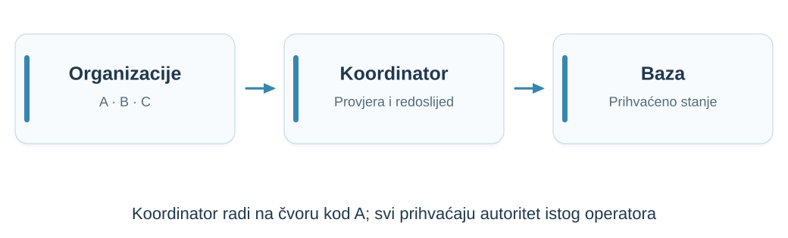{width=1040 fig-alt="Organizacije: A · B · C; Koordinator: Provjera i redoslijed; Baza: Prihvaćeno stanje. Svi prihvaćaju autoritet istog operatora"}

::: {.notes}
Vrijeme: 22–25 min (3 min).

Povežite s BA-01, str. 40: zadržan centralizirani pristup, promijenjen primjer. Pitajte tko može promijeniti pravila. Naglasite da koordinator radi kod A; zato je A u nastavku čvor koji prihvaća upise, a kasnije i član koji odobrava.

Najjednostavniji početak je jedna zajednička služba s bazom podataka. Član šalje zahtjev, služba provjerava njegovu ovlast, pozitivan iznos, raspoloživi saldo i očekivano stanje. Zatim atomarno mijenja oba računa i bilježi ishod. Ostali čitaju prihvaćeno stanje iz te službe. Zaštita od dvaju istodobnih upisa tada je lokalni problem baze i aplikacije.

Ovo rješenje nije pogrešno zato što je centralizirano. Ako organizacije vjeruju operatoru i prihvaćaju njegove ovlasti, može biti dovoljno. Treba imenovati granicu povjerenja: operator upravlja kodom, pristupom bazi i oporavkom. Klijenti ne odlučuju o konačnom stanju samo zato što na zaslonu imaju njegovu kopiju.
:::

## Dva zahtjeva, jedan redoslijed

| Korak | Radnja | Saldo F |
|:---|:---|:---|
| 0 | Početak | 100 [S~7~]{.ver .v7} |
| 1 | [tx~1~]{.tx}: isplati 80, očekuje [S~7~]{.ver .v7} | 20 [S~8~]{.ver .v8} |
| 2 | [tx~2~]{.tx}: isplati 60, očekuje [S~7~]{.ver .v7} | odbijen; 20 [S~8~]{.ver .v8} |

[Ali koordinator ne obrađuje zahtjeve jedan po jedan.]{.bridge}

::: {.notes}
Vrijeme: 25–28 min (3 min).

Prvo sakrijte zadnji redak i tražite predviđanje. Zatim promijenite redoslijed tx~1~/tx~2~ na ploči.

Koordinator prvo odabere tx~1~, provjeri uvjete i atomarno prenese 80 iz F u X. Preostaje F:20, X:80, Y:0 u S~8~. Kada provjeri tx~2~, očekivano stanje S~7~ više nije aktualna. Čak i kada bi podnositelj obnovio tx~2~ nad stanjem S~8~, traženih 60 nema pokriće u preostalih 20. Odbijanje je normalan poslovni odgovor, ne kvar mreže.

Da je tx~2~ proveden prvi, stanje bi bilo F:40, X:0, Y:60, S~8~, a tx~1~ bi bio odbijen. Pravilo ne nalaže da baš tx~1~ pobijedi. Nalaže dopušten redoslijed, nenegativan saldo i jednake prihvaćene promjene kod sudionika. U ovom primjeru nema dodatnih uplata između zahtjeva.
:::

## Koordinator s dvije dretve: obje provjere prije promjene

[Korak 2 · skaliranje koordinatora: više dretvi]{.step-tag}

Isti koordinator obrađuje [tx~1~]{.tx} i [tx~2~]{.tx} istodobno, u dvije dretve.

```python
if ovlasten(clan) and iznos > 0:
    if verzija == ocekivana and saldo_F >= iznos:
        tereti_F_i_odobri_primatelja(iznos)
        verzija += 1
        return "prihvaćeno"
```

Provjera i promjena su dva koraka; između njih druga dretva vidi isti saldo 100. To je **utrka** (*race condition*).

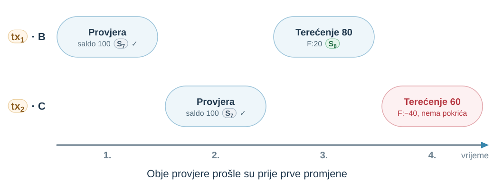{width=680 fig-alt="tx1 (B) i tx2 (C) redom: 1. tx1 provjerava saldo 100, S7; 2. tx2 provjerava saldo 100, S7; 3. tx1 tereti 80, F:20, S8; 4. tx2 tereti 60, F:−40, nema pokrića. Obje provjere prošle su prije prve promjene"}

::: {.notes}
Vrijeme: 28–31 min (3 min).

Odglumite: tx~1~ provjeri 100, tx~2~ provjeri 100, tx~1~ tereti 80, tx~2~ tereti 60. Izračunajte saldo nakon svakog koraka.

Prethodni slajd prikazao je koordinator koji zahtjeve obrađuje jedan po jedan. Stvarna služba obrađuje zahtjeve u više dretvi istodobno. tx~1~ pročita saldo 100 i stanje S~7~, a tx~2~ pročita isto. Oba prođu provjeru. Ako zatim bez ponovne provjere provedu terećenja 80 i 60, saldo F postaje −40, X ima 80, a Y 60. Ukupni zbroj ostaje 100, ali fond je potrošio sredstva koja nema. Ako umjesto terećenja kod prepisuje saldo iz zastarjele kopije, može nastati drukčiji problem: izgubljeni upis i nesklad salda i isplata.

Pseudokod namjerno nema zaštitu koja povezuje provjeru s promjenom. Čak i ako pomoćna funkcija atomarno prenosi iznos između računa, ranija provjera pokrića nije time zaštićena. Pozitivan iznos i ovlast jesu potrebni, ali ne rješavaju konkurentnost. Studenti trebaju pokazati točan raspored radnji koji ruši pravilo. Naglasite da ni provjera `verzija == ocekivana` ne pomaže: obje dretve pročitaju S~7~ prije nego što ijedna poveća verziju. Takav ishod koji ovisi o slučajnom preplitanju dretvi zove se utrka (*race condition*). Najavite: sljedeći slajd pokazuje kako je baza sprječava.
:::

## Jedna baza: atomarnost i izolacija {.illustrated-slide}

**Atomarnost** (*atomicity*): izvrše se i terećenje F i odobrenje X, ili nijedno.

**Izolacija** (*isolation*): drugi zahtjev ne smije potrošiti sredstva između naše provjere i upisa.

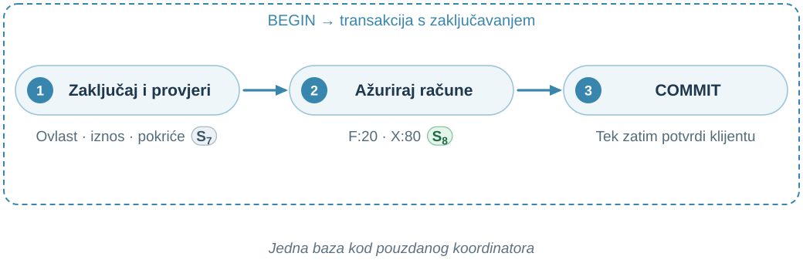{width=1040 fig-alt="Zaključaj i provjeri: Ovlast · iznos · pokriće · S7; Ažuriraj račune: F:20 · X:80 · S8; COMMIT: Tek zatim potvrdi klijentu. Jedna baza kod pouzdanog koordinatora"}

[Utrka je riješena unutar baze. Ali A, B i C nisu u bazi: zahtjeve šalju preko mreže. Kako se zove takav sustav?]{.bridge}

::: {.notes}
Vrijeme: 31–34 min (3 min).

Neka studenti objasne dva odvojena kvara: pad između terećenja i odobrenja te dva zahtjeva koja provjere isti saldo. Povežite prvi s atomarnošću, drugi s izolacijom.

Ovdje govorimo o transakciji u jednoj bazi kod pouzdanog koordinatora, a ne o dogovoru neovisnih organizacija. Atomarnost osigurava da se terećenje F i odobrenje primatelja provedu zajedno ili ponište zajedno. Izolacija određuje dopušteno preplitanje konkurentnih transakcija. Sama atomarnost ne sprječava dva zahtjeva da provjere isti stari saldo.

U našem konkretnom rješenju transakcija počinje naredbom BEGIN. Dohvatimo i zaključamo redak fonda za izmjenu, primjerice SELECT ... FOR UPDATE, pa provjerimo ovlast, pozitivan iznos, pokriće i očekivano stanje. Dok držimo lokot, drugi upis u isti fond čeka. Zatim ažuriramo F i račun primatelja te broj stanja i završavamo s COMMIT. Klijentu šaljemo potvrdu tek nakon uspješnog COMMIT-a; ako uvjet ne vrijedi ili nastane pogreška, transakciju poništavamo. Sljedeći zahtjev nakon čekanja provjerava aktualno stanje. Sve isplate moraju slijediti isti postupak.

Pretpostavljamo fiksne ovlasti članova tijekom ovog primjera i jednu bazu koja sadrži sve račune. Ažuriranje primatelja također mora izbjeći izgubljeni upis; za opće prijenose između više računa trebaju dosljedan redoslijed zaključavanja i obrada deadlocka. Primjer je konceptualni slijed, ne kompletna implementacija. Uvjetni upisi ili serijalizabilna izolacija uz obradu ponovnih pokušaja druge su mogućnosti. [PostgreSQL 18: zaključavanje redaka](https://www.postgresql.org/docs/18/explicit-locking.html#LOCKING-ROWS).

To štiti poslovno pravilo unutar baze, ali ne uklanja povjerenje u njezina administratora. Ako administrator upravlja podacima i kodom, lokalna transakcija sama ne raspodjeljuje njegove ovlasti.
:::

## Raspodijeljenost: rad preko više procesa

I s jednim koordinatorom A, B i C šalju zahtjeve porukama preko mreže. Takav sustav ima ime:

::: {.definition number="1.1"}
**Raspodijeljeni sustav (*distributed system*)** čine komponente koje se neovisno izvršavaju te komuniciraju i koordiniraju razmjenom poruka radi zajedničkog cilja.
:::

Svaku takvu komponentu zovemo **čvor** (*node*). **Zajednička memorija nije pretpostavljena.**

[Što ako koordinator kod A padne ili ga preopterete čitanja?]{.bridge}

::: {.notes}
Vrijeme: 34–36 min (2 min).

Definicija 1.1 preuzeta je doslovno iz RS 01 (Definicija 1.1), da studenti oba kolegija imaju istu definiciju.

Pitajte je li web aplikacija s jednom bazom i udaljenim korisnicima raspodijeljena. Obrazložiti granicu promatranja.

Raspodijeljenost u ovom kolegiju promatramo kroz rad procesa koji razmjenjuju poruke, imaju lokalne informacije i mogu doživjeti djelomične ispade. Više procesa na istom računalu može imati neke od tih problema, ali procesi na više računala dodaju zasebne mrežne i strojne ispade. Broj fizičkih lokacija sam nije potpuna specifikacija sustava.

Na ploči jasno razdvojite klijenta, koordinatora i bazu (crtež je u poglavlju). Čak je i aplikacija s jednom bazom i udaljenim klijentima raspodijeljena u komunikacijskom smislu. Kad kasnije dodamo replike baze, povećavamo raspodijeljenost pohrane; ne „pretvaramo” potpuno lokalni sustav u raspodijeljeni samo tim potezom. Kontrola i dalje može pripadati jednoj organizaciji.
:::

## Zašto dodajemo replike? {.illustrated-slide}

[Korak 2 · skaliranje koordinatora: više kopija]{.step-tag}

**Jedna baza:** sva čitanja opterećuju A; ako A padne, upisi staju.

**Replika** (*replica*) je kopija podataka koja prima prihvaćene promjene. Replike preuzimaju dio čitanja i pomažu oporavku.

Čvorovi A, B i C stoje kod istoimenih organizacija, ali sve vodi **isti operator**. Preuzimanje upisa zahtijeva postupak.

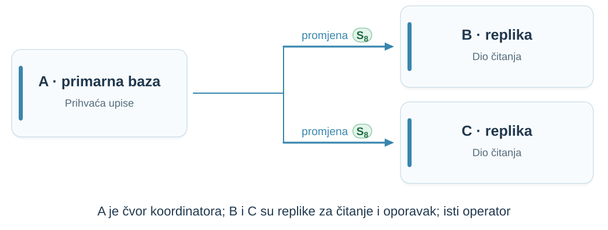{width=760 fig-alt="A · primarna baza: Prihvaća upise; B · replika: Dio čitanja; C · replika: Dio čitanja. Više kopija za čitanje i oporavak; isti operator"}

::: {.notes}
Vrijeme: 36–39 min (3 min).

Pitajte što dobivamo za čitanje, što za oporavak, a što za povjerenje u operatora. Jesu li dvije dodatne kopije dovoljne da upisi nastave nakon pada A?

Dosad sve isplate i sva čitanja prolaze kroz jednu bazu. Kako broj korisnika raste, prikazi salda i izvještaji mogu opteretiti primarnu bazu. Ako ona postane nedostupna, nemamo drugo mjesto spremno preuzeti njezin rad. To su razlozi za razmatranje replika: raspodjela upita za čitanje i dodatna ažurna kopija koja može pomoći oporavku.

Replika je kopija podataka koju sustav održava prijenosom promjena. A zasad jedini prihvaća upise, a B i C primjenjuju prihvaćene promjene i mogu posluživati dio čitanja. Ne tvrdimo da time povećavamo broj neovisnih upisa. Ako A padne, dostupna replika može i dalje posluživati dopuštena čitanja, ali nastavak upisa traži izbor nove primarne baze i zaštitu od istodobnog rada stare i nove primarne baze. Automatsko preuzimanje nije posljedica samog postojanja kopija.

U primjeru pretpostavljamo asinkrono slanje promjena nakon potvrde lokalnog upisa na A. Zato replika može kasniti; ako A nepovratno izgubi zapis prije slanja, preuzimanje sa zaostale replike može izgubiti potvrđenu promjenu. Politiku potvrđivanja i oporavka treba posebno odabrati. [PostgreSQL 18: standby poslužitelji](https://www.postgresql.org/docs/18/warm-standby.html).

Sve kopije zasad vodi isti pouzdani operator. Poboljšavamo mogućnosti čitanja i oporavka, a ne raspodjelu upravljačkih ovlasti. Replika također nije zamjena za sigurnosnu kopiju: pogrešan upis ili brisanje može se prenijeti na sve replike. Zajednički kvar napajanja ili vjerodajnica može pogoditi više kopija. Sljedeći slajd zato pokazuje novu cijenu replikacije: različitu svježinu podataka.
:::

## Kopije nisu trenutačno jednake

| Trenutak | Replika A | Replika B | Replika C |
|:---|:---|:---|:---|
| [t~0~]{.expr} | 100 [S~7~]{.ver .v7} | 100 [S~7~]{.ver .v7} | 100 [S~7~]{.ver .v7} |
| [t~1~]{.expr} | 20 [S~8~]{.ver .v8} | 100 [S~7~]{.ver .v7} | 100 [S~7~]{.ver .v7} |
| [t~2~]{.expr} | 20 [S~8~]{.ver .v8} | 20 [S~8~]{.ver .v8} | 100 [S~7~]{.ver .v7} |
| [t~3~]{.expr} | 20 [S~8~]{.ver .v8} | 20 [S~8~]{.ver .v8} | 20 [S~8~]{.ver .v8} |

::: {.notes}
Vrijeme: 39–41 min (2 min).

Za svaki redak pitajte koliko korisnik vidi na C i koliko je prihvaćeno preostalo u fondu.

Tablica prikazuje saldo fonda F i oznaku stanja na svakoj replici. U t~1~ A prihvaća tx~1~: fond ima 20, a X dobiva 80. B i C još prikazuju starih 100. U t~2~ promjena stiže do B, a u t~3~ do C. Odredišni račun X ažurira se kao dio iste promjene iako zbog preglednosti nije prikazan u tablici.

To je kašnjenje širenja jedne odluke, a ne sukob dvaju donositelja odluke. Kada se sve prihvaćene promjene dostave, kopije se u ovom izvođenju izjednače. Četiri retka nisu dokaz da će svaka buduća mrežna situacija završiti tako: potrebne su pretpostavke o dostavi i oporavku. Replika koja prikazuje 100 nema time pravo neovisno odobriti novu isplatu iz tih sredstava.
:::

## Korisnik ne vidi vlastitu isplatu {.illustrated-slide}

Korisnik organizacije B upravo je dobio potvrdu: isplata 80 ([tx~1~]{.tx}) prihvaćena je na A. Osvježi prikaz, aplikacija čita s replike C, a on i dalje vidi saldo 100.

**Iz njegove perspektive: je li isplata poništena ili je prikaz zastario?**

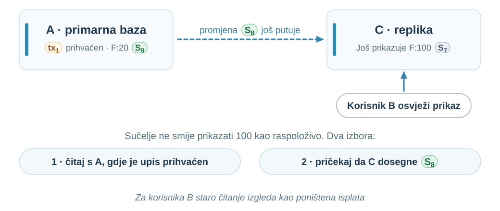{width=1040 fig-alt="A · primarna baza: tx1 prihvaćen, F:20, v8; promjena v8 još putuje prema C; C · replika: još prikazuje F:100, v7; korisnik B osvježi prikaz i čita iz C. Sučelje ne smije prikazati 100 kao raspoloživo; dva izbora: čitaj s A ili pričekaj da C dosegne v8. Za korisnika B staro čitanje izgleda kao poništena isplata"}

::: {.notes}
Vrijeme: 41–43 min (2 min).

Tražite jedno čitanje gdje je kašnjenje prihvatljivo i jedno gdje bi bilo opasno.

Korisnik nakon uspjeha očekuje da sljedeći prikaz sadržava njegovu promjenu. Čitanje sa zaostale replike C može prikazati 100 umjesto 20. Jedno rješenje je čitati od autoriteta za upis, drugo tražiti da replika dosegne barem stanje S~8~. Oba pristupa imaju trošak: čekanje, usmjeravanje ili privremenu nedostupnost čitanja.

Informativni izvještaj može dopustiti označeno kašnjenje. Konačna odluka o novoj isplati ne smije se osloniti samo na zastarjeli prikaz salda. Zato razdvajamo prikaz podataka i ovlast odlučivanja. Sučelje treba prikazati prihvaćenu isplatu i svježinu podataka bez stvaranja dojma da je stari saldo ponovno raspoloživ.
:::

## Zahtjev je izvršen, potvrda nije stigla {.illustrated-slide}

Poruke ne kasne samo između kopija; mogu se i izgubiti.

**Istek vremena čekanja ne govori je li isplata izvršena.**

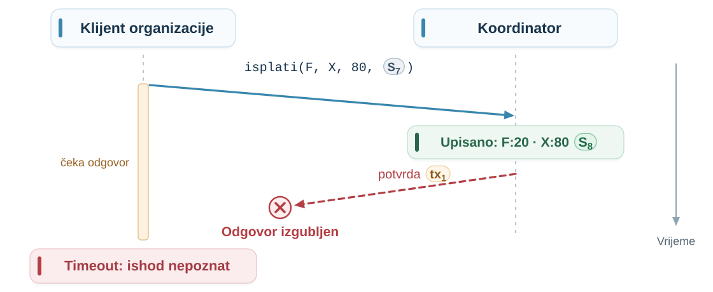{width=1040 fig-alt="Klijent šalje isplati(F, X, 80, v7); koordinator upisuje F:20 · X:80 · S8; potvrda tx1 se izgubi, a klijentu istekne vrijeme čekanja: ishod nepoznat."}

::: {.notes}
Vrijeme: 43–46 min (3 min).

Usporedite dva izvođenja s istim zaslonom klijenta. Pitajte koja činjenica nedostaje.

U ovom izvođenju zahtjev stigne do koordinatora. Koordinator provede tx~1~: F ima 20, X ima 80, stanje je S~8~ i šalje uspješan odgovor. Odgovor se izgubi ili toliko kasni da klijent prestane čekati. Klijent ne smije zaključiti da upisa nije bilo. Iz njegove perspektive isti timeout moguć je i kada zahtjev uopće nije stigao.

Ta neizvjesnost nastaje na granici sustava. Waldo et al. u odjeljku 4.3 opisuju djelomične ispade kao problem koji udaljeni poziv razlikuje od običnog lokalnog poziva: dio sustava može nastaviti raditi dok drugi dio ne odgovara. Za našu aplikaciju posljedica je konkretna: sučelje treba stanje „ishod nepoznat”, a ne izmišljenu konačnu poruku. [A Note on Distributed Computing](https://waldo.scholars.harvard.edu/sites/g/files/omnuum6261/files/waldo/files/waldo-94.pdf), odjeljak 4.3.
:::

## Ponovljeni pokušaj treba isti identitet {.illustrated-slide}

Klijent ne zna je li isplata prošla pa ponavlja zahtjev. Bez zaštite bi ista isplata prošla dvaput.

`zahtjev_id = K42` ostaje isti pri ponavljanju.

Koordinator pamti ishod za K42 i vraća ga ponovno: zahtjev je **idempotentan** (*idempotent*), ponavljanje ne mijenja ishod.

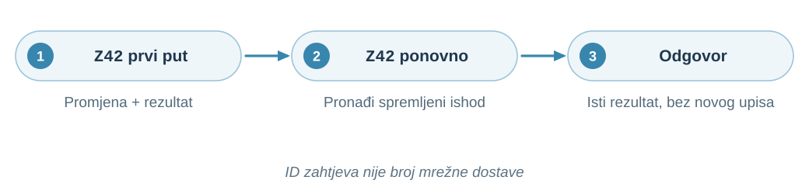{width=1040 fig-alt="K42 prvi put: Promjena + rezultat; K42 ponovno: Pronađi spremljeni ishod; Odgovor: Isti rezultat, bez novog upisa. ID zahtjeva nije broj mrežne dostave"}

::: {.notes}
Vrijeme: 46–49 min (3 min).

Pitajte što ako klijent za ponovni pokušaj stvori novi ID. Razlikujte ponovni pokušaj od nove korisničke namjere.

Zahtjevu dodajemo identifikator K42. Koordinator uz prihvaćenu isplatu bilježi rezultat vezan uz klijenta i taj identifikator. Ako isti klijent ponovi isti zahtjev, može dobiti raniji rezultat umjesto još jedne promjene. ID pritom ne smije biti ponovno iskorišten za drukčiji sadržaj: takav slučaj treba odbiti ili posebno obraditi.

Pohrana rezultata i promjena stanja moraju biti povezane tako da pad između njih ne stvori novu dvosmislenost. U nastavnom modelu pretpostavljamo atomarnu pohranu obaju zapisa i čuvanje ID-a tijekom promatranog razdoblja. Time ne tvrdimo da je mreža dostavila poruku točno jednom. Ograničili smo učinak ponavljanja na strani usluge. [AWS Builders’ Library](https://aws.amazon.com/builders-library/making-retries-safe-with-idempotent-APIs/) opisuje taj obrazac.
:::

## Što znači djelomičan ispad? {.illustrated-slide}

Djelomičan ispad (*partial failure*): dio čvorova ili veza ne radi, a ostatak radi dalje. Izgubljena potvrda bila je jedan takav slučaj. Ovdje rade svi čvorovi, ali je prekinuta veza A–B.

**Nijedan čvor ne vidi stanje cijelog sustava; svaki zna samo ono što mu je stiglo porukama.**

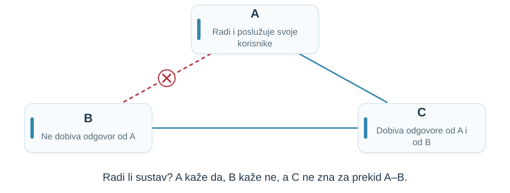{width=1040 fig-alt="A: Radi i poslužuje svoje korisnike; B: Ne dobiva odgovor od A; C: Dobiva odgovore od A i od B. Veza A–B je prekinuta, veze A–C i B–C rade. Radi li sustav? A kaže da, B kaže ne, a C ne zna za prekid A–B."}

::: {.notes}
Vrijeme: 49–51 min (2 min).

Pročitajte status iz perspektive A, zatim B, zatim C. A misli da sustav radi, B misli da je A pao, C dobiva odgovore od oba, ali ne zna da je veza A–B prekinuta, osim ako mu to netko javi. B ne može razlikovati pad čvora A od prekida veze; to razrađujemo na slajdu „Spor čvor i zaustavljen čvor mogu izgledati isto”. U literaturi: nema globalnog stanja, svaki čvor ima samo lokalni pogled. I nadzorni sustav je samo još jedan čvor koji stanje saznaje porukama, sa zakašnjenjem.

Čvor A normalno poslužuje svoje korisnike, dok čvor B do njega ne može doći. Čvor C komunicira s oboma. „Sustav radi” zato nije dovoljno precizan opis: treba navesti tko koju operaciju može izvršiti. Za razliku od jedne funkcije u našem procesu, udaljena usluga može nastaviti mijenjati stanje i nakon što smo prestali čekati odgovor.

Izvor s Harvarda koristimo za temeljnu razliku, ali ne prenosimo njegove povijesne tvrdnje o tadašnjim proizvodima kao današnja ograničenja. Naš konkretni primjer pokazuje zašto i API i korisničko sučelje trebaju izraziti nepoznat ishod. Poboljšanje samo jedne komponente ne uklanja svaku neizvjesnost na komunikacijskoj granici.
:::

## Uz koji model tvrdimo da pravilo vrijedi?

Jamstvo koje želimo: **saldo fonda nikad ne postaje negativan ni kad poruke kasne ili čvor stane.** Prvo navodimo uvjete pod kojima to tvrdimo.

| Pretpostavka | Za naš sljedeći primjer |
|:---|:---|
| Članovi | A, B i C, unaprijed poznati |
| Poruke | mogu kasniti, biti ponovljene ili izgubljene |
| Vrijeme | nemamo poznat konačan rok dostave |
| Čvorovi | zasad mogu stati; ne izmišljaju poruke |
| Pohrana | trajnost lokalnog prihvaćenog zapisa pretpostavljena |

::: {.notes}
Vrijeme: 51–54 min (3 min).

Neka studenti dodaju jedan rizik koji model zasad ne pokriva. Očekivano: zlonamjeran administrator ili gubitak trajne pohrane.

Model sustava navodi što dopuštamo okolini i kvarovima. Bez njega je tvrdnja „radi i kad nešto padne” neprovjerljiva. Za sada imamo tri poznata sudionika, ne proizvoljan broj anonimnih identiteta. Za promatrano izvršavanje nemamo poznatu gornju granicu dostave, a pošteni čvorovi slijede pravila dok rade. Zaustavljen čvor ne odgovara; ne šalje namjerno lažan podatak.

To ne znači da stvarne mreže uvijek kasne neograničeno. Znači da naš zaključak ne smije ovisiti o proizvoljno odabranom roku kao dokazu pada. Ako kasnije dodamo pretpostavku o oporavku ili o poznatoj granici, moramo je izričito navesti. Otpornost na ispad pohrane također nije dana besplatno; u ovom primjeru je posebno pretpostavljena.
:::

## Spor čvor i zaustavljen čvor mogu izgledati isto {.illustrated-slide}

Model ne daje rok dostave. Zato tri sekunde bez odgovora daju **sumnju**, ne dokaz pada.

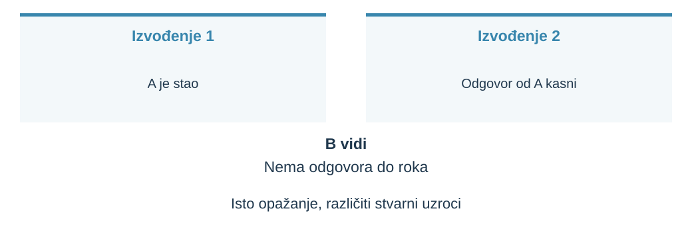{width=1040 fig-alt="Izvođenje 1: A je stao; Izvođenje 2: Odgovor od A kasni; B vidi: Nema odgovora do roka. Isto opažanje, različiti stvarni uzroci"}

::: {.notes}
Vrijeme: 54–57 min (3 min).

Tražite isti opaženi trag za spori i ugašeni čvor. Ne tvrditi da se kvar nikada ne može otkriti uz dodatne pretpostavke.

Pretpostavimo da B nije dobio odgovor od A tri sekunde. Jedno moguće izvođenje jest da je A ugašen. Drugo je da A radi, ali odgovor čeka u mreži. Treće je da je A završio posao i stao prije slanja odgovora. Iz samog izostanka poruke B ne zna koje se izvođenje dogodilo.

Timeout i dalje ima praktičnu vrijednost: omogućuje prestanak čekanja i pokretanje oporavka. No odluka da drugi čvor preuzme upise mora uzeti u obzir mogućnost da prvi i dalje radi. Kad bismo obojici dali neograničeno pravo konačnog potvrđivanja, mogli bismo dobiti dvije povijesti. Ovdje prepoznajemo problem; ne uvodimo još protokol izbora vođe.
:::

## Mreža se razdvojila {.illustrated-slide}

A i B mogu komunicirati, a C je odvojen: to je **mrežna particija** (*network partition*).

Obje strane imaju isti zadnji saldo fonda: F:100 [S~7~]{.ver .v7}. S obje strane i dalje stižu zahtjevi lokalnih korisnika.

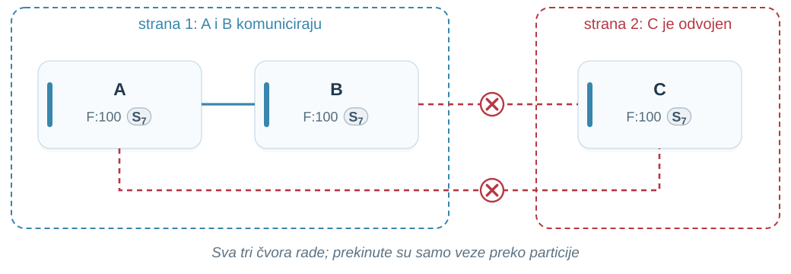{width=1040 fig-alt="Strana 1: čvorovi A i B, oba F:100 v7, povezani punom vezom. Strana 2: čvor C, F:100 v7. Veze B–C i A–C prekinute su na granici particije. Sva tri čvora rade; prekinute su samo veze preko particije"}

::: {.notes}
Vrijeme: 57–60 min (3 min).

Na ploči precrtajte veze prema C, ali ostavite korisnika kod C. Pitajte može li C još prikazivati lokalne podatke.

Mrežna particija u primjeru znači da poruke između skupine A i B te C ne prolaze. To ne zahtijeva gašenje svih računala. Obje strane mogu primati lokalne zahtjeve i imati podatke koji su bili jednaki neposredno prije razdvajanja. Ako nastave odlučivati svaka za sebe, više nema zajedničkog mjesta koje odmah vidi oba zahtjeva.

Važno je nacrtati konkretne nedostupne veze. Rečenica „internet je pao” skriva tko još s kim razgovara. Naš crtež koristi dva dijela radi jednostavnosti; stvarni rasporedi mogu biti složeniji. Za daljnji zadatak obje strane polaze iz F:100, S~7~ i dobivaju zahtjeve za isplate 80 i 60.
:::

## Dvije strane ne smiju obećati suprotno {.illustrated-slide}

C ne čuje A, zaključi da je A pao i sam počne prihvaćati upise.

**A i B potvrđuju isplatu 80, a C isplatu 60.**

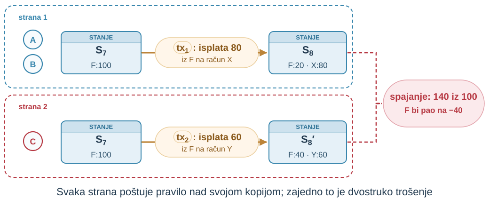{width=1040 fig-alt="Strana 1, čvorovi A i B: iz S7 (F:100) transakcija tx1, isplata 80 iz F na račun X, vodi u S8 (F:20, X:80). Strana 2, čvor C: iz S7 (F:100) transakcija tx2, isplata 60 iz F na račun Y, vodi u S8′ (F:40, Y:60). Spajanje: 140 iz 100, F bi pao na −40. Svaka strana poštuje pravilo nad svojom kopijom; zajedno to je dvostruko trošenje"}

::: {.notes}
Vrijeme: 60–63 min (3 min).

Rasprava: što smije pisati na gumbu i u potvrdi dok je zahtjev samo prijedlog?

Prije razdvajanja obje strane imaju F:100, X:0, Y:0 u S~7~. A i B konačno potvrde tx~1~ pa vide F:20, X:80, Y:0. C konačno potvrdi tx~2~ pa vidi F:40, X:0, Y:60. Kada se veza vrati, ne možemo obje isplate uključiti u valjanu povijest iz početnih 100 bez novih sredstava. Njihovim zbrajanjem F bi pao na −40; odbacivanjem jedne morali bismo povući već izdanu konačnu potvrdu.

Odvojena strana može primati zahtjeve kao nepotvrđene prijedloge ili privremeno zaustaviti isplate. Drukčiji dizajn može unaprijed podijeliti prava potrošnje između strana, ali tada svaka više ne raspolaže cijelih 100. To nije pretpostavka našeg primjera. Pokazujemo zašto neovisne odluke nad istim raspoloživim sredstvima krše odabrano pravilo.
:::

## Tri različita pitanja o arhitekturi {.illustrated-slide}

Dosad je sve vodio jedan operator, a organizacije ne žele da itko sam odlučuje o fondu. Prije nego ga uklonimo, imenujmo što točno uklanjamo.

**Gdje se izvršava? Tko kontrolira? Tko kome pruža uslugu?**

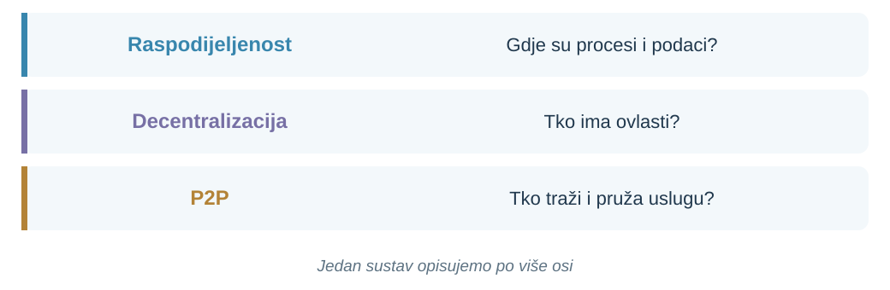{width=1040 fig-alt="Raspodijeljenost: Gdje su procesi i podaci?; Decentralizacija: Tko ima ovlasti?; P2P: Tko traži i pruža uslugu?. Jedan sustav opisujemo po više osi"}

::: {.notes}
Vrijeme: 63–66 min (3 min).

Neka studenti za svaku riječ postave pitanje, umjesto da pokušaju složiti ljestvicu „više je bolje”.

Raspodijeljenost opisuje razmještaj procesa, stanja i komunikacije. Decentralizaciju ovdje promatramo kao raspodjelu relevantnih ovlasti između neovisnih sudionika. P2P opisuje uloge u razmjeni usluga: sudionici nisu samo potrošači nego i pružatelji resursa. To su radne razlike za analizu, ne tvrdnja da postoji jedna univerzalna brojčana mjera decentralizacije.

RFC 5694 upozorava da P2P i centralizirani elementi mogu postojati u istom sustavu. Zato iz mreže vršnjaka ne zaključujemo automatski da nitko nema središnju kontrolu. Može postojati središnji upis članova ili jedini ključ za nadogradnju. Za svaki sustav pitamo koja funkcija ima koju strukturu. [RFC 5694](https://www.rfc-editor.org/rfc/rfc5694), odjeljci 2–4.
:::

## Sto poslužitelja, jedan administrator {.illustrated-slide}

Više računala može ostati pod kontrolom jedne organizacije.

**Broj čvorova nije broj neovisnih donositelja odluka.**

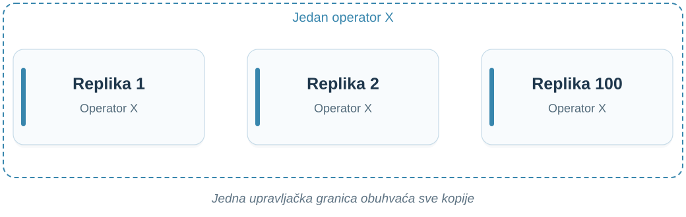{width=1040 fig-alt="Replika 1: Operator X; Replika 2: Operator X; Replika 100: Operator X. Jedna upravljačka granica obuhvaća sve kopije"}

::: {.notes}
Vrijeme: 66–69 min (3 min).

Prekrijte sve čvorove jednom granicom „jedan administrator”. Pitajte što ostaje neriješeno.

Ako jedna organizacija upravlja sa sto replika, raspodijelila je izvršavanje i možda povećala otpornost na pojedine kvarove. Time nije nužno raspodijelila ovlast promjene pravila. Jedan administratorski račun, zajednička nadogradnja ili odluka operatora može utjecati na sve kopije.

Za zajednički budžet zajednički operator može biti razumno ugovorno rješenje. Ako je problem samo dostupnost, dodatne replike mogu pomoći. Ako je problem da operator smije neprimjetno prepisati povijest, sto njegovih replika ne uklanja taj izvor povjerenja. Pitanje neovisnosti odnosi se na kontrolu relevantnu za prijetnju koju analiziramo, a ne samo na broj kutija na dijagramu.
:::

## P2P opisuje razmjenu, ne jamči dogovor {.illustrated-slide}

**P2P** (*peer-to-peer*, ravnopravni čvorovi): čvor može i tražiti i pružati podatke.

To još ne određuje koji zapis svi trebaju prihvatiti.

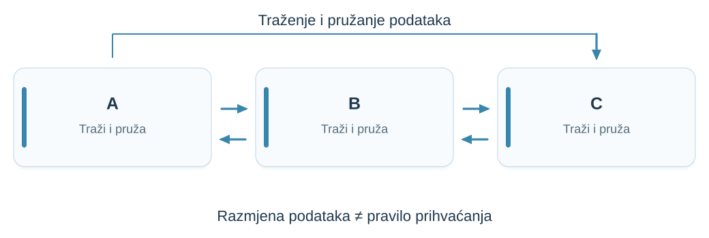{width=1040 fig-alt="A: Traži i pruža; B: Traži i pruža; C: Traži i pruža. Razmjena podataka ≠ pravilo prihvaćanja"}

::: {.notes}
Vrijeme: 69–71 min (2 min).

Nacrtajte strelice u oba smjera i zatražite da student navede informaciju koja još nedostaje.

U P2P dijelu aplikacije A može tražiti zapis od B, a zatim drugom sudioniku pružiti podatak koji ima. To razlikujemo od stroge podjele na klijente koji samo traže i poslužitelje koji samo pružaju uslugu. Ne zahtijevamo da svaki čvor bude povezan sa svakim drugim niti da svi imaju jednake resurse.

Ni P2P razmjena ni topologija trokuta ne definiraju pravilo prihvaćanja. A i B mogu vrlo učinkovito razmijeniti dvije suprotne tvrdnje. Treba dodatno odrediti članstvo, ovlasti, provjeru i dogovor. Primjer je nastavna primjena razlike iz RFC-a, a ne tvrdnja o određenom današnjem proizvodu.
:::

## Raspodijeljen, decentraliziran ili P2P? {.illustrated-slide}

- **Sustav 1:** jedna tvrtka upravlja s 20 kopija baze.
- **Sustav 2:** tri organizacije odobravaju isplate, a poslužitelj, bazu i kod drži jedna tvrtka.
- **Sustav 3:** uređaji razmjenjuju datoteke, jedan administrator određuje članstvo.

Odgovorite DA, NE ili „ne znamo” i obrazložite.

| | Raspodijeljen?<br>gdje se izvršava | Decentraliziran?<br>tko kontrolira | P2P?<br>tko kome pruža uslugu |
|:---|:---:|:---:|:---:|
| **Sustav 1** | [DA]{.fragment fragment-index=1} | [NE]{.fragment fragment-index=1} | [NE]{.fragment fragment-index=1} |
| **Sustav 2** | [?]{.fragment fragment-index=2} | [djelomično]{.fragment fragment-index=2} | [NE]{.fragment fragment-index=2} |
| **Sustav 3** | [DA]{.fragment fragment-index=3} | [NE]{.fragment fragment-index=3} | [DA]{.fragment fragment-index=3} |
: {tbl-colwidths="[16,28,28,28]"}

::: {.notes}
Vrijeme: 71–74 min (3 min).

Stupci su tri pitanja sa slajda „Tri različita pitanja o arhitekturi”. Odgovori se otkrivaju na klik, redak po redak. Sustav 2: ne znamo radi li ta tvrtka na jednom ili više računala; odobravanje je raspodijeljeno, ali izvršavanje i dostupnost ovise o operatoru, pa je decentralizacija djelomična. Slajd preoblikovan u tablicu 2026-10-19 (nastavnik: nije bilo jasno gdje razvrstati); dijagram figure-25 ostaje u skripti. Dvije minute u parovima, zatim po jedan zaključak za svaki sustav. Priznati „nedovoljno informacija” uz dobro dodatno pitanje.

Zadatak traži obrazloženje, ne samo naljepnicu. Prvi sustav ima raspodijeljenu pohranu, ali opisana kontrola ostaje kod tvrtke. Drugi raspodjeljuje odobravanje između organizacija, a tehničko izvršavanje i dostupnost još ovise o operatoru. Treći ima P2P razmjenu datoteka i središnju ovlast za članstvo.

Za neke osi tekst nema dovoljno podataka. Primjerice, iz činjenice da tri organizacije odobravaju promjene ne znamo jesu li te ovlasti tehnički provedive ili samo ugovorne. Dobar odgovor navodi što znamo, što ne znamo i koje bismo dodatno pitanje postavili. Time vježbamo disciplinu važniju od prepoznavanja buzzworda.
:::

## Nova pretpostavka: nema zajedničkog operatora {.illustrated-slide}

::: {.definition number="1.2"}
**Decentralizirani sustav (*decentralized system*)** je raspodijeljeni sustav u kojem su ovlasti nad zajedničkim stanjem (upis, potvrda, pravila, članstvo) podijeljene između neovisnih sudionika, tako da nijedan sam ne može nametnuti promjenu.
:::

**Svaki decentralizirani sustav je raspodijeljen; obrnuto ne vrijedi.**

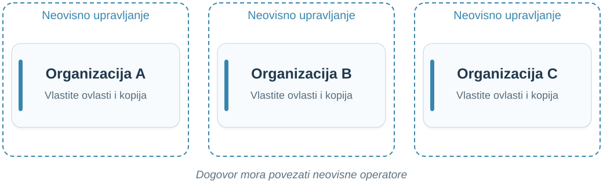{width=640 fig-alt="Organizacija A: Vlastite ovlasti i kopija; Organizacija B: Vlastite ovlasti i kopija; Organizacija C: Vlastite ovlasti i kopija. Dogovor mora povezati neovisne operatore"}

::: {.notes}
Vrijeme: 74–77 min (3 min).

Definicija 1.2 je radna definicija kolegija, preko ovlasti: odgovara Buterinovoj *političkoj* decentralizaciji (koliko neovisnih strana u konačnici kontrolira računala sustava), a raspodijeljenost njegovoj *arhitekturnoj* (V. Buterin, „The Meaning of Decentralization”, 2017, https://medium.com/@VitalikButerin/the-meaning-of-decentralization-a0c92b76a274). Napomena za pitanja: van Steen i Tanenbaum (Distributed Systems, 4. izd., 2023, §1.1) razlikuju drukčije: sustav je decentraliziran kada procesi i resursi *moraju* biti raspoređeni na više računala (npr. zbog administrativnih granica i povjerenja), a raspodijeljen kada je raspodjela *dovoljna* za neki cilj (npr. performanse). Obje definicije slažu se da neovisna kontrola nije isto što i broj računala; mi naglašavamo tko ima ovlast. Primjer iz knjige: korijen DNS-a logički je centraliziran, a fizički raspodijeljen i decentraliziran među više organizacija. Primjer razlike: slajd „Sto poslužitelja, jedan administrator” — raspodijeljen, nije decentraliziran.

Pitajte koja se pretpostavka promijenila u odnosu na slajd sa sto poslužitelja. Nije se samo povećao broj strojeva.

Sada mijenjamo zahtjev, a ne samo tehnički raspored. Organizacije ne žele dati jednoj organizaciji ovlast konačnog odlučivanja. Svaki drži svoju kopiju i provodi dogovorena pravila. Neovisnost upravljanja donosi novu zadaću: treba se usuglasiti ne samo oko sadržaja poruke nego oko toga koja je promjena prihvaćena.

Mreža i dalje može kasniti, a čvorovi i dalje mogu stati. Uz to, različiti operatori mogu imati različite interese. To ne znači da svi moraju biti zlonamjerni. Model mora objasniti što se događa ako se netko ne pridržava protokola. Decentralizacija ovdje premješta dio povjerenja iz jedne organizacije u pravila i pretpostavke zajedničkog postupka.
:::

## Povjerenje rastavljamo na konkretne ovlasti {.illustrated-slide}

Koordinatoru su sve organizacije vjerovale u svemu. Bez njega povjerenje ne nestaje, nego se dijeli po ovlastima.

Tko može **upisati**, **potvrditi**, **promijeniti pravila** ili **primiti i isključiti organizaciju**?

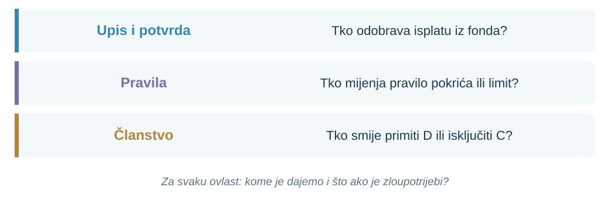{width=1040 fig-alt="Upis i potvrda: Tko odobrava isplatu iz fonda?; Pravila: Tko mijenja pravilo pokrića ili limit?; Članstvo: Tko smije primiti D ili isključiti C?. Za svaku ovlast: kome je dajemo i što ako je zloupotrijebi?"}

::: {.notes}
Vrijeme: 77–80 min (3 min).

Neka studenti za svaku ovlast navedu jedan rizik i osobu/organizaciju kojoj bi je dali.

„Ne vjerujemo A-u” preširoka je izjava. Možemo vjerovati A-u da ispravno identificira svoje zaposlenike, ali mu ne dati pravo da sam briše tuđe zapise. Možemo dopustiti operatoru slanje poruka, ali od njega ne preuzimati konačnu odluku bez provjere. Treba opisati ovlasti i posljedice njihove zlouporabe.

Pravila su ovdje dio programa koji provjerava svaki zahtjev, npr. da isplata ima pokriće i ne prelazi limit; tko smije promijeniti taj kod, može promijeniti i pravilo. Članstvo je popis organizacija koje smiju podnositi i potvrđivati zahtjeve (A, B, C), a ne broj poslužitelja: prijem nove organizacije D ili isključenje C mijenja tko odlučuje.

Za budžet sastavljamo malu matricu: tko podnosi zahtjev, tko provjerava lokalne uvjete i tko potvrđuje prihvaćanje. Zasebno razmatramo promjenu popisa članova i nadogradnju koda. Ako ta dva koraka ostanu pod jednim ključem, ondje je važna središnja ovlast bez obzira na način razmjene podataka.
:::

## Isti pošiljatelj govori dvije stvari {.illustrated-slide}

Koordinatora više nema: svaka organizacija sama odobrava ili odbija prijedloge. Što ako A tu ovlast zloupotrijebi?

B predlaže [tx~1~]{.tx}, C predlaže [tx~2~]{.tx}. A javlja B-u „odobravam [tx~1~]{.tx}”, a C-u „odobravam [tx~2~]{.tx}”.

Pretpostavimo da nitko ne može krivotvoriti poruku u ime A. Ipak, oba odobrenja troše isti saldo (F:100 [S~7~]{.ver .v7}).

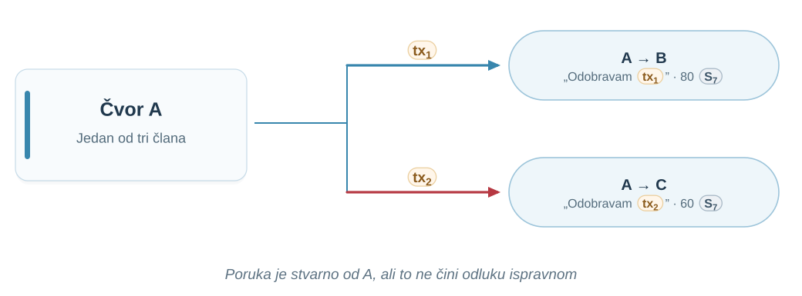{width=1040 fig-alt="Čvor A, jedan od tri člana; A → B: „Odobravam tx1” · 80 · S7; A → C: „Odobravam tx2” · 60 · S7. Poruka je stvarno od A, ali to ne čini odluku ispravnom"}

::: {.notes}
Vrijeme: 80–83 min (3 min).

Na ploči razdvojite pogled B-a i C-a. Što svaki od njih može zaključiti bez dodatne poruke?

A nije koordinator, nego jedan od tri ravnopravna člana. Odstupa od pravila i odobrava oba nespojiva prijedloga. B dobiva A-ovo odobrenje za tx~1~: 80 za X, a C za tx~2~: 60 za Y. Zasad pretpostavljamo da se poruka u tuđe ime ne može krivotvoriti, pa oba znaju da poruka stvarno dolazi od A; kako se to postiže, razrađujemo na slajdu „Identitet ne zamjenjuje pravilo prihvaćanja”. Ipak, obje isplate ne stanu u početni budžet od 100. Čak i kada A navede pojedinačno ispravan novi saldo za svaki zahtjev, ukupna obećanja nemaju pokriće.

Potrebna je dodatna razmjena informacija i pravilo zajedničkog prihvaćanja. Informacija „A je poslao” nije dovoljna. Kod zaostale replike postoji jedna prihvaćena odluka i različita svježina znanja. Ovdje postoje nespojive tvrdnje o tome što je konačno prihvaćeno.
:::

## Pad i proizvoljno ponašanje nisu isti kvar {.illustrated-slide}

Ono što je A upravo napravio zove se **bizantsko ponašanje** (*Byzantine behaviour*).

Čvor koji stane ne šalje nove odgovore.

Čvor s bizantskim ponašanjem može različitim primateljima slati proturječne poruke.

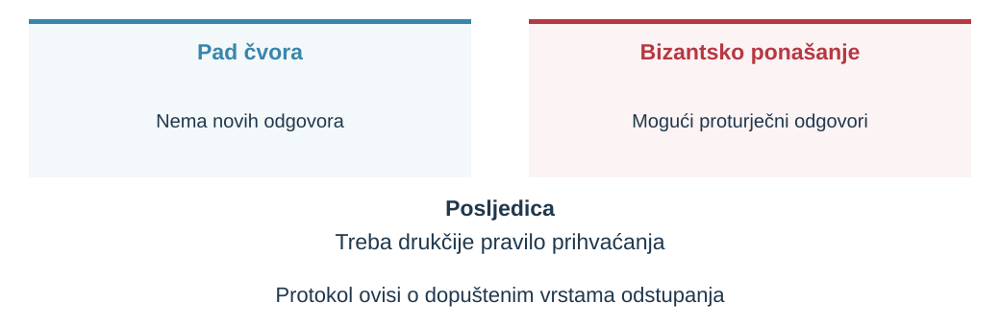{width=1040 fig-alt="Pad čvora: Nema novih odgovora; Bizantsko ponašanje: Mogući proturječni odgovori; Posljedica: Treba drukčije pravilo prihvaćanja. Protokol ovisi o dopuštenim vrstama odstupanja"}

::: {.notes}
Vrijeme: 83–86 min (3 min).

Pitajte mora li bizantski kvar biti namjerna prijevara. Ne mora.

U modelu pada čvor prestane izvršavati korake; ostatak sustava mora raditi s manjkom odgovora. Bizantski model dopušta proizvoljno odstupanje od protokola, uključujući selektivno slanje, lažne vrijednosti i međusobno proturječne tvrdnje. Uzrok može biti napad, programska pogreška ili kvar; za ponašanje protokola važna je dopuštena radnja, ne moralna ocjena operatora.

Lamport, Shostak i Pease uvode problem pouzdanog dogovora kad neispravne komponente različitim dijelovima sustava daju proturječne informacije. Ovdje uzimamo tu razliku, a njihove uvjete i algoritme ostavljamo za sljedeće predavanje. Ne zaključujemo prag otpornosti bez specifikacije komunikacije, identiteta i protokola. [The Byzantine Generals Problem](https://lamport.azurewebsites.net/pubs/byz.pdf), uvod.
:::

## Kašnjenje ili proturječje? {.illustrated-slide}

**Slučaj 1:** C još vidi [S~7~]{.ver .v7}, A i B vide [S~8~]{.ver .v8}.

**Slučaj 2:** A je iz [S~7~]{.ver .v7} B-u odobrio [tx~1~]{.tx} (80), a C-u [tx~2~]{.tx} (60). Zajedno traže 140 od 100: obje ne mogu proći.

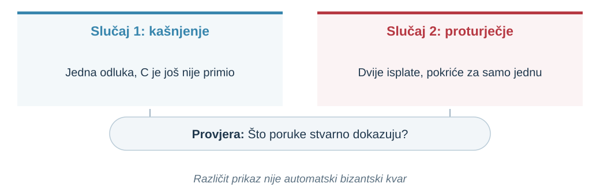{width=1040 fig-alt="Zaostala replika: Jedna odluka, C je još nije primio; Proturječne potvrde: Dvije isplate, pokriće za samo jednu; Provjera: Što poruke stvarno dokazuju?. Različit prikaz nije automatski bizantski kvar"}

::: {.notes}
Vrijeme: 86–89 min (3 min).

Neka studenti klasificiraju oba slučaja i navedu što bi još zatražili za dijagnozu.

U prvom slučaju opažanje je kompatibilno s poštenom, zaostalom replikom. Samo iz starog stanja ne zaključujemo da C laže. U drugom slučaju imamo konkretne proturječne potvrde koje krše pravilo, ako vjerodostojno znamo njihovo podrijetlo i značenje. Ne mora svaka razlika u zaslonima biti dokaz istog problema.

Važno je odrediti koji dokaz imamo. „Moj ekran pokazuje drugo” slabije je od dvije poruke koje potvrđuju dvije nespojive konačne isplate iz istog stanja. Čak ni detekcija proturječja ne određuje automatski koja promjena vrijedi. To treba urediti protokol i način oporavka. Primjer priprema studente da pri analizi ispada ne zamijene opažanje za objašnjenje.
:::

## Identitet ne zamjenjuje pravilo prihvaćanja {.illustrated-slide}

Poruku „odobravam [tx~1~]{.tx}” mogao bi poslati bilo tko i potpisati se kao A: mreža sama ne provjerava pošiljatelja. Zasad pretpostavljamo da se to ne može; omogućuje to **digitalni potpis** (predavanje 03).

Ni to nije dovoljno: znati **tko je poslao** nije isto što i znati **treba li prihvatiti**.

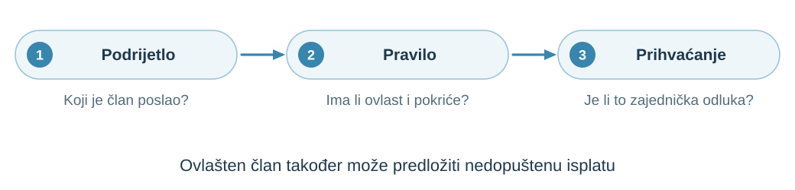{width=1040 fig-alt="Podrijetlo: Koji je član poslao?; Pravilo: Ima li ovlast i pokriće?; Prihvaćanje: Je li to zajednička odluka?. Ovlašten član također može predložiti nedopuštenu isplatu"}

::: {.notes}
Vrijeme: 89–91 min (2 min).

Nemojte uvoditi hash funkcije ni sintaksu potpisa. Potpis samo imenujte kao alat koji rješava krivotvorenje pošiljatelja i najavite predavanje 03. Studenti trebaju prepoznati tri različita pitanja.

Pretpostavimo samo da možemo provjeriti od kojeg je člana stigla poruka; kriptografski mehanizam još ne razrađujemo. Provjeren identitet ne daje sadržaju automatsku valjanost. Poznati član može poslati zahtjev za isplatu iz stanja koje više nije aktualno, tražiti radnju za koju nije ovlašten ili dati suprotne odgovore različitim primateljima.

Provjera zato ima više slojeva: podrijetlo, dopuštenost radnje prema stanju i dogovor da je promjena prihvaćena. Ova razlika štiti od česte prečice da je svaka autentificirana poruka ujedno zajednička odluka. Mehanizme potpisa obradit ćemo kad budu potrebni za provjerljive zapise.
:::

## „Uzmimo dva od tri” još nije protokol {.illustrated-slide}

Ako potvrda jednog člana nije dovoljna, prirodan je pokušaj tražiti većinu: dva od tri.

B vidi potvrde **A+B** za [tx~1~]{.tx}.

C vidi potvrde **A+C** za [tx~2~]{.tx}.

Preklapanje je A, a A šalje proturječne poruke.

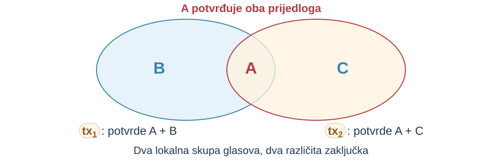{width=1040 fig-alt="B vidi: A + B potvrđuju tx1; Presjek: A potvrđuje oboje; C vidi: A + C potvrđuju tx2. Dva lokalna skupa glasova, dva različita zaključka"}

::: {.notes}
Vrijeme: 91–95 min (4 min).

Nacrtajte skupove {A,B} i {A,C}. Tražite da student pokaže zašto sam presjek nije dovoljan.

Neka B prihvati tx~1~ kad vidi dvije potvrde, svoju i A-ovu. C prema istom pravilu prihvati tx~2~ jer vidi svoju i A-ovu potvrdu. A je potvrdio oba zahtjeva. Obje skupine imaju po dva od tri člana, ali jedini član u njihovu presjeku odstupa od protokola. Zato pravilo „većina glasova” u ovom naivnom primjeru nije osiguralo jedinstven rezultat.

Ovo nije dokaz da svaki dogovor s tri sudionika uvijek mora propasti, niti izvod općeg praga tolerancije. To je protuprimjer točno navedenom postupku. Za jamstvo treba opisati tko i kada smije glasati, koje poruke razmjenjuje, kakve kvarove toleriramo i pod kojim uvjetima čekanje završava. Tu ćemo u predavanju 02 formalizirati problem konsenzusa.
:::

## Tko uopće ima pravo glasa? {.illustrated-slide}

„Dva od tri” pretpostavlja da znamo tko su ta tri. Broj poruka nije broj članova.

**A, B i C unaprijed su poznate organizacije.**

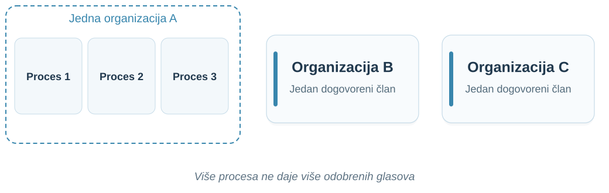{width=1040 fig-alt="Organizacija A: Može pokrenuti 10 procesa; Organizacija B: Jedan dogovoreni član; Organizacija C: Jedan dogovoreni član. Više procesa ne daje više odobrenih glasova"}

::: {.notes}
Vrijeme: 95–97 min (2 min).

Pitajte što je glas u našem modelu: paket, proces, račun ili organizacija? Odgovor ovisi o dogovorenom članstvu.

Naš primjer cijelo vrijeme ima dogovoreno članstvo. Ako primimo deset poruka od A, to nisu glasovi deset organizacija. Jednako tako deset procesa kojima upravlja A ne znači deset neovisnih članova. Pravilo glasovanja mora vezati glas uz određeni identitet i definirati promjene tog skupa.

Otvoreno pristupanje postavlja dodatno pitanje: kako spriječiti da jedna strana stvori proizvoljan broj identiteta i tako promijeni ishod? Danas to samo izdvajamo kao novo ograničenje. Ne miješamo model bizantskog ponašanja poznatih članova s otpornošću na stvaranje identiteta. Precizno članstvo jedna je od stavki s kojom završavamo specifikaciju za sljedeće predavanje.
:::

## Studija slučaja (1/3): pošten koordinator {.illustrated-slide}

Složimo sve dosad u tri izvođenja istog para [tx~1~]{.tx} i [tx~2~]{.tx}. Prvo: B predlaže [tx~1~]{.tx}, C predlaže [tx~2~]{.tx}, a A je jedini koji odlučuje.

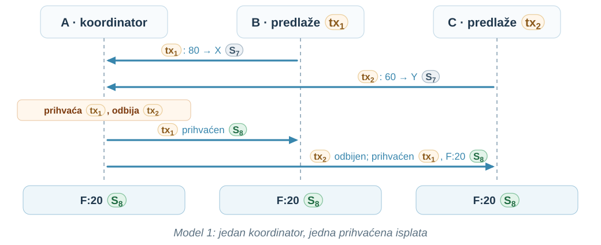{width=1040 fig-alt="B: tx1: 80 → X · S7; C: tx2: 60 → Y · S7; A prihvaća tx1, odbija tx2 (S7 zastario); A → B: tx1 prihvaćen · S8; A → C: tx2 odbijen; prihvaćen tx1, F:20 · S8; svi: F:20 · S8. Izvođenje 1: jedan koordinator, jedna prihvaćena isplata"}

::: {.notes}
Vrijeme: 97–99 min (2 min).

Studija slučaja zamjenjuje radionicu na papiru (nastavnik, 2026-10-19). Prije otkrivanja ishoda pitajte što će svaki sudionik zapisati.

Polazno stanje je F:100, X:0, Y:0 u S~7~. B šalje tx~1~, C šalje tx~2~, a A je jedini ovlašteni donositelj odluke. A prima tx~1~ prvi, prihvaća ga i stvara S~8~; tx~2~ i dalje očekuje S~7~, pa ga odbija (a pokrića ionako ne bi bilo). Obje strane dobiju izričit odgovor i svi završe s istim stanjem. Pravilo je očuvano jer postoji jedno mjesto koje vidi oba zahtjeva i određuje redoslijed. Cijena: svi ovise o A.
:::

## Studija slučaja (2/3): izgubljena potvrda {.illustrated-slide}

Ista odluka, ali potvrda prema B se izgubi.

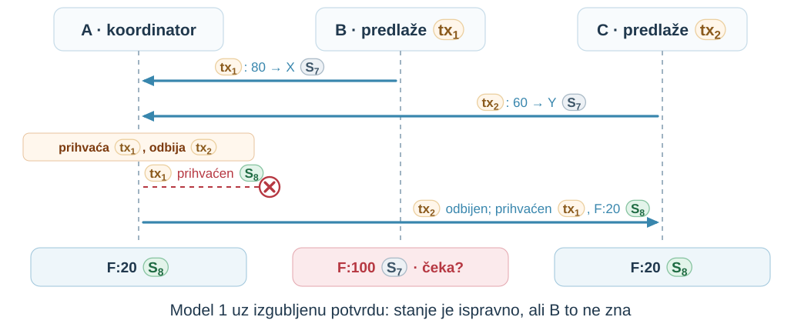{width=1040 fig-alt="Isti tijek kao u izvođenju 1, ali poruka A → B „tx1 prihvaćen · S8” se gubi; A i C: F:20 · S8; B: F:100 · S7, čeka. Izvođenje 2: stanje je ispravno, ali B to ne zna"}

::: {.notes}
Vrijeme: 99–101 min (2 min).

Studija slučaja zamjenjuje radionicu na papiru (nastavnik, 2026-10-19). Prije otkrivanja ishoda pitajte što će svaki sudionik zapisati.

Odluka je ista, ali poruka „tx~1~ prihvaćen” prema B se gubi. Stanje kod A je ispravno: jedna isplata, F:20. B međutim i dalje prikazuje F:100 · S~7~ i ne zna je li tx~1~ prihvaćen, odbijen ili samo spor. Ako B ponovno pošalje tx~1~, A ga mora prepoznati kao isti zahtjev, a ne kao novu isplatu. Ovdje nije prekršeno pravilo fonda, nego je nepotpuno znanje klijenta. To je drukčiji problem od dvostrukog trošenja i traži drukčiji popravak: ponovno slanje, identifikator zahtjeva i upit o stanju.
:::

## Studija slučaja (3/3): pravilo „dva od tri” {.illustrated-slide}

Isto pravilo kao na slajdu „Uzmimo dva od tri”, sada poruku po poruku. Nema koordinatora, a A se ponaša **bizantski**: glasa za oba prijedloga.

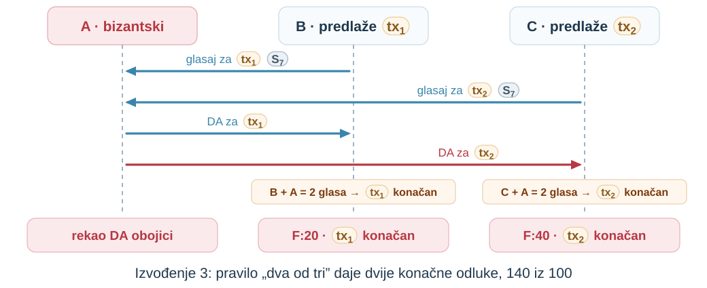{width=1040 fig-alt="A se ponaša bizantski. B i C traže glas od A; A odgovara DA za tx1 B-u i DA za tx2 C-u; B: B + A = 2 glasa, tx1 konačan, F:20; C: C + A = 2 glasa, tx2 konačan, F:40. Izvođenje 3: pravilo „dva od tri” daje dvije konačne odluke, 140 iz 100"}

::: {.notes}
Vrijeme: 101–103 min (2 min).

Studija slučaja zamjenjuje radionicu na papiru (nastavnik, 2026-10-19). Prije otkrivanja ishoda pitajte što će svaki sudionik zapisati.

Sada nema koordinatora. Naivno pravilo kaže: isplata je konačna kad je podrže dva od tri sudionika. B glasa za svoj tx~1~ i pita A; C glasa za svoj tx~2~ i pita A. A odgovara DA obojici. B broji B + A i proglašava tx~1~ konačnim; C broji C + A i proglašava tx~2~ konačnim. Ukupno je isplaćeno 140 iz fonda od 100: dvostruko trošenje. Dva skupa od po dva glasa preklapaju se samo u A, a A je rekao dvije različite stvari. Pravilo „dva od tri” jamči sigurnost samo ako sudionik u presjeku ne smije glasati dvaput; to je tema predavanja 02.
:::

## Analiza: gdje je pravilo o saldu prekršeno? {.illustrated-slide}

Za svaku konačnu potvrdu pokažite:

**početno stanje → primljene poruke → korišteno pravilo**.

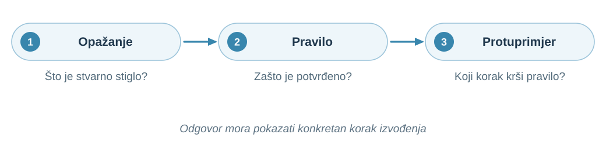{width=1040 fig-alt="Opažanje: Što je stvarno stiglo?; Pravilo: Zašto je potvrđeno?; Protuprimjer: Koji korak krši pravilo?. Odgovor mora pokazati konkretan korak izvođenja"}

::: {.notes}
Vrijeme: 103–107 min (4 min).

Prođite tri izvođenja iz studije slučaja i za svaku konačnu potvrdu pokažite stanje, poruke i pravilo. Pohvaliti konkretan protuprimjer, ne složenost predloženog protokola.

U prvom izvođenju postoji jedan ovlašteni donositelj odluke i jedna prihvaćena isplata. U drugom stanje može biti ispravno, a znanje klijenta nepotpuno. U trećem naivno pravilo dopušta dvije konačne odluke. Te razlike treba imenovati prije prijedloga popravka. „Dodaj još jednu kopiju” ne objašnjava kako će se promijeniti pravilo prihvaćanja.

Za svaki prijedlog popravka tražimo preostalu slabost. Ako svi čekaju sve, što radi zaustavljen član? Ako netko odlučuje sam, kome je povjereno upravljanje? Ako glasujemo, koje članstvo i dopuštene kvarove pretpostavljamo? Odgovori pokazuju zašto je dogovor o redoslijedu poseban problem, a ne dodatna strelica na arhitekturnom crtežu.
:::

## Odaberite arhitekturu prema problemu

| Potreba | Početni smjer |
|:---|:---|
| Svi prihvaćaju jednog operatora | zajednička služba i baza |
| Treba preživjeti pad pojedine kopije | replikacija i plan oporavka |
| Neovisni operatori moraju provjeravati odluke | zajednički protokol i model kvarova |

**Više koordinacije ima cijenu.**

::: {.notes}
Vrijeme: 107–110 min (3 min).

Za naš budžet tražite dva različita, ali obrazložena izbora. Dodatne pretpostavke zapišite uz izbor.

Uspoređujemo potrebe, ne dodjeljujemo moralne ocjene arhitekturama. Zajednička baza ima manje sudionika u odlučivanju i može biti dobar odgovor kad je operator prihvaćen. Replikacija rješava dio problema rada s kopijama i oporavka, ali traži pravilo potvrđivanja i preuzimanja. Neovisno odlučivanje više organizacija uvodi dodatnu razmjenu poruka, složenije kvarove i pitanje zajedničke nadogradnje.

Za budžet pitamo treba li svaka organizacija tehnički provjeravati odluke ili je dovoljan ugovor i revizija rada operatora. Ne postoji obveza koristiti *blockchain* samo zato što je tema kolegija. Danas još nemamo njegov mehanizam; imamo jasniji problem koji bi odabrana tehnologija trebala opravdano riješiti.
:::

## Ponavljanje: što ne štima u ovom prijedlogu protokola?

Naš budžet: fond **F ima 100**. B predlaže **[tx~1~]{.tx}** (80 iz F na račun X), C predlaže **[tx~2~]{.tx}** (60 iz F na račun Y). Zajedno nemaju pokriće.

Netko predlaže:

> „Isplatu spremamo na tri poslužitelja, **pa je sustav decentraliziran**. Čim jedan poslužitelj potvrdi, **isplata je prihvaćena**. Ako potvrda ne stigne na vrijeme, **isplata nije prošla**, pa šaljemo novi zahtjev.”

**Za svaki istaknuti zaključak nađite scenarij u kojem ne vrijedi.**

::: {.notes}
Vrijeme: 110–112 min (2 min).

2 min u parovima. Prijedlog je izmišljen: zvuči uvjerljivo i služi kao ponavljanje prije sažetka. Sva tri zaključka ruše se scenarijima koje smo već vidjeli na budžetu; rješenja su na sljedećem slajdu, pa ga ne otvarajte prije rasprave.

Ako studenti zapnu, pitajte: tko upravlja poslužiteljima? Što ako dva poslužitelja prvi put potvrde različite isplate? Što ako je isplata prošla, a izgubio se samo odgovor?
:::

## Tri zaključka, tri protuprimjera {.illustrated-slide}

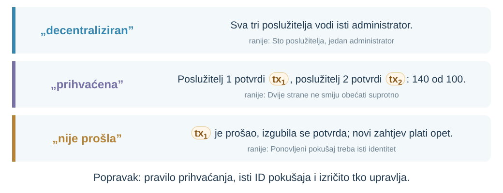{width=1040 fig-alt="„decentraliziran”: Sva tri poslužitelja vodi isti administrator.; „prihvaćena”: Poslužitelj 1 potvrdi tx1, poslužitelj 2 potvrdi tx2: 140 od 100.; „nije prošla”: tx1 je prošao, izgubila se potvrda; novi zahtjev plati opet. Popravak: pravilo prihvaćanja, isti ID pokušaja i izričito tko upravlja."}

::: {.notes}
Vrijeme: 112–114 min (2 min).

Rasprava. Za svaki redak neka par iznese svoj scenarij, pa pokažite redak.

- „decentraliziran”: broj kopija ne govori tko upravlja. Tri poslužitelja pod jednim administratorskim računom i dalje su jedan centar kontrole (slajd „Sto poslužitelja, jedan administrator”).
- „prihvaćena”: tx~1~ i tx~2~ polaze od S~7~ i svaka zasebno ima pokriće. Ako poslužitelj 1 prvi potvrdi tx~1~, a poslužitelj 2 prvi potvrdi tx~2~, A i B misle da su uspjeli, a fond bi trebao isplatiti 140 od 100 (slajdovi „Pravilo koje mora ostati istinito” i „Dvije strane ne smiju obećati suprotno”).
- „nije prošla”: istek roka ne znači neuspjeh. Isplata je možda izvršena, a izgubila se samo potvrda; novi zahtjev s novim ID-om izvršava se kao druga isplata (slajdovi „Zahtjev je izvršen, potvrda nije stigla” i „Ponovljeni pokušaj treba isti identitet”).

Popravak u tri dijela: izričito pravilo kada je isplata prihvaćena (ne „prva potvrda”), isti identitet pri ponovnom pokušaju i odvojena tvrdnja o tome tko upravlja poslužiteljima. Ni to zajedno još nije protokol tolerantan na bizantske kvarove; to je tema predavanja 02.
:::

## Sažetak: tri pojma koja ne smijemo izjednačiti {.illustrated-slide}

Ova tri razlikovanja vrijede za svaki decentralizirani sustav. Na njima grade konsenzus (predavanje 02) i *blockchain* (predavanja 03–04).

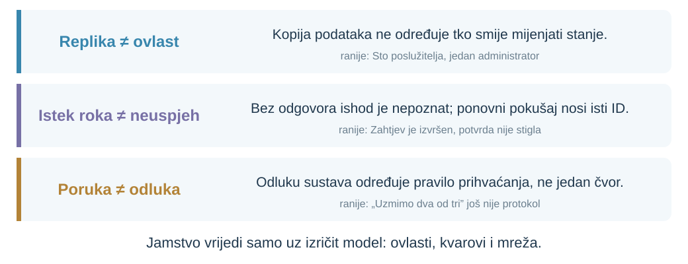{width=1040 fig-alt="Replika ≠ ovlast: Kopija podataka ne određuje tko smije mijenjati stanje.; Istek roka ≠ neuspjeh: Bez odgovora ishod je nepoznat; ponovni pokušaj nosi isti ID.; Poruka ≠ odluka: Odluku sustava određuje pravilo prihvaćanja, ne jedan čvor. Jamstvo vrijedi samo uz izričit model: ovlasti, kvarovi i mreža."}

::: {.notes}
Vrijeme: 114–116 min (2 min).

Brzi izlazni odgovori: jedno pitanje po redu učionice, bez ponovnog čitanja definicija. Svaki redak je jedan par pojmova koje smo na budžetu razlikovali; desno je preciznija tvrdnja, a sitno slajd na kojem smo je pokazali. „Ostaju” znači da se ta razlikovanja ne gube kad uvedemo konsenzus i blockchain: blockchain ne ukida nijedno od njih, nego daje određeno pravilo prihvaćanja uz određene pretpostavke.

Predavanje je krenulo od jednog zapisa i poslovnog pravila. Lokalna atomarna promjena riješila je sukob u jednoj bazi. Replike su otvorile pitanje svježine, a mreža neizvjesnost o ishodu. Neovisni operatori promijenili su granicu povjerenja i dodali mogućnost proturječnih poruka. Svaki korak zahtijevao je novu, izričitu pretpostavku.

Provjerite možete li objasniti razliku između raspodijeljenosti, decentralizacije i P2P-a bez navođenja imena proizvoda. Zatim objasnite zašto su zaostala kopija i dvije suprotne konačne potvrde različiti problemi. Konačno, navedite što u našem primjeru znamo o članovima i vremenu dostave. To je podloga na koju će se nasloniti precizni zahtjevi konsenzusa.
:::

## Otvoreno pitanje za predavanje 02 {.illustrated-slide}

Do slajda „Raspodijeljen, decentraliziran ili P2P?” sve je vodio **jedan operator**. Nakon toga A, B i C vode čvorove **neovisno**, a jedan može slati proturječne poruke. Pokazali smo koja pravila ne rade; pravilo koje radi još nemamo. To je pitanje s početka: banke se oslanjaju na središnju banku, a mi tražimo dogovor bez nje.

**Kako ispravni sudionici prihvaćaju istu promjenu i kada smiju prestati čekati?**

To je problem **konsenzusa** (*consensus*).

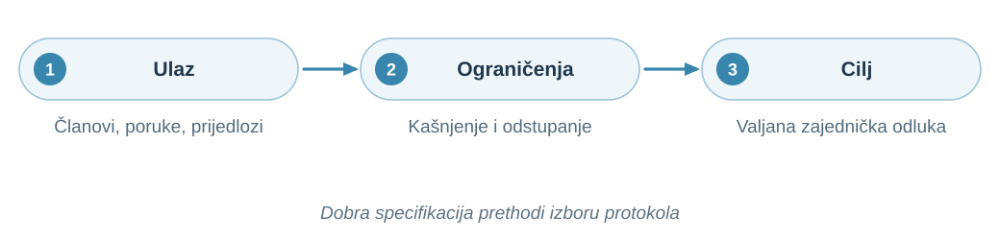{width=1040 fig-alt="Ulaz: Članovi, poruke, prijedlozi; Ograničenja: Kašnjenje i odstupanje; Cilj: Valjana zajednička odluka. Dobra specifikacija prethodi izboru protokola"}

::: {.notes}
Vrijeme: 116–119 min (3 min).

Ostavite minute za završna pitanja. Naglasite da „dogovor bez koordinatora” nije nova tema: postavili smo ga od slajda „Nova pretpostavka: nema zajedničkog operatora”, ali smo ga ostavili otvorenim. Najavite konsenzus i bizantske generale u 02, bez preuzimanja sljedećeg predavanja.

Za sljedeće predavanje predajemo specifikaciju, a ne gotov odgovor: postoje poznati sudionici, dopuštena odstupanja i zahtjev da ispravni sudionici ne donose nespojive konačne odluke. Treba još precizno odrediti koje su odluke valjane i pod kojim uvjetima postupak mora završiti. Ako zaboravimo bilo koji od tih dijelova, lako je predložiti prividno rješenje koje uvijek čeka ili uvijek prihvaća unaprijed zadanu vrijednost.

Za pripremu nacrtajte dva prijedloga: jedan koji čeka sve odgovore i jedan koji odlučuje nakon prvih nekoliko. Za svaki napišite primjer u kojem ima problem. Ne traži se naziv algoritma niti programska implementacija. Traži se veza između uvjeta rada i jamstva koje tvrdite da pružate.
:::

## Literatura za produbljivanje

- [Waldo et al.: A Note on Distributed Computing](https://waldo.scholars.harvard.edu/sites/g/files/omnuum6261/files/waldo/files/waldo-94.pdf), §4.3.
- [RFC 5694: P2P Architecture](https://www.rfc-editor.org/rfc/rfc5694), §2–4.
- [Lamport, Shostak, Pease: The Byzantine Generals Problem](https://lamport.azurewebsites.net/pubs/byz.pdf), uvod.
- [AWS: Making retries safe with idempotent APIs](https://aws.amazon.com/builders-library/making-retries-safe-with-idempotent-APIs/).

::: {.notes}
Vrijeme: 119–120 min (1 min).

Objasnite što čitati iz kojeg izvora. Literatura nije dodatna lista obveznih proizvoda.

Za prvo čitanje odaberite Waldoov odjeljak o djelomičnim ispadima i usporedite ga s primjerom izgubljene potvrde. Iz RFC-a izdvojite jednu funkciju sustava koja može biti središnja čak kad je razmjena P2P. U uvodu rada o bizantskim generalima prepoznajte problem različitih informacija poslanih različitim primateljima. Algoritamski dio tog rada nije preduvjet za današnju vježbu.

AWS-ov tekst povezuje ponavljanje zahtjeva s API dizajnom. Primjeri i dijagrami našeg digitalnog budžeta autorski su nastavni primjeri; ne prikazuju implementaciju AWS-a niti platnog sustava u produkciji. Precizna evidencija izvora, pregledanih dijelova i adaptacije starog BA PDF-a nalazi se u sources.md uz predavanje.
:::
