## Evidencija prisutnosti {#attendance .attendance-slide}

::: {.attendance-content}
[{width=455 height=455 fig-alt="QR kod za evidenciju prisutnosti na kolegiju Blockchain aplikacije."}](https://bit.ly/bc-tu-sam)

[bit.ly/bc-tu-sam](https://bit.ly/bc-tu-sam)
:::

::: {.notes}
Vrijeme: 0.5–1 min (0.5 min).
Ostavite pola minute za evidenciju putem QR koda ili poveznice. Isti QR kod kao u predavanju 00 (https://bit.ly/bc-tu-sam).
:::

## Gdje smo stali {.illustrated-slide}

Pravilo „dva od tri”: B skupi glasove A + B za [tx~1~]{.tx}, C skupi A + C za [tx~2~]{.tx}.

**A glasa za oba prijedloga, pa su obje isplate „konačne”: 140 iz 100.**

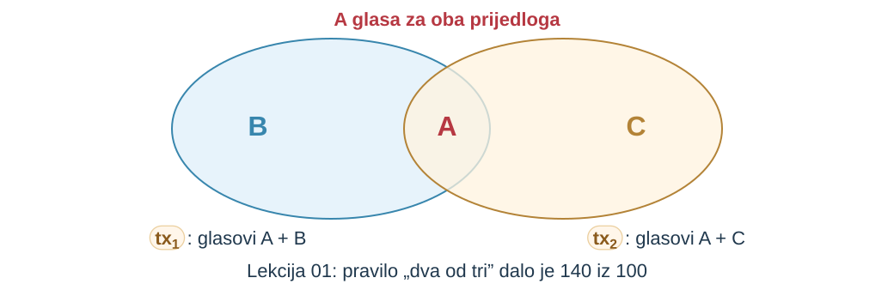{width=900 fig-alt="Dva preklopljena skupa glasova: B i A za tx1, A i C za tx2; u presjeku je A, koji glasa za oba prijedloga. Lekcija 01: pravilo „dva od tri” dalo je 140 iz 100"}

::: {.notes}
Vrijeme: 1–4 min (3 min).

Neka studenti bez gledanja u bilješke ponove tko je za što glasao i gdje je pravilo prekršeno.

U trećem izvođenju studije slučaja iz predavanja 01 nije bilo koordinatora. B je predložio tx~1~ i skupio svoj glas i glas od A. C je predložio tx~2~ i skupio svoj glas i glas od A. Oba skupa imala su po dva glasa, pa su B i C proglasili različite isplate konačnima.

Pravilo nije propalo zato što je glasanje loša ideja, nego zato što jedini zajednički član dvaju skupova nije poštovao protokol. Odatle dva pitanja: koliko članova treba da presjek uvijek sadrži poštenog člana i što kad ni broj članova ne znamo.
:::

## Dva pitanja predavanja {.illustrated-slide}

**Kako postići dogovor ako neki sudionici lažu, a identiteti se mogu stvarati?**

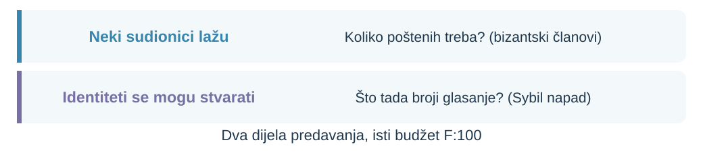{width=1040 fig-alt="Neki sudionici lažu: koliko poštenih treba? (bizantski članovi). Identiteti se mogu stvarati: što tada broji glasanje? (Sybil napad). Dva dijela predavanja, isti budžet F:100"}

::: {.notes}
Vrijeme: 4–6 min (2 min).

Napišite oba pitanja na ploču i ostavite ih vidljivima do kraja predavanja.

U prvom dijelu članovi su poznate organizacije, ali neke mogu odstupati od protokola. Tražimo uvjet pod kojim pošteni ipak dolaze do iste odluke. U drugom dijelu pretpostavka poznatog članstva otpada: jedna strana može predstaviti više identiteta, pa se mijenja i ono što glasanje broji.
:::

## Ishodi i predznanje {.outcomes-slide}

Nakon predavanja moći ćete:

1. **razlikovati** dogovor, valjanost i okončanje; sigurnost (*safety*) i živost (*liveness*) [Analiza]{.bloom .b4}
2. **objasniti** zašto asinkroni deterministički protokol ne jamči okončanje („FLP”) [Razumijevanje]{.bloom .b2}
3. **izračunati** [n ≥ 2f + 1]{.expr} uz padove i [n ≥ 3f + 1]{.expr} uz bizantske članove [Primjena]{.bloom .b3}
4. **objasniti** Sybil napad: identiteti nisu neovisni članovi [Razumijevanje]{.bloom .b2}
5. **obrazložiti** zašto klasični BFT protokoli za konsenzus ne rješavaju otvorenu mrežu [Vrednovanje]{.bloom .b5}

::: {.prereq}
[Predznanje]{.prereq-label} Predavanje 01: model sustava, bizantsko ponašanje i pravilo „dva od tri”.
:::

::: {.notes}
Vrijeme: 6–8 min (2 min).

Najavite 110 minuta s dvije kratke vježbe i završnim ponavljanjem. „FLP” su inicijali autora rezultata (Fischer, Lynch, Paterson, 1985); objašnjavamo ga na slajdu „„FLP”: spor ili zaustavljen, opet”. Ne učimo popis protokola: za predloženo pravilo odlučivanja treba znati reći koje svojstvo jamči, uz koji model i koliko članova smije odstupati.
:::

## Prvo zadatak, onda protokol

::: {.definition number="2.1"}
**Konsenzus (*consensus*)**: svaki od [n]{.expr} članova počinje s ulaznom vrijednošću (prijedlogom) i najviše jednom donosi nepromjenjivu odluku. Protokol rješava konsenzus uz najviše [f]{.expr} neispravnih članova ako u svakom izvođenju za ispravne članove vrijede:

- **dogovor** (*agreement*): nijedna dva ispravna člana ne odluče različito;
- **valjanost** (*validity*): ako svi članovi počnu s istom vrijednošću [v]{.expr}, odluka je [v]{.expr};
- **okončanje** (*termination*): svaki ispravan član na kraju odluči.

Prema Dwork, Lynch i Stockmeyer (1988), §2.4.
:::


::: {.notes}
Vrijeme: 8–11 min (3 min).

Pitajte zašto svojstva ne mogu vrijediti i za neispravne članove.

Dosad smo predlagali pravila i tražili protuprimjere. Da bismo rekli je li protokol ispravan, najprije zapisujemo što od njega tražimo. U našem primjeru vrijednost je isplata koja postaje sljedeća promjena stanja: iz S~7~ u S~8~ prelazi tx~1~ ili tx~2~. Ispravan član (*correct*) slijedi protokol; neispravan može stati ili, u bizantskom modelu, ponašati se proizvoljno. Od člana koji laže ne možemo tražiti ništa, pa se svojstva odnose samo na ispravne.
:::

## Dogovor: nitko ne odluči drukčije {.illustrated-slide}

**Dogovor** (*agreement*): nijedna dva ispravna člana ne odluče različito.

Upravo to je prekršeno u studiji slučaja iz predavanja 01.

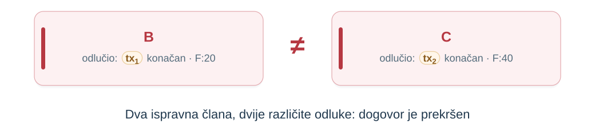{width=1040 fig-alt="B: odlučio tx1 konačan, F:20; C: odlučio tx2 konačan, F:40. Dva ispravna člana, dvije različite odluke: dogovor je prekršen"}

::: {.notes}
Vrijeme: 11–14 min (3 min).

Pitajte krši li dogovor član koji još čeka. Ne krši.

B je tx~1~ smatrao konačnim, C je tx~2~ smatrao konačnim, a oba su bila ispravna. Kad je dogovor jednom prekršen, nikakav kasniji korak to ne popravlja: B i C su već nekome potvrdili isplatu. Dogovor ne traži da svi odluče u istom trenutku; krši ga tek različita odluka.
:::

## Valjanost: dogovor nije dovoljan {.illustrated-slide}

Protokol „uvijek odbij sve” nikad ne daje dvije različite odluke.

**Valjanost** isključuje izmišljenu ili unaprijed fiksiranu odluku. Za budžet tražimo strožu inačicu: odluka je valjan prijedlog nekog člana, [tx~1~]{.tx} ili [tx~2~]{.tx} iz [S~7~]{.ver .v7} s pokrićem.

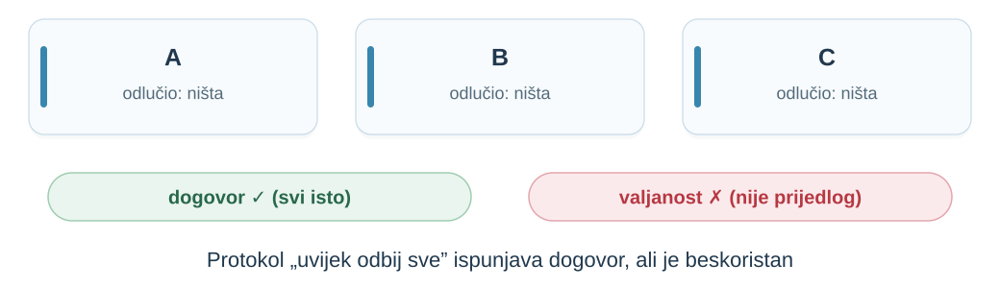{width=1040 fig-alt="A, B i C odlučili su ništa; dogovor vrijedi (svi isto), valjanost ne vrijedi (nije prijedlog). Protokol „uvijek odbij sve” ispunjava dogovor, ali je beskoristan"}

::: {.notes}
Vrijeme: 14–17 min (3 min).

Tražite drugi trivijalan protokol koji ispunjava dogovor, npr. „uvijek odluči tx~1~”, i pitajte što krši.

Definicija 2.1 koristi jaku jednoglasnost iz [DLS 1988, §2.4](https://groups.csail.mit.edu/tds/papers/Lynch/jacm88.pdf): ako svi počnu s istom vrijednošću v, odluka je v. Za budžet je to preslabo, jer B i C predlažu različito; zato tražimo da S~8~ nastane iz tx~1~ ili tx~2~, i to samo ako isplata poštuje pravila iz predavanja 01: ovlast, pozitivan iznos i pokriće u S~7~. Sve inačice isključuju protokol koji odluku izmišlja ili je unaprijed fiksira.
:::

## Okončanje: odluka mora doći {.illustrated-slide}

Protokol „čekaj glasove svih” nikad ne krši dogovor. Ali ako C stane?

**Okončanje** (*termination*): svaki ispravan član na kraju odluči.

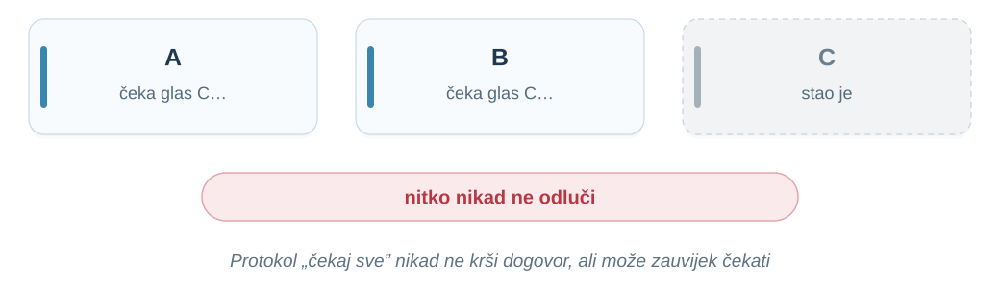{width=1040 fig-alt="A i B čekaju glas od C, a C je stao; nitko nikad ne odluči. Protokol „čekaj sve” nikad ne krši dogovor, ali može zauvijek čekati"}

::: {.notes}
Vrijeme: 17–20 min (3 min).

Povežite s predavanjem 01: to je bio prvi prijedlog popravka „neka svi čekaju sve”.

Ako C stane, A i B čekaju zauvijek: isplata nikad ne prođe, korisnik nikad ne dobije odgovor. „Na kraju” ne znači unutar roka, nego da ne postoji izvođenje u kojem ispravan član čeka beskonačno. Koliko smije čekati u praksi, ovisi o modelu vremena.
:::

## Sigurnost i živost {.illustrated-slide}

**Sigurnost** (*safety*): ništa loše se nikad ne dogodi. **Živost** (*liveness*): nešto dobro se na kraju dogodi.

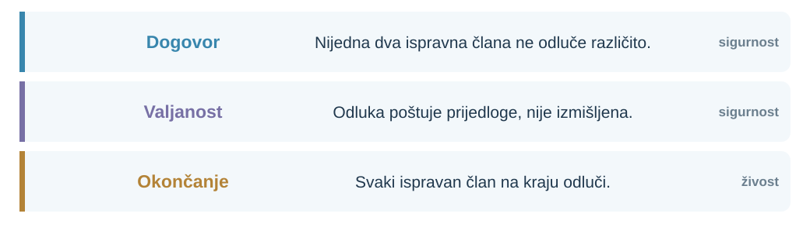{width=1040 fig-alt="Dogovor: nijedna dva ispravna člana ne odluče različito (sigurnost). Valjanost: odluka poštuje prijedloge, nije izmišljena (sigurnost). Okončanje: svaki ispravan član na kraju odluči (živost)."}

::: {.notes}
Vrijeme: 20–23 min (3 min).

Pitajte što bi korisnik budžeta radije prihvatio: da isplata kasni ili da prođu obje.

Kršenje sigurnosti uvijek pokazujemo konačnim dijelom izvođenja, npr. trenutkom kad je drugi član odlučio drukčije. Kršenje živosti ne može se pokazati konačnim dijelom: odluka je možda samo daleko. Protokoli koje ćemo vidjeti čuvaju sigurnost u svim izvođenjima, a za živost traže pretpostavke o mreži. Ako mreža dugo ne radi, sustav smije stati, ali ne smije potvrditi dvije različite isplate.
:::

## Vježba: koje svojstvo krši?

| Prijedlog | Krši | Izvođenje |
|:---|:---|:---|
| „Svaki član odmah odluči svoj prijedlog.” | [dogovor]{.fragment fragment-index=1} | [B odluči [tx~1~]{.tx}, C odluči [tx~2~]{.tx}]{.fragment fragment-index=1} |
| „Odluči [tx~1~]{.tx} bez obzira na prijedloge.” | [valjanost]{.fragment fragment-index=2} | [predložen je samo [tx~2~]{.tx}]{.fragment fragment-index=2} |
| „Odluči tek kad svi glasaju isto.” | [okončanje]{.fragment fragment-index=3} | [C stane]{.fragment fragment-index=3} |
: {tbl-colwidths="[46,20,34]"}

::: {.notes}
Vrijeme: 23–27 min (4 min).

Dvije minute u parovima, zatim otkrivajte odgovore redak po redak.

Treći prijedlog krši živost i kad se članovi ne slože: ako jedan glasa za tx~1~, a drugi za tx~2~, nitko ne skupi jednoglasnost. Pohvalite odgovore koji navedu konkretno izvođenje, a ne samo naziv svojstva.
:::

## Model je dio zadatka

| Pretpostavka | Pitanje | Primjer |
|:---|:---|:---|
| Vrijeme | postoji li poznat rok dostave? | sinkrono, asinkrono, djelomično |
| Kvarovi | što neispravan član smije? | stati ili lagati |
| Broj | koliko neispravnih od [n]{.expr}? | [f = 1]{.expr} od [n = 4]{.expr} |
| Članstvo | znamo li tko glasa? | A, B, C, D unaprijed |
| Potpisi | može li se poruka krivotvoriti? | zasad bez potpisa |

**Isti protokol može biti ispravan u jednom modelu, a neispravan u drugom.**

::: {.notes}
Vrijeme: 27–30 min (3 min).

Neka studenti za „dva od tri” iz predavanja 01 popune stupac Primjer.

U predavanju 01 zapisali smo model kao tablicu: članovi, poruke, vrijeme, kvarovi. Ovdje dodajemo dvije stavke koje određuju odgovor: koliko članova smije biti neispravno (f od ukupno n) i mogu li se poruke provjerljivo potpisati. Tvrdnja „naš sustav podnosi lažljivce” bez modela ne znači ništa.
:::

## Tri modela vremena {.illustrated-slide}

Djelomično sinkrono (*partial synchrony*): mreža neko vrijeme može kasniti proizvoljno, ali od trenutka koji nitko ne zna unaprijed, **GST** (*global stabilization time*), poruke opet stižu unutar roka [Δ]{.expr}.

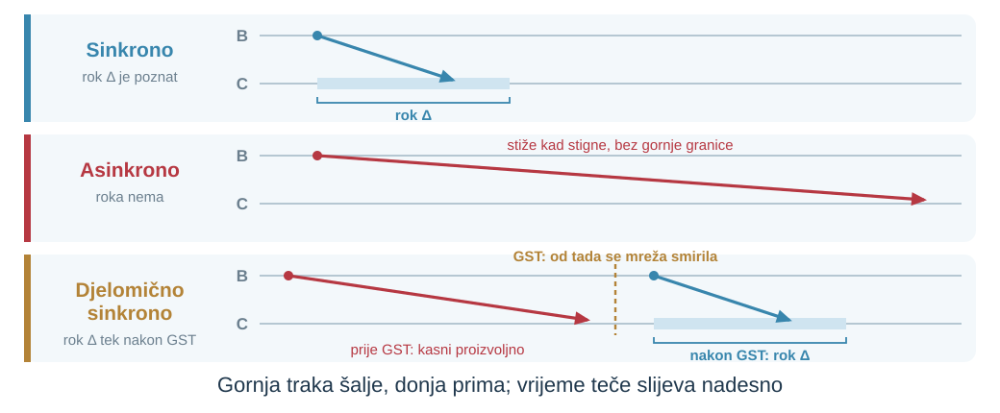{width=1040 fig-alt="Prostorno-vremenski dijagram, B šalje, C prima. Sinkrono: poruka stiže unutar poznatog roka Δ. Asinkrono: poruka stiže kad stigne, bez gornje granice. Djelomično sinkrono: prije GST poruka kasni proizvoljno; od GST, kad se mreža smirila, stiže unutar roka Δ."}

::: {.notes}
Vrijeme: 30–34 min (4 min).

Pitajte koji je model u tablici iz predavanja 01 (redak Vrijeme: „nemamo poznat konačan rok dostave”). Asinkroni.

U sinkronom modelu (*synchronous*) postoji poznat rok Δ, pa je izostanak odgovora nakon roka dokaz pada. U asinkronom (*asynchronous*) roka nema. Djelomično sinkroni model (*partial synchrony*) uveli su Dwork, Lynch i Stockmeyer: rok postoji, ali ga ne znamo, ili vrijedi tek od nepoznatog trenutka GST (*global stabilization time*) ([DLS 1988, sažetak i §1](https://groups.csail.mit.edu/tds/papers/Lynch/jacm88.pdf)). GST nije sat ni događaj koji možemo izmjeriti: to je trenutak od kojeg se mreža smirila, npr. nakon zagušenja ili popravka veze. Protokol ga ne zna i ne smije ga čekati, ali smije računati da će nastupiti. To dobro opisuje stvarnu mrežu: većinu vremena poruke stižu brzo, ali povremeno kasne. Protokol mora čuvati sigurnost i u tim razdobljima, a odlučiti smije kad se mreža smiri.
:::

## „FLP”: spor ili zaustavljen, opet {.illustrated-slide}

U **asinkronom** modelu svaki deterministički protokol za konsenzus može ne završiti, čak i ako samo jedan član može stati (Fischer, Lynch, Paterson, 1985).

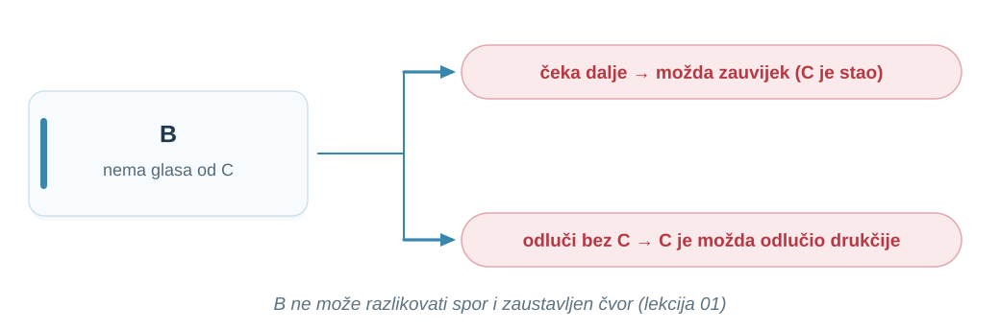{width=1040 fig-alt="B nema glasa od C. Čeka dalje: možda zauvijek (C je stao). Odluči bez C: C je možda odlučio drukčije. B ne može razlikovati spor i zaustavljen čvor (lekcija 01)"}

::: {.notes}
Vrijeme: 34–38 min (4 min).

Neka studenti sami ispričaju oba ishoda prije nego što pokažete crtež.

Dokaz se oslanja na ono što smo vidjeli u predavanju 01: proces ne može razlikovati proces koji je stao od procesa koji radi vrlo sporo ([FLP 1985, sažetak i §1](https://groups.csail.mit.edu/tds/papers/Lynch/jacm85.pdf)). Ako B čeka dalje, a C je stao, krši se okončanje. Ako odluči bez C, a C samo kasni, C je možda sudjelovao u drukčijoj odluci i krši se dogovor. Ovo je intuicija, ne dokaz; dokaz pokazuje da protivnik uvijek može odabrati redoslijed poruka koji odgađa odluku.
:::

## Što „FLP” ne kaže

„FLP” **ne** kaže da je konsenzus nemoguć. Stvarni sustavi:

- čuvaju sigurnost uvijek, a okončanje jamče kad se mreža smiri (djelomično sinkroni model);
- istek roka (*timeout*) koriste samo za živost, npr. za zamjenu vođe;
- ili koriste slučajnost i završavaju s vjerojatnošću 1.

**Za budžet: dok mreža ne radi, isplata smije čekati, ali ne smije proći dvaput.**

::: {.notes}
Vrijeme: 38–40 min (2 min).

Pitajte koja od tri tvrdnje nije posljedica „FLP-a”: „konsenzus je nemoguć”, „asinkroni deterministički protokol može ne završiti”, „istek roka ne dokazuje pad”. Prva.

„FLP” kaže da u potpuno asinkronom modelu deterministički protokol ne može jamčiti i sigurnost i okončanje u svakom izvođenju. Istek roka nikad nije razlog da se prekrši dogovor. Stanje „na čekanju” treba pokazati korisniku, kao u predavanju 01.
:::

## GST: pretpostavka za dokaz, ne postavka mreže {.illustrated-slide}

GST nitko ne mjeri ni ne podešava. **Sigurnost** vrijedi i ako GST nikad ne dođe; **okončanje** vrijedi kad GST jednom dođe.

U praksi „zauvijek nakon GST” znači „dovoljno dugo da jedan krug završi”, a nepoznat [Δ]{.expr} protokol nalazi rastućim istekom roka.

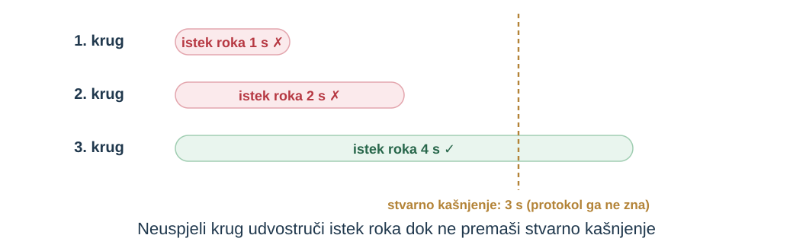{width=900 fig-alt="Tri kruga: istek roka 1 s neuspješan, 2 s neuspješan, 4 s uspješan; stvarno kašnjenje je 3 s i protokol ga ne zna. Neuspjeli krug udvostruči istek roka dok ne premaši stvarno kašnjenje"}

::: {.notes}
Vrijeme: 40–43 min (3 min).

Pitajte što sustav radi ako mreža nikad ne postane stabilna. Čeka; ne potvrđuje dvije isplate.

GST je alat modela, a ne svojstvo stvarne mreže. Nakon FLP-a Dwork, Lynch i Stockmeyer tražili su najslabiju dodatnu pretpostavku uz koju okončanje opet postaje moguće ([DLS 1988, §1](https://groups.csail.mit.edu/tds/papers/Lynch/jacm88.pdf)). Jamstvo je zato uvjetno: nikad pogrešan odgovor, a odgovor kad se mreža dovoljno dugo ponaša dobro. Doslovno, model kaže da je mreža dobra zauvijek nakon GST; stvarne mreže su dobre neko vrijeme pa opet loše. Protokolu treba samo dovoljno dugo stabilno razdoblje da završi jedan krug, npr. da vođa skupi kvorum; „zauvijek” samo pojednostavljuje dokaz (to je tumačenje, ne citat).

Protokol ne mora znati ni GST ni Δ: istek roka povećava nakon svakog neuspjelog kruga, npr. udvostručavanjem, dok ne premaši stvarno kašnjenje. Uvjet živosti u PBFT-u odgovara tome: kašnjenje ne smije neograničeno rasti brže od 2t ([PBFT 1999, §3](https://pmg.csail.mit.edu/papers/osdi99.pdf)). Brojevi na slici su ilustracija.
:::

## Kvorum: dovoljno glasova za odluku {.illustrated-slide}

::: {.definition number="2.2"}
**Kvorum (*quorum*)**: skup članova čiji su glasovi za isti prijedlog dovoljni za odluku.
:::

**Uvjet sigurnosti:** svaka dva moguća kvoruma dijele **poštenog** člana. Na slici je to B, koji glasa samo za jedan prijedlog; u predavanju 01 bio je to A, koji je glasao dvaput.

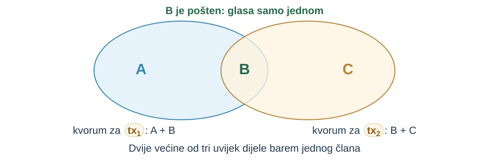{width=680 fig-alt="Mogući kvorumi {A, B} za tx1 i {B, C} za tx2 dijele B. B je pošten i glasa samo za tx1: kvorum za tx1 je skupljen, a za tx2 ima samo C i ostaje nepotpun. Dvije većine od tri dijele člana; pošten član omogućuje samo jednu odluku"}

::: {.notes}
Vrijeme: 43–45 min (2 min).

Pitajte zašto „jedan od tri” nije kvorum. Dva takva skupa ne moraju se preklapati.

Kvorum mora biti dostupan: i kad f članova ne odgovara, ostali moraju moći skupiti kvorum, inače se krši okončanje. I dva kvoruma moraju se preklapati u poštenom članu, inače se krši dogovor. Uz n = 3 bez lažljivaca kvorumi {A, B} i {B, C} dijele B, koji glasa samo jednom, pa ne mogu proći obje isplate.
:::

## Uz padove: [n ≥ 2f + 1]{.expr} {.illustrated-slide}

Toleriramo **padove**, ali svi su članovi **pošteni**. Ne znamo koji će pasti, nego samo koliko najviše: [f]{.expr}. Zato [n]{.expr} i kvorum biramo tako da uvjet vrijedi za svaki raspored kvarova.

1. **Živost:** čekamo najviše [n − f]{.expr} glasova, jer [f]{.expr} članova možda nikad ne odgovori.
2. **Sigurnost:** dva kvoruma [n − f]{.expr} dijele barem [n − 2f]{.expr} članova. Kako nitko ne laže, dovoljan je jedan zajednički: **[n ≥ 2f + 1]{.expr}**.

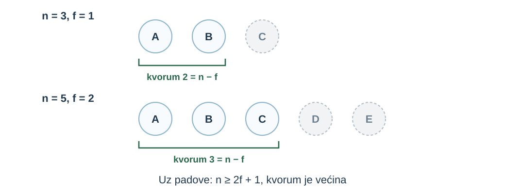{width=740 fig-alt="n = 3, f = 1: A i B rade, C je pao, kvorum 2 = n − f. n = 5, f = 2: A, B i C rade, D i E su pali, kvorum 3 = n − f. Uz padove: n ≥ 2f + 1, kvorum je većina"}

::: {.notes}
Vrijeme: 45–49 min (4 min).

Izvedite nejednakost na ploči zajedno sa studentima, korak po korak.

Neka do f članova može stati, a nijedan ne laže. Dva kvoruma veličine n − f preklapaju se ako zajedno imaju više od n članova. Najmanji takav n je 2f + 1, a kvorum je većina, f + 1. U djelomično sinkronom modelu uz padove upravo je to granica ([DLS 1988, Tablica I](https://groups.csail.mit.edu/tds/papers/Lynch/jacm88.pdf)).
:::

## Vježba: koliko padova podnosimo?

| [n]{.expr} | najveći [f]{.expr} uz padove | kvorum [n − f]{.expr} |
|:---|:---|:---|
| 5 | [2]{.fragment fragment-index=1} | [3]{.fragment fragment-index=1} |
| 7 | [3]{.fragment fragment-index=2} | [4]{.fragment fragment-index=2} |
| 4 | [1]{.fragment fragment-index=3} | [3]{.fragment fragment-index=3} |

[Četvrti član ne povećava [f]{.expr}, a povećava kvorum: zato se uz padove često bira neparan [n]{.expr}.]{.fragment fragment-index=3}

::: {.notes}
Vrijeme: 49–52 min (3 min).

Prvo n = 5, zatim n = 7, a n = 4 kao pitanje za brže studente. Za n = 4 dobivamo isti f kao za n = 3.
:::

## Zašto većina ne pomaže uz lažljivca {.illustrated-slide}

Uz padove je bio dovoljan jedan zajednički član. Kvorumi {A, B} i {A, C} se preklapaju, ali u presjeku je samo bizantski A.

**Uz [f]{.expr} lažljivaca presjek mora imati barem [f + 1]{.expr} člana: tada barem jedan od njih nije lažljivac.**

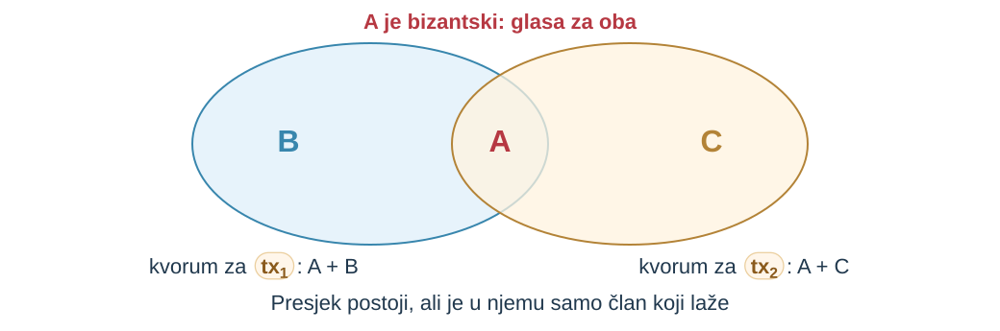{width=760 fig-alt="Kvorum za tx1: A i B; kvorum za tx2: A i C; u presjeku je A, koji je bizantski i glasa za oba. Presjek postoji, ali je u njemu samo član koji laže"}

::: {.notes}
Vrijeme: 52–55 min (3 min).

Pitajte koliko bi članova presjek morao imati uz f = 2. Tri.

Preklapanje u bilo kojem članu nije dovoljno: treba preklapanje u poštenom članu. Ako presjek ima f + 1 člana, svih f lažljivaca ne može ga popuniti.
:::

## Problem bizantskih generala {.illustrated-slide}

Lamport, Shostak i Pease traže dva uvjeta, u radu nazvana IC1 i IC2 (*interactive consistency*):

**Uvjet 1:** svi odani poručnici izvrše istu zapovijed → **dogovor**.

**Uvjet 2:** ako je zapovjednik odan, izvrše njegovu zapovijed → **valjanost**.

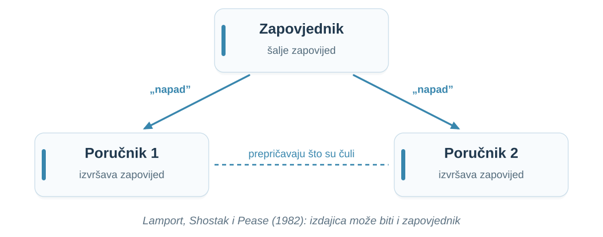{width=860 fig-alt="Zapovjednik šalje zapovijed „napad” poručniku 1 i poručniku 2; poručnici prepričavaju jedan drugome što su čuli. Lamport, Shostak i Pease (1982): izdajica može biti i zapovjednik"}

::: {.notes}
Vrijeme: 55–59 min (4 min).

Na ploči spojite uvjet 1 (IC1) s dogovorom i uvjet 2 (IC2) s valjanošću. IC je kratica za *interactive consistency* (interaktivna konzistentnost), naziv koji rad daje ovim dvama uvjetima.

Lamport, Shostak i Pease opisali su 1982. isti problem kao priču o generalima bizantske vojske koji komuniciraju samo glasnicima ([LSP 1982, §1](https://lamport.azurewebsites.net/pubs/byz.pdf)). Zapovjednik je naš član koji predlaže isplatu, poručnici su ostali članovi. Model je sinkron: rad pretpostavlja da se izostanak poruke može otkriti (pretpostavka A3, §3).
:::

## Tri generala, jedan izdajica {.illustrated-slide}

Bez potpisanih poruka poručnik 1 ne zna je li izdajica zapovjednik ili poručnik 2.

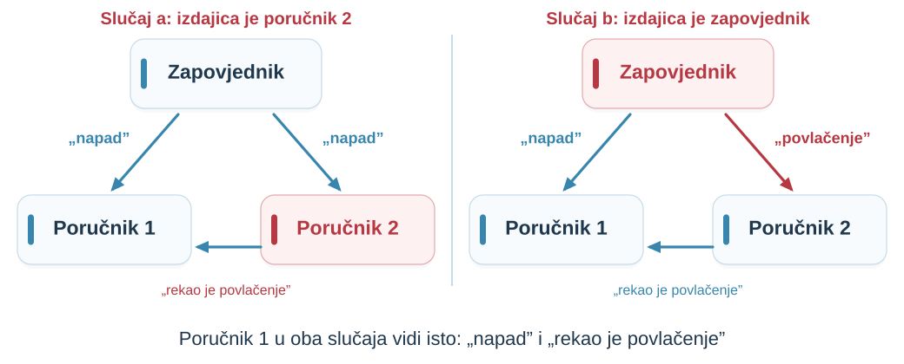{width=1040 fig-alt="Slučaj a: odan zapovjednik šalje napad, izdajica poručnik 2 javlja poručniku 1 da je zapovjednik rekao povlačenje. Slučaj b: zapovjednik izdajica šalje napad poručniku 1 i povlačenje poručniku 2, koji to iskreno prenosi. Poručnik 1 u oba slučaja vidi isto"}

::: {.notes}
Vrijeme: 59–63 min (4 min).

Dvoje studenata neka glume poručnika 1 u oba slučaja i objasne zašto ne mogu odlučiti drukčije.

U slučaju a vrijedi IC2, pa poručnik 1 mora napasti. Slučaj b izgleda mu jednako, pa i tada napada. Istim argumentom poručnik 2 u slučaju b mora se povući, i IC1 je prekršen ([LSP 1982, §2](https://lamport.azurewebsites.net/pubs/byz.pdf)). Autori upozoravaju da je ovakvo neformalno zaključivanje varljivo i upućuju na strogi dokaz. Iz istog rezultata izvode: uz m izdajica i nepotpisane poruke treba barem 3m + 1 generala.
:::

## Uz bizantske članove: [n ≥ 3f + 1]{.expr} {.illustrated-slide}

Ista dva koraka kao uz padove, uz stroži uvjet presjeka:

1. **Živost:** i dalje čekamo najviše [n − f]{.expr} glasova.
2. **Sigurnost:** presjek [n − 2f]{.expr} mora biti veći od [f]{.expr}, pa je barem jedan zajednički član pošten: **[n ≥ 3f + 1]{.expr}**, kvorum **[2f + 1]{.expr}**.

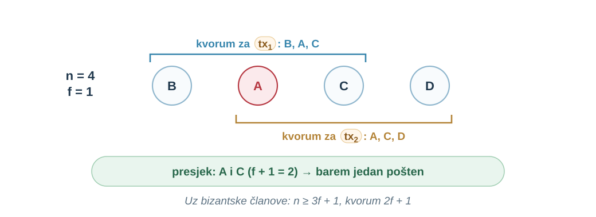{width=900 fig-alt="n = 4, f = 1: kvorum za tx1 je B, A, C; kvorum za tx2 je A, C, D; presjek je A i C (f + 1 = 2), barem jedan pošten. Uz bizantske članove: n ≥ 3f + 1, kvorum 2f + 1"}

::: {.notes}
Vrijeme: 63–67 min (4 min).

Izvedite nejednakost na ploči uz prethodnu za padove i usporedite korake.

Protokol i dalje čeka samo n − f glasova, jer f članova može šutjeti. Dva kvoruma te veličine dijele barem 2(n − f) − n = n − 2f članova. Da bi u presjeku bio pošten, n − 2f > f, tj. n > 3f. Za f = 1: četiri člana, kvorum tri, presjek dva, najviše jedan laže. Castro i Liskov navode isti argument ([PBFT 1999, §3](https://pmg.csail.mit.edu/papers/osdi99.pdf)), a rezultat se slaže s 3m + 1 iz LSP 1982.
:::

## Naš budžet s četiri organizacije {.illustrated-slide}

Dodajemo D. A je i dalje bizantski, kvorum je tri.

**Pošten član glasa najviše za jedan prijedlog po stanju.**

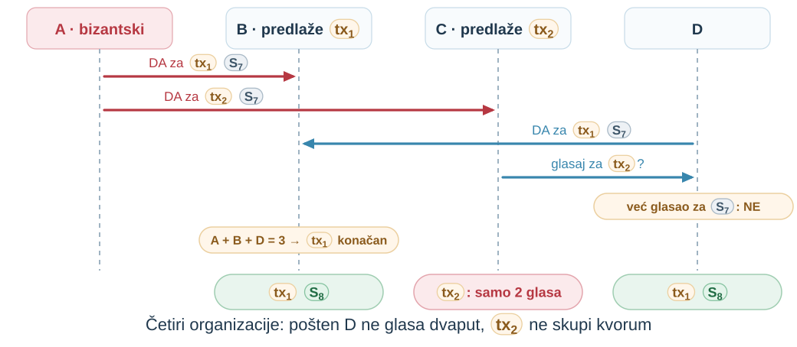{width=920 fig-alt="A (bizantski) šalje DA za tx1 B-u i DA za tx2 C-u; D šalje DA za tx1 B-u; C traži glas za tx2 od D, D odbija jer je već glasao za v7; A + B + D = 3, tx1 konačan; B i D imaju tx1 v8, C ima samo 2 glasa za tx2. Četiri organizacije: pošten D ne glasa dvaput, tx2 ne skupi kvorum"}

::: {.notes}
Vrijeme: 67–71 min (4 min).

Pitajte što bi se dogodilo da D glasa za tx~2~ prije nego što primi zahtjev od B. Tada tx~1~ ne skupi kvorum, a tx~2~ prođe; obje isplate nikad.

tx~1~ skupi tri glasa (A, B, D) i postaje S~8~. tx~2~ ima samo dva glasa (A, C). C bi trebao glas od B ili D, a oboje su već glasali za tx~1~. Bez pravila „najviše jednom po stanju” D bi mogao glasati i za tx~2~ i presjek ne bi štitio ništa.
:::

## Kad bizantski član šuti {.illustrated-slide}

A ne mora lagati: može i šutjeti da odluka zapne.

**B, C i D sami čine kvorum: prag [3f + 1]{.expr} čuva i dogovor i okončanje.**

[f]{.expr} broji **sve** neispravne članove: pad poštenog člana troši isti [f]{.expr} kao laž. Ako su neispravna dva (jedan laže, drugi je pao), sustav staje, ali ne donosi proturječne odluke.

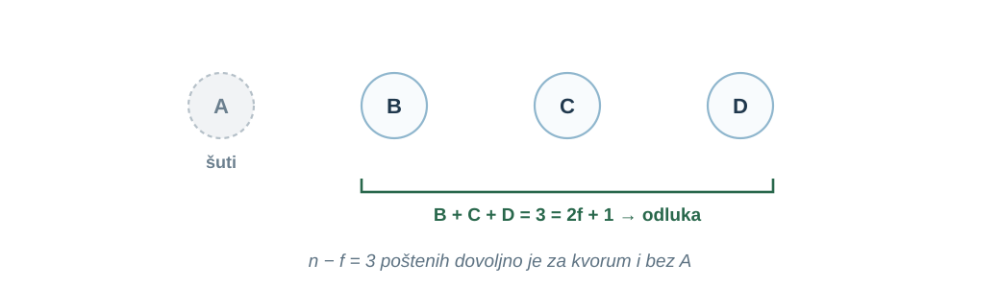{width=900 fig-alt="A šuti; B, C i D zajedno čine 3 = 2f + 1 glasa i donose odluku. n − f = 3 poštenih dovoljno je za kvorum i bez A"}

::: {.notes}
Vrijeme: 71–73 min (2 min).

Pitajte zašto kvorum ne smije biti sva četiri člana. Jedan šutljiv član tada bi zaustavio sve.

Presjek kvoruma sadrži poštenog člana (dogovor), a pošteni članovi sami čine kvorum (okončanje).

Primjer za drugu rečenicu: A laže, a pošteni B padne. C i D imaju samo dva glasa; ako A šuti, kvorum od tri se ne skupi i sustav stane (gubi se živost). Dva kvoruma od tri među četiri člana i dalje dijele dva člana, od kojih najviše jedan laže, pa proturječnih odluka nema (sigurnost ostaje). To vrijedi dok je lažljivaca najviše f. Napomena: pošten član koji se ponovno pokrene mora pamtiti svoj glas, pa ga BFT protokoli trajno zapisuju prije slanja. Član koji zaboravi glas mogao bi glasati drukčije i za protokol se ponaša bizantski.
:::

## Kvorumi korak po korak (1/6): uz padove {.quorum-anim-slide}

```{=html}
<div class="qa" data-scene="0"></div>
<script src="assets/quorum-anim.js"></script>
```

::: {.notes}
Vrijeme: 73–74 min (1 min).

Prvi slajd animacije. Svaka strelica naprijed izvodi jedan korak: prijedloge, zatim glas po glas, na kraju ishod. Animacija stane nakon svakog koraka, a tekst kaže što slijedi. Nema središnje kutije s glasovima: svaki član svima šalje glas i sam broji primljene glasove (brojač ispod čvora), a odlučuje kad vidi kvorum. Dok scena miruje, pitajte što će odlučiti svaki član.

Ovdje: model padova, n = 3, f = 1, kvorum 2. C je pao; A i B odlučuju bez njega.
:::

## Kvorumi korak po korak (2/6): pošten član u presjeku {.quorum-anim-slide}

```{=html}
<div class="qa" data-scene="1"></div>
```

::: {.notes}
Vrijeme: 74–75 min (1 min).

Svi su pošteni. B svima šalje isti glas za tx~1~, pa svaki član vidi dva glasa za tx~1~ i jedan za tx~2~. I C, koji je predložio tx~2~, odlučuje tx~1~: konsenzus. Pitajte: zašto je dovoljno da je zajednički član B pošten?
:::

## Kvorumi korak po korak (3/6): lažljivac uz n = 3 {.quorum-anim-slide}

```{=html}
<div class="qa" data-scene="2"></div>
```

::: {.notes}
Vrijeme: 75–76 min (1 min).

Isti prag uz lažljivca. A je dvoličan (*equivocation*): B-u šalje glas za tx~1~, a C-u za tx~2~. B i C lokalno vide kvorum za različite prijedloge: 140 iz 100, kao u predavanju 01. Zaustavite se nakon A-ova glasa i pitajte što sada vidi B, a što C.
:::

## Kvorumi korak po korak (4/6): n = 3f + 1 {.quorum-anim-slide}

```{=html}
<div class="qa" data-scene="3"></div>
```

::: {.notes}
Vrijeme: 76–77 min (1 min).

n = 3f + 1 = 4, kvorum 3. A je opet dvoličan, ali B i D vide tri glasa za tx~1~, a C samo po dva i čeka. Proturječne odluke nema. U stvarnom protokolu (PBFT) C kasnije sustigne ostale; animacija prikazuje jedan krug glasanja.
:::

## Kvorumi korak po korak (5/6): bizantski član šuti {.quorum-anim-slide}

```{=html}
<div class="qa" data-scene="4"></div>
```

::: {.notes}
Vrijeme: 77–78 min (1 min).

A šuti. B, C i D razmijene glasove i svaki vidi kvorum od tri: prag čuva i okončanje. Pitajte zašto kvorum ne smije biti četiri.
:::

## Kvorumi korak po korak (6/6): f je prekoračen {.quorum-anim-slide}

```{=html}
<div class="qa" data-scene="5"></div>
```

::: {.notes}
Vrijeme: 78–79 min (1 min).

A laže, a pošteni D je pao: neispravna su dva, više od f. B i C vide samo po dva glasa i nitko ne odlučuje. Sustav staje, ali ne donosi proturječne odluke.
:::

## Kvorumi: slobodno istraživanje {.quorum-anim-slide}

```{=html}
<div class="qa" data-scene="sandbox"></div>
```

::: {.notes}
Vrijeme: 79–80 min (1 min).

Slobodni način: klik na člana mijenja njegovo stanje (ispravan → pao → laže → šuti), klizači mijenjaju n i f. Zadatak: pronađite najmanji n uz koji dva lažljivca ne mogu izazvati proturječne odluke (n = 7, f = 2). Pravila animacije: pošten predlagatelj glasa za svoj prijedlog, ostali pošteni za prvi prijedlog; lažljivac svakom primatelju šalje glas za ono za što je taj primatelj glasao; pali i šutljivi ne šalju ništa.
:::

## Prag ovisi o modelu

| Kvarovi | Sinkrono | Djelomično sinkrono | Asinkrono |
|:---|:---|:---|:---|
| Pad | bilo koji [n]{.expr} | [n ≥ 2f + 1]{.expr} | nema („FLP”) |
| Bizantski, bez potpisa | [n ≥ 3f + 1]{.expr} | [n ≥ 3f + 1]{.expr} | nema |
| Bizantski, s potpisima | bilo koji [n]{.expr} | [n ≥ 3f + 1]{.expr} | nema |

Dwork, Lynch i Stockmeyer (1988), Tablica I, pojednostavljeno; asinkrono = deterministički protokoli.

**Potpisi ne uklanjaju prag [3f + 1]{.expr} u djelomično sinkronoj mreži.**

::: {.notes}
Vrijeme: 80–82 min (2 min).

Neka studenti pronađu redak i stupac za naš budžet: bizantski, djelomično sinkrono, bez potpisa.

Tablica prema [DLS 1988, Tablica I](https://groups.csail.mit.edu/tds/papers/Lynch/jacm88.pdf); sinkroni slučaj s potpisima prema [LSP 1982, §4](https://lamport.azurewebsites.net/pubs/byz.pdf). Upravo djelomično sinkronu mrežu imamo u praksi. Potpise uvodimo u predavanju 03; ovdje je važno da njihova korist ovisi o modelu vremena.
:::

## Što model vremena mijenja u algoritmu {.illustrated-slide}

Isto opažanje: B nema glas od C. Razlika je u tome **smije li istek roka utjecati na odluku**.

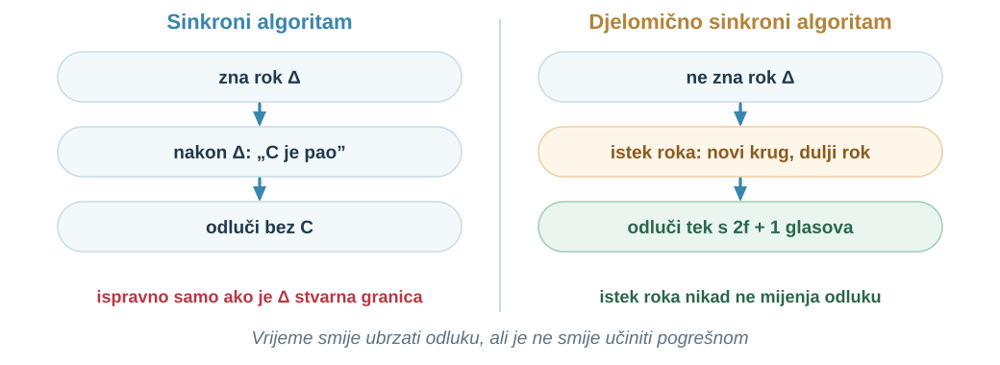{width=1000 fig-alt="Isto opažanje, B nema glas od C, dva algoritma. Sinkroni: zna rok Δ, nakon Δ zaključi da je C pao, odluči bez C; ispravno samo ako je Δ stvarna granica. Djelomično sinkroni: ne zna rok Δ, na isteku roka pokreće novi krug s duljim rokom, odlučuje tek s 2f + 1 glasova; istek roka nikad ne mijenja odluku. Vrijeme smije ubrzati odluku, ali je ne smije učiniti pogrešnom"}

::: {.notes}
Vrijeme: 82–85 min (3 min).

Pitajte: što bi na budžetu značilo pravilo „ako C ne odgovori za 3 s, C je pao, odluči bez njega”? Ako je C samo spor, možda je već sudjelovao u drugoj odluci: dvije isplate.

Algoritam GST ne vidi i ne obrađuje; GST postoji samo u analizi. Razlika je u kodu. Sinkroni algoritam zna Δ i izostanak poruke nakon Δ tretira kao dokaz pada, kao pretpostavka A3 u [LSP 1982, §3](https://lamport.azurewebsites.net/pubs/byz.pdf). Djelomično sinkroni algoritam istek roka koristi samo za napredak: novi krug ili novi vođa, s duljim rokom, a odluku donosi samo kvorumom 2f + 1, čiji presjek štiti dogovor bez obzira na vrijeme. Takav je PBFT: sigurnost ne ovisi o vremenskim pretpostavkama, a zamjena vođe pokreće se istekom roka ([PBFT 1999, §3 i §4.4](https://pmg.csail.mit.edu/papers/osdi99.pdf)). Cijena je u broju članova (prethodni slajd): kad šutnja ne dokazuje ništa, treba više poštenih.
:::

## Kako izgleda BFT protokol {.illustrated-slide}

**BFT** (*Byzantine fault tolerance*): protokoli za konsenzus koji podnose bizantske članove. PBFT (Castro i Liskov, 1999) radi s [n = 3f + 1]{.expr}.

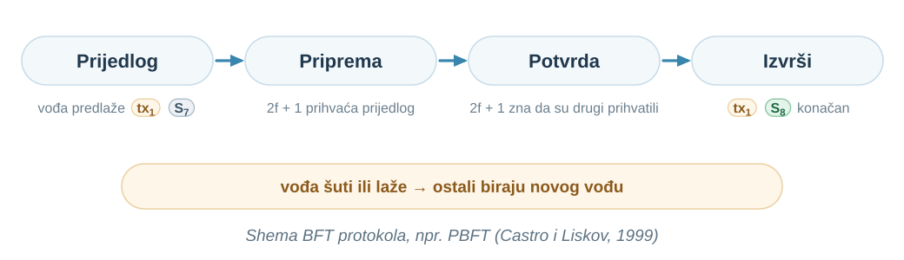{width=1040 fig-alt="Prijedlog: vođa predlaže tx1 v7; Priprema: 2f + 1 prihvaća prijedlog; Potvrda: 2f + 1 zna da su drugi prihvatili; Izvrši: tx1 v8 konačan. Vođa šuti ili laže: ostali biraju novog vođu. Shema BFT protokola, npr. PBFT"}

::: {.notes}
Vrijeme: 85–88 min (3 min).

Pitajte gdje se u ovim fazama koristi istek roka. Samo za zamjenu vođe.

Faze normalnog rada su *pre-prepare*, *prepare* i *commit*; priprema i potvrda čekaju kvorum. Ako vođa šuti ili šalje proturječne prijedloge, ostali biraju novog vođu ([PBFT 1999, §4.2 i §4.4](https://pmg.csail.mit.edu/papers/osdi99.pdf)). Sigurnost algoritma ne ovisi o vremenskim pretpostavkama; za živost traži da kašnjenje ne raste neograničeno (§3). To je podjela iz prvog dijela predavanja. Detalje faza ne učimo napamet.
:::

## Cijena BFT-a {.illustrated-slide}

U pripremi i potvrdi svaki član šalje poruku svakom drugom: **[n(n − 1)]{.expr} poruka po fazi**.

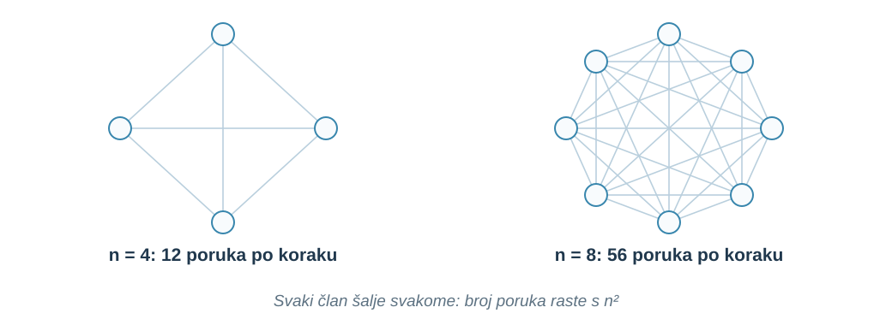{width=900 fig-alt="Potpun graf s 4 člana: 12 poruka po koraku; potpun graf s 8 članova: 56 poruka po koraku. Svaki član šalje svakome: broj poruka raste s n²"}

::: {.notes}
Vrijeme: 88–90 min (2 min).

Izračunajte zajedno broj poruka za n = 10 (90) i n = 100 (9.900).

Castro i Liskov navode da dodatne replike smanjuju performanse jer se razmjenjuje više i većih poruka ([PBFT 1999, §4](https://pmg.csail.mit.edu/papers/osdi99.pdf)). Zato se klasični BFT koristi u manjim skupinama poznatih članova, npr. u nekoliko organizacija koje vode zajednički sustav.
:::

## Prešutna pretpostavka: znamo tko su članovi {.illustrated-slide}

[n]{.expr} i [f]{.expr} brojimo po **organizacijama**. Deset poruka od A i dalje je jedan glas.

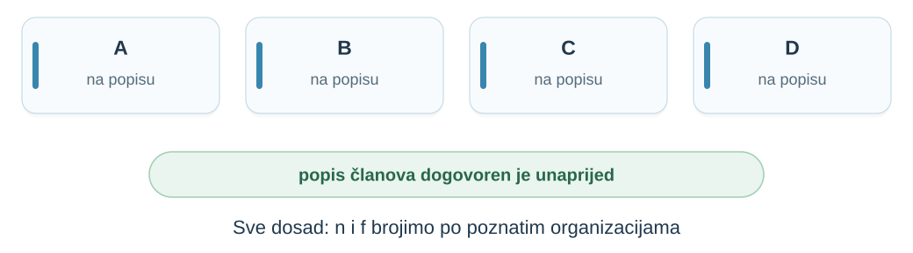{width=1040 fig-alt="A, B, C i D, svi na popisu; popis članova dogovoren je unaprijed. Sve dosad: n i f brojimo po poznatim organizacijama"}

::: {.notes}
Vrijeme: 90–92 min (2 min).

Povežite sa slajdom „Tko uopće ima pravo glasa?” iz predavanja 01.

To je dobra pretpostavka za konzorcij organizacija koje su se ugovorom dogovorile tko sudjeluje. Glas je vezan uz člana, ne uz poruku.
:::

## Otvorena mreža {.illustrated-slide}

Pridružiti se može bilo tko, bez popisa (*permissionless*). Mreža vidi samo **identitete**.

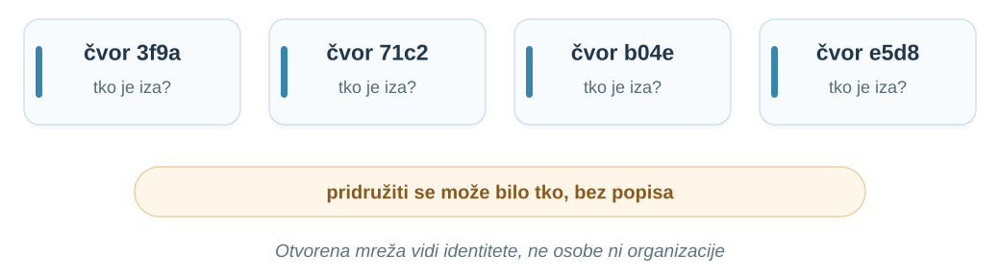{width=1040 fig-alt="Četiri čvora s oznakama 3f9a, 71c2, b04e i e5d8; za svaki: tko je iza? Pridružiti se može bilo tko, bez popisa. Otvorena mreža vidi identitete, ne osobe ni organizacije"}

::: {.notes}
Vrijeme: 92–94 min (2 min).

Pitajte kako bi B mogao znati da su dva identiteta zapravo ista strana. U općem slučaju ne može.

Iza četiri identiteta mogu biti četiri organizacije ili jedna osoba s četiri računala. Douceur: lokalni čvor bez izravnog fizičkog znanja o udaljenima vidi ih samo kao informacijske apstrakcije, identitete ([Douceur 2002, §1](https://courses.csail.mit.edu/6.895/fall02/papers/Douceur/iptps02-douceur.pdf)).
:::

## Sybil napad {.illustrated-slide}

**Sybil napad** (*Sybil attack*): jedna strana predstavlja više identiteta.

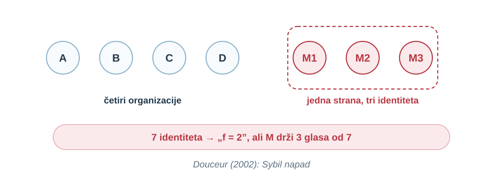{width=1000 fig-alt="Četiri organizacije A, B, C, D i jedna strana M s tri identiteta M1, M2, M3; 7 identiteta, mreža misli f = 2, ali M drži 3 glasa od 7. Douceur (2002): Sybil napad"}

::: {.notes}
Vrijeme: 94–98 min (4 min).

Neka studenti izračunaju koliko identiteta M mora stvoriti da sruši prag uz četiri poštene organizacije. Već dva: uz šest identiteta prag 3f + 1 dopušta samo f = 1, a M drži dva glasa.

Douceur pokazuje da su bez logički centraliziranog autoriteta Sybil napadi uvijek mogući, osim uz krajnje i nerealne pretpostavke o jednakosti resursa i koordinaciji ([Douceur 2002, sažetak](https://courses.csail.mit.edu/6.895/fall02/papers/Douceur/iptps02-douceur.pdf)). Mreža sa sedam identiteta zaključuje f = 2 i kvorum pet, ali M sam drži tri glasa. Pretpostavka „najviše f neispravnih” više nije istinita, a sva jamstva iz prvog dijela izvedena su iz nje.
:::

## Brojimo identitete, a trebamo neovisne strane

Prag [3f + 1]{.expr} govori o **neovisnim članovima**. Glasanje u otvorenoj mreži broji **identitete**.

Ako je identitet besplatan, napadač uvijek može premašiti svaki [f]{.expr}.

**Klasični BFT ostaje ispravan, ali njegova pretpostavka o članstvu nije ispunjena.**

::: {.notes}
Vrijeme: 98–100 min (2 min).

Pitajte koja je pretpostavka iz tablice „Model je dio zadatka” ovdje prekršena. Članstvo.

Dodavanje čvorova u otvorenoj mreži zato ne povećava otpornost, nego je može smanjiti.
:::

## Kako ograničiti identitete? {.illustrated-slide}

Središnji upis vraća koordinatora; cijena po identitetu broji resurs, a ne identitete.

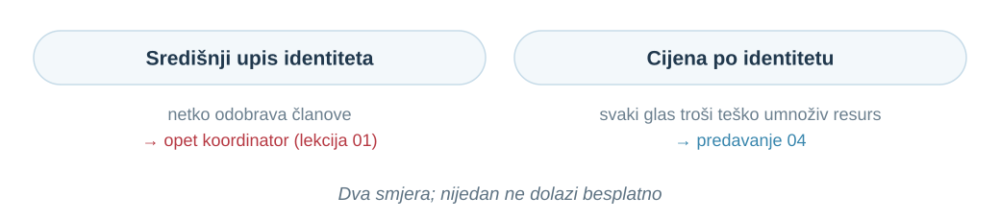{width=1040 fig-alt="Središnji upis identiteta: netko odobrava članove, opet koordinator (lekcija 01). Cijena po identitetu: svaki glas troši teško umnoživ resurs, predavanje 04. Dva smjera; nijedan ne dolazi besplatno"}

::: {.notes}
Vrijeme: 100–103 min (3 min).

Pitajte koji resurs studenti mogu zamisliti kao cijenu identiteta i koji je od njih lako umnožiti. Ne imenujte Bitcoin; najavite samo predavanje 04.

Središnji upis može biti prihvatljiv u konzorciju, ali nije otvorena mreža. Kod cijene po identitetu sto identiteta stoji sto puta više od jednog, pa se broji udio resursa. Douceurov rezultat upozorava da ni to nije besplatno: pretpostavlja da nijedna strana nema nesrazmjerno više resursa od ostalih.
:::

## Klasični BFT nasuprot otvorenoj mreži

| | Klasični BFT | Otvorena mreža |
|:---|:---|:---|
| Članstvo | poznato unaprijed | bilo tko se pridruži |
| Što glas broji | jednog člana | jedan identitet |
| Prag | [n ≥ 3f + 1]{.expr} članova | treba ograničiti identitete |
| Poruke | [n²]{.expr} po fazi, mali [n]{.expr} | velik [n]{.expr}, ne svatko svakome |
| Primjer | konzorcij organizacija | javna mreža (predavanje 04) |

**Klasični konsenzus nije pogrešan; rješava drukčiji problem.**

::: {.notes}
Vrijeme: 103–105 min (2 min).

Za naš budžet od tri organizacije pitajte koji stupac odgovara. Lijevi: članovi su poznati.

Otvorena mreža traži i otpornost na Sybil napad i način komunikacije koji radi s mnogo nepoznatih sudionika.
:::

## Ponavljanje: što ne štima u ovom prijedlogu protokola?

Naš budžet: fond **F ima 100**, B predlaže **[tx~1~]{.tx}** (80 iz F na račun X), C predlaže **[tx~2~]{.tx}** (60 iz F na račun Y).

> „Imamo četiri organizacije, **pa sustav podnosi jednog lažljivca**. Svatko može pokrenuti dodatni čvor. Isplata je **konačna čim tri čvora glasaju za nju**. Ako vođa ne odgovori za dvije sekunde, **vođa je pao**, pa njegov prijedlog odbacujemo i prihvaćamo drugi.”

**Za svaki istaknuti zaključak nađite izvođenje u kojem ne vrijedi.**

::: {.notes}
Vrijeme: 105–109 min (4 min).

Tri minute u parovima, zatim po jedan protuprimjer od svakog para.
:::

## Tri zaključka, tri protuprimjera {.illustrated-slide}

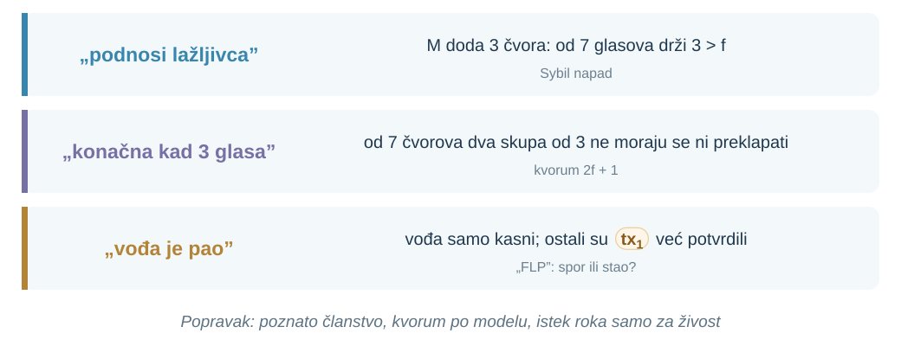{width=1040 fig-alt="„podnosi lažljivca”: M doda 3 čvora, od 7 glasova drži 3 > f (Sybil napad). „konačna kad 3 glasa”: od 7 čvorova dva skupa od 3 ne moraju se ni preklapati (kvorum 2f + 1). „vođa je pao”: vođa samo kasni, ostali su tx1 već potvrdili („FLP”: spor ili stao?)."}

::: {.notes}
Vrijeme: 109–112 min (3 min).

Za svaki protuprimjer pitajte koji je slajd ranije pokazao isti problem.

Prvi zaključak vrijedi samo uz poznato članstvo. Drugi koristi apsolutan broj tri: uz sedam čvorova dva skupa od tri ne moraju se ni preklapati, pa mogu proći i tx~1~ i tx~2~; kvorum mora biti 2f + 1 u odnosu na stvaran n. Treći tretira istek roka kao dokaz pada: vođa je možda samo spor, a ostali su tx~1~ možda već potvrdili. Istek roka smije pokrenuti zamjenu vođe, ali novi vođa mora poštovati ono što je možda već odlučeno.
:::

## Sažetak {.illustrated-slide}

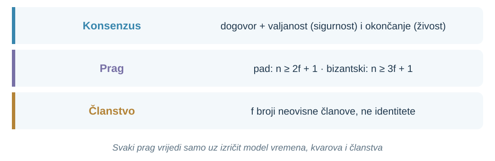{width=1040 fig-alt="Konsenzus: dogovor + valjanost (sigurnost) i okončanje (živost). Prag: pad n ≥ 2f + 1, bizantski n ≥ 3f + 1. Članstvo: f broji neovisne članove, ne identitete. Svaki prag vrijedi samo uz izričit model vremena, kvarova i članstva"}

::: {.notes}
Vrijeme: 112–114 min (2 min).

Neka svaki student zapiše jednu rečenicu koju bi rekao kolegi koji je propustio predavanje.

Koliko članova treba, ovisi o modelu: u djelomično sinkronom modelu uz padove n ≥ 2f + 1, a uz bizantske članove n ≥ 3f + 1, jer dva kvoruma moraju dijeliti poštenog člana. Sve to broji neovisne članove; u otvorenoj mreži Sybil napad ruši tu pretpostavku.
:::

## Otvoreno pitanje za predavanje 03 {.illustrated-slide}

Dvaput smo prešutno pretpostavili: B zna da je „DA za [tx~1~]{.tx}” stvarno od D, a D ne može kasnije tvrditi da je glasao drukčije.

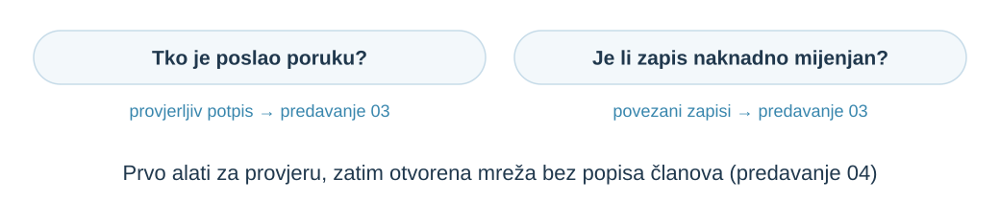{width=1040 fig-alt="Tko je poslao poruku? Provjerljiv potpis, predavanje 03. Je li zapis naknadno mijenjan? Povezani zapisi, predavanje 03. Prvo alati za provjeru, zatim otvorena mreža bez popisa članova (predavanje 04)"}

::: {.notes}
Vrijeme: 114–116 min (2 min).

Ostavite pitanja otvorena; ne uvodite hash funkcije ni Bitcoin. Predavanje 03 uvodi potpise i povezane zapise; pitanje otvorene mreže bez popisa članova vraća se u predavanju 04.
:::

## Dodatna literatura {.references-slide}

- [Lamport, Shostak, Pease: The Byzantine Generals Problem](https://lamport.azurewebsites.net/pubs/byz.pdf), TOPLAS 1982, §1–4.
- [Fischer, Lynch, Paterson: Impossibility of Distributed Consensus with One Faulty Process](https://groups.csail.mit.edu/tds/papers/Lynch/jacm85.pdf), JACM 1985.
- [Dwork, Lynch, Stockmeyer: Consensus in the Presence of Partial Synchrony](https://groups.csail.mit.edu/tds/papers/Lynch/jacm88.pdf), JACM 1988, Tablica I.
- [Castro, Liskov: Practical Byzantine Fault Tolerance](https://pmg.csail.mit.edu/papers/osdi99.pdf), OSDI 1999, §3–4.
- [Douceur: The Sybil Attack](https://courses.csail.mit.edu/6.895/fall02/papers/Douceur/iptps02-douceur.pdf), IPTPS 2002.

::: {.notes}
Vrijeme: 116–117 min (1 min).

Za čitanje prije predavanja 03 preporučite uvod i §2 rada Lamporta, Shostaka i Peasea.
:::
